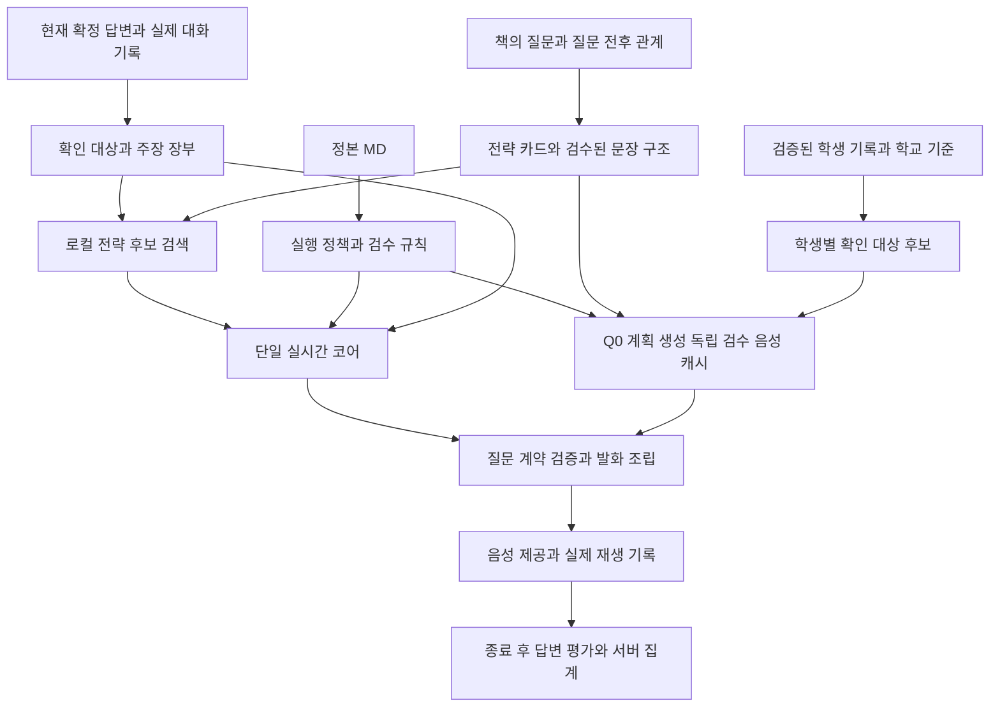

# AI 면접관 질문 전략과 자료 연결 아키텍처

작성일: 2026년 11월 3일 · 상태: 기본 아키텍처 적용 완료

현재 면접 화면의 질문력·꼬리질문력·평가 일관성을 개선한다. 핵심은 **현재 학생에게 무엇을 확인할지 먼저 결정하고, 책에서는 그 목적을 질문으로 만드는 전략과 표현을 참고하는 것**이다. 기존의 사전 Q0 생성·독립 검수·음성 캐시, 실시간 단일 코어, 종료 후 평가는 유지한다.

질문 계약·실행 정책·전략 카드·학생별 목표·대화 장부·단일 코어·승인 발화 구조·품질 관찰을 적용했다. 아래 기존 구조 분석은 설계 당시의 개선 대상이며, 실제 적용 내역과 검증 범위는 [적용 결과](C:/Users/MaYunsong/Documents/각자의답NEW/docs/AI_면접관_전략엔진_적용결과.md)에 기록한다. 대상은 현재 연결된 학생 자료와 면접 엔진이며 화면·업로드·계정·결제·신규 서비스는 포함하지 않는다.

## 개선 전 구현의 제약

| 확인한 동작 | 영향 | 변경 방향 |
|---|---|---|
| [주질문 계획](C:/Users/MaYunsong/Documents/각자의답NEW/server/interview-planner.ts:51)이 5개 주제의 정규식·일반적인 목적·기능별 기본 깊이로 구성된다. | 학생마다 구체적으로 무엇을 확인할지가 약하고, 기능으로 깊이를 결정하기 쉽다. | 원문을 분해한 뒤 학생별 확인 대상과 요구 의미를 계획한다. 기능·깊이는 각각 결정한다. |
| [책 검색](C:/Users/MaYunsong/Documents/각자의답NEW/server/data/book-question-reference.ts:274)은 동일 주기능을 필수로 하고, 주제의 단어·부분문자열·깊이로 정렬한다. | 주제는 달라도 질문 방식이 적절한 사례를 놓친다. 답변에서 새로 필요한 검증 전략을 찾기 어렵다. | 주제 유사도보다 적용 조건·검증 대상·전략을 우선하는 검색을 추가한다. |
| [실시간 검색](C:/Users/MaYunsong/Documents/각자의답NEW/server/providers/realtime-core.ts:188)은 코어 판단 전에 원래 질문의 기능과 현재 질문 문장으로 이루어진다. | 최신 답변의 주장·공백이 검색에 충분히 반영되지 않는다. | 원문 답변의 관찰 신호로 전략 후보를 미리 검색하고, 단일 코어가 실제 적용 여부를 결정한다. |
| [꼬리질문 발화](C:/Users/MaYunsong/Documents/각자의답NEW/server/providers/realtime-core.ts:156)는 서버가 정해진 문형을 조립한다. | 책을 연결해도 최종 표현에 그대로 반영되지 않는다. | 전략별로 사전 검수한 문장 구조와 출처에 결합된 슬롯을 사용한다. |
| [기존 문형](C:/Users/MaYunsong/Documents/각자의답NEW/server/providers/follow-up-language.ts:5)은 12목표의 요청 3종과 인용 도입 3종이다. | 모든 F가 인용 도입형이고, 표현 교체 이상의 전략 변화가 제한된다. | 직접 질문·짧은 맥락 언급·존재 확인·조건 변경·비교 등 질문 행위를 확장한다. |
| [F2 범위](C:/Users/MaYunsong/Documents/각자의답NEW/server/providers/realtime-core.ts:60)가 F1의 goal 하나로 고정된다. | F1 답변에서 확인한 내용에 맞춰 다음 초점을 바꾸기 어렵다. | 같은 묶음의 미해결 대상과 직전 답변을 보고 새 초점을 선택하되 F≤2를 유지한다. |
| [코어 분기](C:/Users/MaYunsong/Documents/각자의답NEW/server/providers/realtime-core.ts:206)는 충분한 답변이면 전환하고, 부분답변에서 F를 만든다. | 요구 충족과 추가 검증 가치가 결합되어 있다. | 충족 여부와 다음 행동을 분리한다. 충분한 답변 뒤에도 필요한 한계·적용 검증은 가능하되, 횟수를 채우는 심화는 금지한다. |
| [문장 검수](C:/Users/MaYunsong/Documents/각자의답NEW/server/providers/question-plan.ts:39)에 기능 단어의 정규식이 사용된다. | 의미가 적절한 질문도 ‘근거·과정’ 등의 단어를 직접 쓰지 않으면 거절될 수 있다. | 목적 검증은 질문 계약과 검수된 문장 구조를 기준으로 하고, 정규식은 표면 오류 탐지로 한정한다. |

현재 [같은 묶음의 답변 원문과 정정·부정 신호](C:/Users/MaYunsong/Documents/각자의답NEW/server/providers/answer-context.ts:20), 출처 해시, 전제 검수, 실제 재생 기록, 평가 집계는 재사용할 기반이다. 단순히 프롬프트를 길게 만드는 것으로 위 제약이 해소되지는 않는다.

## MD에서 추가로 반영할 원칙

| 적용할 원칙 | 정본 근거 | 설계 반영 |
|---|---|---|
| 근거 → 검증 대상 → 평가 의도 → 질문 → 답변에 따른 후속 검증 | [질문 기준 제1·6조](<C:/Users/MaYunsong/Documents/각자의답NEW/각자의답_MD/9. 면접엔진_질문생성_가이드라인_v2.3.md:25>), 특히 75~81행 | QuestionBlueprint를 최종 문장보다 먼저 구성한다. 원문을 기계적으로 의문문으로 바꾸지 않는다. |
| 확인된 활동·개념·주장에서 새로운 비교·반례·대안으로 확장 | [질문 기준 제7조](<C:/Users/MaYunsong/Documents/각자의답NEW/각자의답_MD/9. 면접엔진_질문생성_가이드라인_v2.3.md:83>) | 책에 대응 문항이 없어도 생성할 수 있다. 출발 근거와 확장 이유를 남긴다. |
| 15개 기능은 고정하되 실제 확인 대상은 구체화 | [질문 기준 제9조](<C:/Users/MaYunsong/Documents/각자의답NEW/각자의답_MD/9. 면접엔진_질문생성_가이드라인_v2.3.md:100>) | primaryFunction은 15개 중 하나, target.description은 현재 학생에 맞는 개방형 설명이다. 새 주제마다 기능 코드를 만들지 않는다. |
| 질문 깊이와 회차 난이도는 독립 | [질문 기준 제10조](<C:/Users/MaYunsong/Documents/각자의답NEW/각자의답_MD/9. 면접엔진_질문생성_가이드라인_v2.3.md:126>) | 실제 인지 요구로 D1~D4를 결정한다. 회차 난이도는 분포·응용 정도를 조정한다. |
| 원문 언급은 필요할 때만, 추상 평가어는 행동으로 확인 | [질문 기준 제11·12조](<C:/Users/MaYunsong/Documents/각자의답NEW/각자의답_MD/9. 면접엔진_질문생성_가이드라인_v2.3.md:138>) | 내부 근거 인용과 실제 발화를 분리한다. 교사의 ‘우수·리더십’ 평가를 학생의 확정 역량으로 말하지 않는다. |
| 학년별 관심 변화와 활동 간 연결도 질문 소재 | [학생부 분석 5.5](<C:/Users/MaYunsong/Documents/각자의답NEW/각자의답_MD/5. 학생부_분석_기준_v2.2.md:384>) | StudentTrajectory를 준비한다. 주제가 비슷하다는 이유만으로 인과관계는 단정하지 않는다. |
| 계열별 확인 관점을 활용 | [학생부 분석 자연·공학 기준](<C:/Users/MaYunsong/Documents/각자의답NEW/각자의답_MD/5. 학생부_분석_기준_v2.2.md:435>) | 원리·변수·해석·제약·선택 등 목표 후보를 넓힌다. 정해진 질문 트리로 강제하지 않는다. |
| 인재상은 학생의 행동과 연결 이유가 필요 | [학생부 분석 9.2](<C:/Users/MaYunsong/Documents/각자의답NEW/각자의답_MD/5. 학생부_분석_기준_v2.2.md:597>), [질문 기준 제8조](<C:/Users/MaYunsong/Documents/각자의답NEW/각자의답_MD/9. 면접엔진_질문생성_가이드라인_v2.3.md:98>) | 학교 표어를 외우게 하기보다 실제 선택·기여·협업 행동을 확인한다. 일반 인재상과 전형 공식 평가요소를 분리한다. |
| F는 답변에 반응하며, 최대 두 개는 목표가 아닌 상한 | [질문 기준 제14~17조](<C:/Users/MaYunsong/Documents/각자의답NEW/각자의답_MD/9. 면접엔진_질문생성_가이드라인_v2.3.md:175>) | 충족·새 주장·공백·시간을 보고 후속/재진술/전환/종료를 선택한다. |
| 새 경험은 기록에 없다는 이유로 거짓으로 판단하지 않음 | [평가 기준 제7조](<C:/Users/MaYunsong/Documents/각자의답NEW/각자의답_MD/10. 면접엔진_답변평가_가이드라인_v2.3.md:89>) | 실제 충돌하는 두 주장과 출처를 연결해야 모순 확인 후보가 된다. 정정은 이전 주장과 구분한다. |
| 평가 기대는 실제 질문과 함께 고정 | [질문 기준 제22·26조](<C:/Users/MaYunsong/Documents/각자의답NEW/각자의답_MD/9. 면접엔진_질문생성_가이드라인_v2.3.md:249>), [평가 기준 제8조](<C:/Users/MaYunsong/Documents/각자의답NEW/각자의답_MD/10. 면접엔진_답변평가_가이드라인_v2.3.md:105>) | 발화하지 않은 요구를 사후 채점에서 추가하지 않는다. 예시답안과 표현 순서가 다르다는 이유로 감점하지 않는다. |

책의 역할은 [질문 기준 854행](<C:/Users/MaYunsong/Documents/각자의답NEW/각자의답_MD/9. 면접엔진_질문생성_가이드라인_v2.3.md:854>)에 명시된 ‘질문 사례와 방법론’이다. 모든 질문의 주제 목록이나 학생 답변의 정답 목록으로 사용하지 않는다.

## 자료별 권한과 매칭

| 자료 | 맡길 역할 | 다른 자료에 넘길 수 없는 권한 |
|---|---|---|
| 최신 공통 운영·질문·평가 MD | 필수 규칙·분류·시간/횟수·검수·평가 계약 | 문서 속 예문이 사용자 요청을 덮어쓰는 고정 스크립트가 될 수 없다. |
| 현재 학생부의 검증된 원문 | 기록된 행동·개념·결과의 사실 근거 | 분석자가 추론한 동기·성과·개인 역할을 확정 사실로 만들 수 없다. |
| 현재 학생의 실제 확정 답변 | 직전 주장·설명·정정·새 경험의 후속 근거 | 학생의 진술을 공식 학생부나 과학적 정답으로 승격할 수 없다. |
| 현재 연결된 학교 공식 검증 자료 | 전형의 범위·평가 관점과 학생별 확인 목적 연결 | 일반 인재상을 공식 배점이나 문항 비율로 바꿀 수 없다. |
| 면접바이블 질문 | 검증 전략·문장 구조·대화 분기의 참고 | 책 속 학생 사실·수치·예시답안·대학 운영 정보를 현재 면접의 사실로 사용할 수 없다. |
| 실제 면접 로그 | 실패 재현·전략 선택 평가·지연 측정·회귀 데이터 | 로그가 자동으로 원천 사실을 수정하거나 모델을 재학습시키지는 않는다. |

학교 공식 자료는 이미 연결된 자료를 재사용한다. 책의 대학별 소개에서 일정·시간·면접관 구성을 추가 수입하지 않는다. 승인된 교과·학술 근거가 없는 개념의 정오를 단정해서 채점하지 않으며, 별도 근거가 필요한 경우 확인형 질문 또는 평가 보류로 처리한다.

규칙의 충돌은 조항별로 해결한다. 사용자 명시 요청을 우선 반영하고, MD 안에서는 공통 운영·최신 개정·질문별 필수 조건을 확인한다. 예를 들어 학생부 분석의 복합 질문 사례는 질문 기준의 단일 요구 규칙에 맞춰 분해한다. 이미 삭제 요청한 ‘먼저 학생부에 기록된 활동부터…’는 문서 예문에 있다는 이유로 복구하지 않는다. 기존 최신 평가 집계 100% / 70:30 / 70:15:15와 유효 표본 게이트는 유지한다.

## 권장 실행 구조



논리적 단계는 분리하지만 실시간 LLM을 반응·맥락·질문 에이전트로 나누지 않는다. 사전 준비, 실시간 진행, 사후 평가라는 실행 시점의 분리를 유지한다.

## 핵심 데이터 계약

아래는 전체 구현을 위한 핵심 필드의 예시다. 출처 참조는 현재 원문·해시·offset 계약을 확장한다.

```ts
type EvidenceRef = {
  kind: 'RECORD' | 'STUDENT_CONFIRMED' | 'ANSWER_TURN';
  sourceId: string;
  revision: string;
  start: number;
  end: number;
  confirmationStatus: ConfirmationStatus; // 기존 원천의 5개 확인 상태
  claimStatus: 'record_fact' | 'student_confirmed'
    | 'student_claim_unverified' | 'conflict_needs_review';
};

type QuestionBlueprint = {
  id: string;
  clusterId: string;
  clusterObjective: { id: string; description: string }; // 묶음 생성 시 고정
  parentQuestionId: string | null;
  answerTurnId: string | null;
  questionIntent: string;
  grounding:
    | { kind: 'STUDENT_EVIDENCE' }
    | { kind: 'COMMON_APPROVED'; moduleId: string; approvalRevision: string;
        supportTargetId: string }
    | { kind: 'ADMISSION_VERIFIED'; sourceIds: string[] };
  anchorRefs: EvidenceRef[];
  target: { description: string; unresolvedReason: string };
  subordinationRationale: string | null; // F가 묶음 목적에 종속되는 이유
  primaryFunction: PrimaryFunction; // 기존 15개 기능 코드
  depth: 'D1' | 'D2' | 'D3' | 'D4';
  expectedEvidence: string[]; // 요구한 의미 범주이며 정답 문장이 아님
  expansionRationale: string | null;
  criterionLinks: Array<{ sourceId: string; rationale: string }>;
  strategyIds: string[]; // 책에 일치하는 항목이 없으면 빈 목록 허용
};

type QuestionStrategyCard = {
  id: string;
  sourceBindings: BookSourceSpan[];
  assessmentTarget: string;
  triggerDescription: string;
  requiredClaimSlots: string[];
  notApplicableWhen: string[];
  operation: string;
  expectedEvidence: string[];
  surfacePatterns: ApprovedSurfacePattern[];
  prohibitedPresuppositions: string[];
  compatibleFunctions: PrimaryFunction[];
};

type CoreDecision = {
  relevance: 'related' | 'unrelated' | 'unclear' | 'non_answer';
  fulfillment: 'met' | 'partial' | 'unknown';
  nextAction: 'FOLLOW_UP' | 'CLARIFICATION' | 'TRANSITION' | 'CLOSING';
  objectiveProposal: {
    anchorCandidateIds: string[];
    targetDescription: string;
    requiredMeaning: string[];
    primaryFunction: PrimaryFunction;
    depth: 'D1' | 'D2' | 'D3' | 'D4';
    expansionRationale: string | null;
    subordinationRationale: string | null;
  } | null;
  strategyId: string | null;
  questionIR: QuestionIR | null;
  reasonCode: string;
};
```

primaryFunction은 관리 분류로 유지하고, target.description으로 구체적인 확인 대상을 표현한다. ‘자료를 고른 기준’은 CHOICE, ‘비교 조건을 맞춘 방법’은 PROCESS, ‘결론을 지지하는 관찰’은 EVIDENCE로 구분한다. 구체적인 확인 대상을 정한 뒤 관리 분류에 연결한다.

질문·묶음 ID, 해시, revision, 원문 offset, 부모·답변 턴, 공식 기준 출처와 시간·횟수 예산은 서버가 소유한다. 코어는 제공된 출처 후보·원문 구간·카드 ID와 확인 목적을 선택하며 서버가 참조의 실재와 범위를 검사해 최종 Blueprint를 확정한다. 모델이 임의 offset이나 공식 출처를 만들어 제출하는 계약으로 구현하지 않는다. 기존 필수 메타데이터는 계속 유지한다.

ConfirmationStatus는 기존 confirmed_from_record / confirmed_by_student / needs_confirmation / student_says_different / cannot_confirm을 사용한다. 확정 전사가 있다는 사실과 별도 확인된 학생 경험은 구별한다. 공통 승인 질문은 anchorRefs가 비어도 승인 모듈·버전·지원처를 가져야 하며, F에는 실제 parentQuestionId와 answerTurnId가 필요하다.

## 책을 전략과 표현으로 변환하는 방법

기존 원문 후보·모델 분류·보정 내역·4,321개 요구 구간은 보존한다. 그 위에 전략 카드를 파생 생성한다. 한 카드에 여러 문항이 연결되거나 한 문항에서 여러 전략이 나올 수 있다. 3,170개 전부에 카드 연결·제한 유지·변환 보류 중 하나의 처리 결과를 남겨 다시 임의의 소수 목록으로 축소하지 않는다.

추출할 것은 ‘질문 문장’뿐 아니라 다음의 관계다.

| 책에서 확인할 구조 | 전략으로 남길 것 | 현재 학생에게 적용할 조건 |
|---|---|---|
| [관심 → 실제로 알아본 행동](C:/Users/MaYunsong/Documents/각자의답NEW/각자의답_MD/2027_면접바이블_대학별정리_v1.0.md:2500) | 추상적 관심을 행동으로 구체화 | 학생이 관심을 말했으나 현재 질문이 요구한 행동은 아직 설명하지 않은 경우 |
| [판단의 긍정·부정에 따른 다른 F](C:/Users/MaYunsong/Documents/각자의답NEW/각자의답_MD/2027_면접바이블_대학별정리_v1.0.md:1804) | 답변 입장에 따른 분기 | 실제 학생이 선택한 입장이 확인된 경우에만 대응 가지를 선택 |
| [주장의 근거·반대 사례](C:/Users/MaYunsong/Documents/각자의답NEW/각자의답_MD/2027_면접바이블_대학별정리_v1.0.md:700) | 근거 확인과 적용 한계 확인 | 필요한 한 가지를 골라 질문하고, 다른 요구는 다음 F 예산 안에서 결정 |
| [예시 답변에서 새로 나온 내용을 활용한 추가 질문](C:/Users/MaYunsong/Documents/각자의답NEW/각자의답_MD/2027_면접바이블_내용정리_v1.0.md:8784) | 새 주장 → 인접한 상황 적용 | 현재 학생의 실제 발화에 대응하는 주장이 있어야 적용 |

원문 질문·예시답변·추가 질문의 관계는 answer_conditioned / same_activity_deeper / related_concept / topic_transition / unknown으로 구분한다. 단지 제목이 ‘추가 질문’이라는 이유로 모두 직전 답변의 F로 연결하지 않는다.

예시답변은 오프라인에서 분기 조건을 추출할 때만 읽는다. 런타임에는 인명·활동명·수치·예시답안 내용을 제거한 전략과 조건 슬롯을 전달한다. 책 속 학생의 답변이 현재 학생의 말처럼 입력되는 경로를 차단한다.

전략 카드가 없거나 일치하지 않아도 유효한 질문을 만들 수 있어야 한다. 출처 없는 카드 ID를 만들지 말고, 기본 승인 전략과 현재 출처 슬롯을 결합하거나 오프라인에서 새 Q0를 생성·검수한다. 전혀 새로운 실시간 문장 구조는 검수 없이 사용하지 않는다.

## 실시간 자료 매칭과 단일 코어

### 호출 전 로컬 검색

현재 답변의 길이·부정·정정·불확실성·실제 수치·행동 표현 등 관찰 가능한 신호를 추출한다. 이는 검색 후보를 넓히는 보조 신호이며, 특정 단어가 있다는 이유만으로 답변이 부족하거나 모순이라고 판정하지 않는다.

검색 후보는 세 경로의 합집합으로 만든다.

1. 현재 확인 대상과 미해결 의미에 관련된 검증 전략.
2. 답변에서 관찰한 주장·정정·선택 등에 적용 가능한 다른 전략.
3. 다른 주제에서도 재사용할 수 있는 문장 구조와 기본 승인 전략.

필수자료가 확실히 없거나 횟수 상한을 위반하는 카드만 사전에 제외한다. 의미상 적용 가능성이 unknown인 카드는 후보에 남기고 코어가 실제 맥락에서 판단한다. 정규식의 신호 부재만으로 선행조건 불충족을 확정하지 않는다. 주제·현재 기능의 일치도는 보조 순위로 낮추고, 전략 적합성·전제 위험·중복 회피를 우선한다. 원래 질문이 CONCEPT라고 해서 EVIDENCE·LIMIT 전략을 검색에서 모두 제거하지 않는다. 다만 최종 발화는 새로 선택한 의도·기능·깊이에 맞춰 검수한다.

후보 수와 카드 길이는 토큰 예산으로 제한한다. 기존 ‘문항 3개’를 그대로 고정하기보다 실제 지연과 품질을 측정하여 결정한다. 현재 규모에서는 버전된 로컬 색인부터 사용하고 벡터 DB를 필수 의존성으로 추가하지 않는다. 의미 검색은 고정 평가셋에서 이득이 확인될 때만 도입한다.

### 한 번의 호출에서 판단

단일 코어는 관련성 → 요구 충족 → 추가 확인의 가치 → 다음 행동 → 확인 대상 → 전략·문장 슬롯을 구조화해 반환한다. 관련성은 원래 질문과 실제 대화로 판단하고 책의 사례로 무관한 답변의 숨은 맥락을 만들지 않는다.

fulfillment와 nextAction을 분리한다. 충분한 답변이라도 실제 답변에 새로 나타난 주장·해석의 한계를 확인할 필요가 있고, 원래 clusterObjective에 종속되는 검증이며 시간·범위·F 예산이 허용되면 FOLLOW_UP을 선택할 수 있다. 필요한 목적이 없으면 즉시 전환한다. partial을 만들기 위해 이미 답한 내용을 누락으로 표시하지 않는다.

F2는 F1의 goal을 그대로 고정하지 않는다. 같은 묶음에서 F1 답변을 읽고 남은 대상이나 새 주장의 확인 가치를 판단하며 clusterObjective와의 종속 이유를 남긴다. 같은 활동이라도 독립된 평가 목적이면 새 Q0 묶음이다. 이미 확인한 목적을 다시 묻기 위해 새 묶음으로 포장하지 않는다. F는 최대 두 번이며 재진술·면접관 변경으로 횟수를 초기화하지 않는다.

판단 후 새 검색 모델을 호출하는 직렬 구조를 만들지 않는다. 호출 전 로컬 검색으로 다양한 전략 후보를 공급하고 같은 호출에서 선택한다. 사전 검색에 정확한 카드가 없더라도 기본 승인 전략으로 처리할 수 있다.

### 대화 기억

ConversationLedger에는 요청한 대상, 실제 답변 인용, 확인된 범위, 미해결 대상, 학생의 정정, 거절·모름, 이미 물은 요구, F 사용량을 기록한다. 모든 해석은 원문 span과 질문 ID로 돌아갈 수 있어야 한다. 모델의 요약이 실제 전사를 대체하지 않는다.

모순 후보는 서로 충돌하는 두 실제 진술과 각각의 출처가 있어야 한다. ‘학생부에 없다’는 이유는 모순이 아니다. 부정·정정된 주장은 현재 유효한 주장과 구분하고 재추궁하지 않는다. 면접관 두 역할은 같은 장부를 공유하므로 교대 때 다시 인사하거나 확인한 내용을 재질문하지 않는다.

같은 묶음의 원문은 유지하고, 다른 묶음에서는 관련된 출처만 선택해 전달한다. 전체 전사를 매 턴 다시 넣어 토큰을 계속 늘리지 않는다. 장부 갱신은 기존 코어의 구조화 결과와 서버 검증으로 처리하며 요약용 LLM을 추가하지 않는다.

## 발화와 검수

초기 적용은 검수된 전략별 문장 구조와 QuestionIR을 사용한다. QuestionIR은 확인 행위·초점·허용된 가정·출처 슬롯을 나타내는 구조이며 최종 발화는 서버가 렌더링한다. 슬롯 길이·형태·전제 유형을 제한해야 하며 임의 문장 전체를 슬롯에 넣어 검수를 우회할 수 없다.

내부 proof에는 정확한 인용·위치가 항상 남아도, 발화에서 매번 그 인용을 읽을 필요는 없다. anchorMode는 none / short_context / exact_quote로 선택한다. 직접 질문, 존재를 여는 확인, 조건 변화, 비교, 한계 확인을 각 전략에 맞게 제공하고 어미 선택은 최근 문형 이력으로 조정한다.

예를 들어 협업에 참여했다는 기록만 있다면 ‘맡은 역할을 어떻게 성공적으로 수행했나요?’를 사용하지 않는다. 개인 역할·성공을 먼저 가정하지 않고 ‘그 활동에서 본인이 직접 한 일은 무엇이었나요?’처럼 묻는다. 협업 역량이라는 확인 관점은 학교 기준에서, 질문 방식은 책에서, 사실 전제는 학생 기록에서 각각 얻는다.

검수 순서는 범위 → 출처 → 전제 → 단일 의도 → 실제 인지 요구와 깊이 → 중복·F·시간 → 부적절한 개인정보 요구 → 최종 발화다. 실패하면 안전한 다른 승인 문형·재진술·캐시 Q0 전환 중 현재 상태에 맞는 방법으로 복구한다. 기술 실패를 학생의 무응답이나 낮은 평가로 바꾸지 않는다.

승인 문장 구조는 슬롯의 출처·형태·문장 구조 준수를 검사할 수 있지만, 코어가 선택한 확인 대상과 전략이 실제 답변에 의미적으로 적절하다는 것을 완전하게 보증하지는 않는다. 근거를 입증할 수 없는 전제는 보류·전환하고, 남는 의미 오류는 회귀 평가와 로그 심사의 대상으로 기록한다. 검증 방식은 사전 문장 구조 검수와 런타임 출처·구조 검사로 표시하며 이를 독립 의미 검수 완료라고 부르지 않는다.

자유 문장 생성은 별도 단계의 품질 과제다. 단일 코어가 자신의 문장을 검토한 것을 독립 의미 검수로 표시하거나 정확한 인용 하나로 전체 전제가 검증됐다고 간주하지 않는다. 먼저 자유 발화 후보를 실제 사용자에게 재생하지 않는 비교 모드에서 평가하고, 이후 독립 의미 검수의 지연·비용까지 비교한다. 이번 권장 기본 구조는 실시간 추가 LLM 호출 없이 승인된 구조를 확장하는 방식이다.

최종 발화·QuestionBlueprint·사용 문장 구조·검수 결과는 하나의 불변 승인 객체로 묶는다. 승인 뒤 표현을 바꾸면 다른 후보로 재검수한다. 종료 평가에는 이 객체와 실제 제시·답변 기록을 넘겨, 질문하지 않은 STAR 요소나 책의 예시답안 내용을 사후 필수 조건으로 추가하지 못하게 한다.

## 파일별 TS 고도화

아래 신규 경로는 이번 적용에서 추가한 모듈이며, 기존 파일과 구분한다. 실제 타입 정의와 파일 구성이 본문의 개념 예시보다 우선한다.

| 파일 | 책임과 변경 |
|---|---|
| 신규 server/policy/interviewer-policy.ts | 조항·버전·필수/기본/허용·우선순위·프롬프트 규칙·실행 가드·회귀 사례를 연결한다. MD 전문을 무조건 넣는 대신 검수한 정책 팩을 만든다. |
| 신규 scripts/compile-interviewer-policy.ts | 정본 해시와 실행 정책의 대응을 검증한다. 규범 문구를 모델이 임의로 자동 확정하는 작업이 아니라 명시적 규칙 매핑의 빌드·감사 단계다. |
| 기존 server/data/prepared-activities.ts | 현재 출처 슬롯 위에 실제 행동·해석 공백·활동 간 연결 후보를 준비한다. 분석·추론과 기록 사실은 분리한다. |
| 신규 server/question-objective.ts | 학생별 확인 대상·요구 의미·기능·깊이·확장 이유·학교 기준 연결을 구성한다. |
| 기존 server/data/question-reference-analysis.ts 및 신규 server/data/question-strategy-catalog.ts | 기존 분류를 보존하고 적용 조건·전략·문장 구조·Q/A/F 관계를 파생한다. |
| 신규 server/question-strategy-retrieval.ts | 원문 주제보다 검증 공백·대화 행위·선행조건·다양성을 기준으로 로컬 검색한다. |
| 기존 server/interview-planner.ts | 정적 주제 순환을 학생별 목표 후보·영역 분산·미확인 지점·시간 예산 중심으로 고도화한다. |
| 기존 server/providers/openai.ts 및 server/data/prepared-question-bank.ts | Blueprint를 먼저 만들고 Q0 표현을 생성·독립 검수·TTS 캐시한다. 새 정책·전략·질문 구조 버전을 은행 키에 반영한다. |
| 기존 server/providers/answer-context.ts 및 신규 server/conversation-ledger.ts | 실제 원문과 확인 대상·주장·정정·중복 이력을 함께 관리한다. |
| 기존 server/providers/realtime-core.ts | 관련성·충족·행동을 분리하고 한 호출에서 대상·전략·슬롯을 결정한다. |
| 기존 server/providers/follow-up-language.ts 및 신규 server/providers/question-realization.ts | 12목표의 고정 인용형에서 전략별 승인 문장 구조로 확장한다. 기존 세션의 문형 검증은 호환 경로로 유지한다. |
| 기존 server/providers/question-plan.ts 및 신규 server/providers/question-guards.ts | 기능 단어 출현 검사를 의미 계약·구조·출처 검증으로 보완한다. |
| 기존 server/protocol.ts 및 server/realtime.ts | Blueprint·장부·카드 선택 이유·승인 방식·정책 버전을 저장하고 실제 음성·재생 로그와 연결한다. |
| 기존 종료 평가 경로 | 실제 승인 질문의 요구와 발화를 그대로 평가 계약으로 사용한다. 점수 산식과 비언어 지표 분리는 유지한다. |

정책·전략 카드·학생 기록·학교 공식 자료의 변경은 각각 해시를 가진다. Q0 캐시는 사용한 계약·정책·자료 버전에 의존하고, 시작한 세션은 해당 버전을 고정한다. 수정할 때 기존 세션과 로그를 새 규칙으로 조용히 덮어쓰지 않는다.

## 구현 순서와 완료 기준

| 순서 | 작업 | 완료 판단 |
|---|---|---|
| 1 | 정책 매핑·Blueprint·승인 질문 계약 | 현재 Q0/F를 동일 계약으로 표현하고 출처·의도·실제 발화가 추적된다. 기존 무응답·복구·평가 회귀가 유지된다. |
| 2 | 전체 자료의 전략 카드·Q/A/F 관계 추출 | 전 후보의 변환 상태가 기록된다. 책 속 사실·예시답안이 런타임 학생 근거로 전달되지 않는다. |
| 3 | 학생별 목표 계획과 전략 검색 | 책에 없는 주제에서도 현재 근거로 목표를 만들고, 다른 주제의 적합한 전략을 검색할 수 있다. 일치 카드 없음이 정상 경로다. |
| 4 | 단일 코어·장부·F2 판단 고도화 | met여도 필요한 확인은 가능하고, partial이어도 중복이면 전환한다. 정정·모름·무관·기술 실패를 구분한다. |
| 5 | 승인 문장 구조 확장과 지연 검증 | 내부 인용을 반복해서 읽지 않고 같은 목적을 자연스럽게 묻는다. 실시간 모델 호출은 비명백 답변당 최대 1회다. |
| 6 | 실제 로그 비교 후 점진 적용 | 고정 평가셋과 실사용 로그에서 개선을 확인하고 정책 버전을 고정한다. |

회귀 사례에는 같은 뜻의 짧고 긴 답변, 순서가 다른 충분한 답변, 좋은 답변 뒤의 불필요한 심화, 이미 설명한 근거 재요구, 역할 부정, 수치가 없는 결과, 앞선 답변 정정, 새 경험, 실제 모순 쌍, 엉뚱한 답변, 정상 무응답, STT 실패를 포함한다. 각 사례는 기대 행동뿐 아니라 **물어도 되는 대상과 금지 전제**를 갖는다. 정책을 조정한 사례와 별도의 고정 평가 사례를 나눠 과적합을 확인한다.

품질은 이미 답한 대상 재요구율, 허위 전제 도입률, 답변 핵심 누락률, 전략 적합성, 불필요한 F 비율, 질문 목적 대비 표현의 명료성으로 측정한다. 문장 중복률이나 책 참조 개수만으로 품질 향상을 판정하지 않는다. 충분한 답변·새 경험·비정형 답변에 대한 사람 검토도 포함한다.

지연은 제출 → STT 확정, 코어 요청/완료, 질문 승인, TTS 요청/준비, 브라우저 실제 재생 시작을 각각 기록해 전체 및 구간별 p50/p95를 비교한다. 소수 사례의 최솟값을 목표 지연으로 발표하지 않는다. 사전 Q0는 런타임 생성·검수·TTS 0회 경로를 유지하고, 연결 멘트는 필요한 경우에만 같은 턴 음성과 병렬 준비한다. 고정 멘트 반복으로 대기를 감추는 방식은 사용하지 않는다.

초기 완료 조건은 질문 문구의 수가 아니라, **현재 학생에게 필요한 확인 대상을 고르고, 실제 답변에 맞는 전략으로 묻고, 그 요구만 일관되게 평가하는 경로가 연결되는 것**이다.
