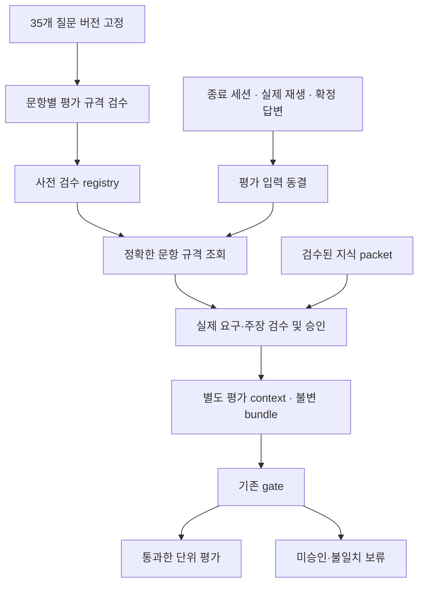

# 각자의답 — 정확한 질문 버전에 연결하는 평가 범위·검수 자료 공급 계약 v0.1

작성일: 2026-11-06<br>
상태: 구현 제안, 앱 미적용<br>
입력 현황: 사용자 설명 기준 현재 승인 질문 35개에 승인된 평가 범위 연결이 없음. 이번 작성에서 실제 질문은행 35개를 재검수하거나 승인하지 않았다.<br>
코드 검토 기준: `a666f7a81dd2e80851f8589d135a0aac67c1eae2`의 평가 gate·검수 자료 계약·종료 후 검수 자료 공급 CLI.

## 1. 이번 보완의 결론

현재 필요한 작업은 평가 보류 조건을 완화하는 것이 아니라 **정확한 질문·근거·평가 요구에 대한 검수 자료를 만들고, 실제 종료 세션에 연결해 평가 worker에 공급하는 경로**다.

`question_approved`와 `evaluation_scope_approved`는 독립 상태다. 질문 35개가 승인됐다는 사실로 35개 모두 채점 가능하다고 표시하지 않는다. 역할·경험 문항도 기능 라벨만으로 평가 범위를 자동 승인하지 않는다.

특히 기존 `DemandKnowledgeBinding`은 질문은행에 미리 넣을 범용 scope가 아니다. 실제 `sessionId`, `turnId`, 질문과 승인 계약의 해시, 검수한 요구 구간, 세션 전체 질문·답변 해시까지 고정한다. **사전 문항 검수 자료와 실제 세션 평가 승인 자료를 두 단계로 분리**해야 한다.

## 2. 기존 코드와 새로 필요한 부분

| 구분 | 현재 확인한 계약 | 이번에 연결할 부분 |
|---|---|---|
| 평가 gate | 승인 bundle 부재·불일치·미해결 scope이면 보류 | gate를 유지하고 정확한 자료 공급 |
| 자료 타입 | ApprovedKnowledgePacket / DemandKnowledgeBinding / ApprovedKnowledgeBundle | 문항별 사전 검수 자료 registry와 실제 세션 결합 서비스 |
| 기존 CLI | 준비된 reviewed input을 받아 별도 종료 평가 context 생성·재평가 enqueue | 검수 입력을 실제로 생산·승인하는 운영 경로와 일반 종료 경로 연결 |
| 기존 approval | explicit_reviewed_input과 approverId 문자열 | 인증된 검수자·권한·검수 대상·감사 이력 확인 |
| 부속 JSON Schema | session/turn/answer가 연결된 평가 scope envelope | 사전 문항 자료 타입은 별도. 빈 session ID로 억지 사용 금지 |

`prepare-approved-knowledge.ts`는 검수 자료를 스스로 찾아 사실을 승인하는 프로그램이 아니다. 검수된 입력을 검증·저장하고 평가에 연결하는 도구다. 해당 CLI의 `passed: true`나 형식·해시 통과를 출처의 진실성·과학적 정오 검증 완료로 취급하지 않는다. 일부 문항은 `heldTurns`로 남을 수 있다.

## 3. A단계 — 35개 문항의 사전 평가 규격

### 3.1 정확한 문항에 묶는 필드

제안 명칭은 `QuestionEvaluationSpec`이다. 기존 질문 승인을 덮어쓰지 않고 별도 불변 검수 산출물로 둔다.

| 필드 | 의미 |
|---|---|
| evaluation_spec_id / revision | 사전 평가 규격의 식별자·수정 버전 |
| owner/student/target scope | 자료의 허용 범위. 공통 정책과 개인 근거를 구분 |
| bank_key / bank_content_hash | 어떤 질문은행의 후보를 검수했는지 |
| candidate_id / question_revision_id | 정확한 후보·질문 버전 |
| question_sha256 | 학생에게 제시할 실제 질문 문장 |
| approved_contract_sha256 | 질문 근거·기능·범위가 포함된 승인 계약 |
| reviewed_demand | 실제 질문의 요구 구간·UTF-16 위치·정확한 인용·hash |
| source_manifest_hash | 검수할 때 사용한 원문·분석·공식 자료 버전 |
| policy/rubric version | 평가 기능·각 차원·배점·허용 해석의 정책 버전 |
| proposed_scope | record_consistency_only / objective_accuracy_core / unresolved |
| assessable_criteria / excluded_criteria | 판단 가능한 사항과 판단하면 안 되는 사항 |
| packet_refs | 객관 정오가 필요한 경우 검수된 자료의 ID·revision·hash |
| evidence_expectations | 답변 이후 어떤 실제 주장·조건을 확인해야 하는지 |
| review_record / status | 실제 검수자·판정·사유·시각·pending/approved/rejected/withdrawn |

주제·학과·질문 기능·objective_id만으로 자료를 연결하지 않는다. 같은 목적 ID라도 문장·요구 범위·근거·평가 정책이 달라지면 해당 revision의 재검수가 필요하다. 목적 별칭은 출제 이력을 연결하는 자료이며 평가 승인을 전파하는 권한이 아니다.

일반 rubric과 외부 지식 packet은 공통 자산으로 재사용할 수 있다. 다만 어떤 문항에 어떤 범위로 적용 가능한지는 각 문항의 실제 요구에 대해 별도로 검수한다. 동일 문장을 다른 학생에게 사용하더라도 개인 원문 근거·권한이 다르면 그대로 개인 승인을 복제하지 않는다.

### 3.2 scope별 검수 기준

| scope | 승인에 필요한 것 | 금지 |
|---|---|---|
| record_consistency_only | 실제 질문의 요구, 원문/실제 발화에 한정한 판단 범위, 적용 rubric, 판정 금지 영역 검수 | ROLE 라벨만으로 승인, 원문에 있다는 이유로 과학적으로 참이라고 판정 |
| objective_accuracy_core | 실제 요구에 맞는 출처·인용·조건·제외 범위가 검수된 packet, 답변 후 핵심 주장 검수 절차 | 자료 제목·URL만 첨부, 모델의 일반 지식으로 정오 확정 |
| unresolved | 부족한 승인·근거·범위를 이유와 함께 기록 | 빈 자료를 정상 승인으로 취급 |

기존 코드의 scope 이름을 그대로 사용한다. 앞서 제공한 제안 스키마의 `objective_knowledge`는 기존 `objective_accuracy_core`에 대응하는 어댑터가 필요하며 이름만 바꿔 운영 코드에 넣지 않는다. 제안 스키마의 `none`도 기존 `unresolved`와 의미를 맞춰야 한다.

예를 들어 “본인이 맡은 역할을 설명해 주세요”가 승인된 기록 일관성 범위라면 역할·행동 설명을 그 범위에서 평가할 수 있다. 학생이 답변 중 “성능이 62% 증가했다”고 말해도 그 수치의 과학적 타당성을 자동 승인한 것은 아니다. 실제 후속질문이 측정 조건·비교 기준의 타당성을 요구한다면 해당 후속질문의 별도 범위·자료·답변 주장 검수가 필요하다.

숫자 점수에 필요한 평가 차원 일부의 판단 권한이 없으면 나머지 차원만 임의로 재가중해 총점을 만들지 않는다. 기존 보류·묶음 집계 정책을 유지한다.

### 3.3 35개 자료 목록의 초기 상태

실제 은행에서 후보를 export해 각 문항별 다음 목록을 만든다. 이번 문서에서 임의의 Q01~Q35와 가짜 해시를 만들어 승인 파일로 제공하지 않는다.

```text
candidate_id | bank_hash | question_hash | approved_contract_hash
reviewed_demand | proposed_scope | required_packet_refs
review_status | hold_reasons | reviewer | review_revision
```

사용자가 전달한 상태를 기준으로 초기 검수 목록은 35건 모두 평가 승인 연결 대기다. 실제 작업 시작 시 은행 key·후보 수·각 해시를 다시 대조해 이 목록의 기준 snapshot을 고정한다. 이 숫자는 이번에 DB를 조회한 결과가 아니다.

## 4. B단계 — 실제 종료 세션의 승인 bundle

### 4.1 공급 순서



1. 종료 요청·재생 receipt·전사 정정 상태를 정리하고 평가에 사용할 세션 revision을 동결한다. status가 ending이라는 이유만으로 입력이 더 이상 바뀌지 않는다고 가정하지 않는다.
2. 실제 `EvaluationUnit`을 기준으로 질문·답변 시도·재진술 계보를 구성한다.
3. 실제 질문 문장·승인 계약·원문 manifest·정책과 일치하는 사전 규격을 exact lookup한다. 가장 비슷한 문항의 규격으로 대체하지 않는다.
4. 실제 답변이 확정된 후 질문 요구와 연결한다. 객관 지식 범위라면 핵심 주장, 조건 충족, 제외 범위 비해당을 검수한다.
5. 검수자가 실제 session-bound 입력을 승인한 뒤 `DemandKnowledgeBinding`과 `ApprovedKnowledgeBundle`을 확정한다.
6. 원래 면접 context는 보존하고 승인 bundle을 주입한 별도 평가 context를 만든다.
7. 기존 gate를 실행한다. 불일치·충돌은 실행 입력 오류로 격리하고, 승인·자료 부족은 보류 사유로 남긴다.
8. 통과한 단위에만 제한된 자료를 공급해 평가하고, 평가가 인용한 근거도 허용된 검수 구간 안인지 확인한다.

**초기 연결 단계에서는 사전 규격 승인만으로 실제 세션 binding을 승인했다고 만들지 않는다.** 서버는 결합 후보와 해시를 기계적으로 만들 수 있지만 사람의 검수를 완료한 것처럼 approverId·승인 상태를 복제하지 않는다. 실제 종료 입력을 검수한 승인 경로부터 연결한다.

향후 반복적인 기록 일관성 binding을 자동 확정하려면, 자동화가 허용되는 정확한 조건·승인 권한·감사 증거를 가진 별도 버전 계약과 회귀 검증이 필요하다. 현재 `explicit_reviewed_input`에 자동 승인 결과를 몰래 끼워 넣지 않는다. 초기 보수적 단계에서는 이 때문에 점수 제공이 비동기 검수 대기일 수 있음을 제품 상태에 반영한다.

### 4.2 기존 gate가 요구하는 정확한 결합

| 항목 | 현재 검사 의미 |
|---|---|
| sessionId + turnId | 평가할 실제 회차·질문 단위, 일치 binding 1개 |
| sessionQuestionAnswerSha256 | 해당 세션의 모든 실제 질문·답변·재진술 계보 해시 |
| questionSha256 | 실제 제시 문장 일치 |
| approvedContractSha256 | 해당 문장의 승인 계약 일치 |
| reviewedDemand | 질문에 실제 존재하는 정확한 요구 구간 |
| packetRefs | 승인 자료의 ID·revision·내용 hash 일치 |
| claimReviews | 실제 확정 답변의 turn/answer/hash·주장 인용과 연결 |
| assumptions / excludedScopes | 자료 적용 조건 충족·제외 조건 비해당 검수 |

`record_consistency_only`는 packetRefs·claimReviews가 비어 있고 claimCoverage가 not_applicable이어야 한다. 이 범위의 bundle에 객관 지식 claim review를 섞지 않는다.

`objective_accuracy_core`는 승인 packet과 실제 핵심 주장 검수가 필요하다. `all_core_claims_reviewed` 문자열을 채웠다고 전체 핵심 주장이 검수된 것은 아니다. 운영 검수 자료에 실제 요구별 핵심 주장 목록과 처리 결과를 남겨 선언의 근거를 확인한다. 과학적 정오 판단은 승인된 적용 범위 밖으로 확장하지 않는다.

기존 계약의 해시는 `JSON.stringify` 직렬화와 연결돼 있다. Python에서 임의로 키를 정렬하거나 공백·Unicode 직렬화를 바꿔 만든 hash를 그대로 공급하지 않는다. 초기에는 기존 TS serializer로 확정하고, 언어를 확장할 때 같은 bytes·UTF-16 인용을 검증하는 fixture를 둔다.

### 4.3 F1/F2·재진술·답변 정정

- F1/F2는 Q0의 scope 승인을 자동 상속하지 않는다. 실제 후속질문 문장·요구에 대해 별도 검수 자료를 연결한다.
- 같은 요구의 재진술은 기존 비평가 처리와 답변 시도 묶음을 보존한다. 부모와 같은 요구라는 사실 및 실제 재진술 계보가 확인돼야 하며, 새 문장에 임의 승인 해시를 붙이지 않는다.
- 객관 주장에 대한 검수가 없어 F가 보류되면 해당 F를 평가에서 몰래 삭제해 Q0만의 높은 점수로 집계하지 않는다. 기존 묶음 전체 제외·유효 묶음 기준을 적용한다.
- 답변 정정·질문 재분류가 일어나면 새 평가 입력 revision을 만든다. 과거 답변·점수는 덮어쓰지 않는다.
- 현재 sessionQuestionAnswerSha256는 세션 전체를 묶는다. 한 답변이 바뀌면 그 세션의 기존 binding 전체가 새 해시와 맞지 않는다. 변경 없는 문항의 사전 규격·packet은 재사용할 수 있지만, 기존 세션 binding bytes를 그대로 재사용하지 않는다.

## 5. 실제 공급을 담당할 최소 기능

다음 명칭은 제안이다. 기존 코드가 이미 제공하는 CLI와 새로 필요한 기능을 구분한다.

| 기능 | 책임 |
|---|---|
| export-question-evaluation-inventory | 실제 승인 은행에서 35개 후보·문장·계약·근거를 export |
| review-question-evaluation-spec | 사전 범위·rubric·자료 적용성의 검수·승인·반려 |
| prepare-ended-session-review | frozen session과 사전 규격을 결합해 검수 대기 자료 생성 |
| approve-session-evaluation-bundle | 실제 요구·답변·주장·조건을 검수한 입력 승인 |
| createReviewedEvaluationKnowledgeContext | 기존 기능 활용: 원래 context를 보존한 종료 평가 context 구성 |
| enqueueReviewedKnowledgeEvaluation | 기존 기능 활용: 승인 자료·평가 입력 버전에 따른 재평가 등록 |
| coverage-report | question approved / spec approved / bound / gate passed / held 개수를 분리 표시 |

기존 `--reviewer` 문자열 일치 검사만으로 서비스 운영자의 권한을 보장하지 않는다. 앞서 정의한 검수 API/CLI의 인증된 actor·역할·접근 범위를 붙이고, worker·학생·평가 모델은 승인자를 지정할 수 없게 한다. 승인 철회는 registry에서 검사해 이후 평가를 차단하고, 이미 발행한 점수에 대해서는 정정 필요 상태와 별도 revision을 남긴다.

일반 종료 worker는 자료가 없으면 `evaluation_review_required` 같은 명시 상태로 기다리고, 승인 이벤트 이후 동일한 종료 입력에 대한 작업을 등록한다. 부족한 승인 때문에 모델 재시도만 반복하지 않는다. 검수 이후의 재평가는 새 source fingerprint·approval hash·pipeline version으로 구별하고, 같은 입력 재시도는 중복 점수 발행을 막는다.

## 6. 질문 재고와 평가 준비 상태

기존 4대 정책의 실전 시작 재고에 이미 평가 범위 유효성 조건이 있다. 이번 보완에서는 그 의미를 두 단계로 명확히 한다.

| 상태 | 의미 |
|---|---|
| question_pool_ready | 승인 Q0·근거·노출·최근 사용·상호 겹침·다양성을 만족 |
| preapproved_q0_scope_ready | 위 후보 중 정확한 문항별 사전 평가 규격도 승인된 K+R 집합이 존재 |
| session_evaluation_ready | 실제 종료 입력·F·답변·주장 검수까지 끝나 gate 통과 |

35개 문항이 질문 승인 상태여도 평가 규격 연결이 0개라면 preapproved_q0_scope_ready는 false다. 이를 “35개 채점 가능”으로 표시하지 않는다. 사전 Q0 규격이 승인됐더라도 미래 F와 실제 답변의 객관 지식 검수까지 보장하지 못하므로 즉시 완전한 점수 리포트를 약속하지 않는다.

현재 검증용 면접을 실행할 수 있는지와 점수 제공을 약속하는 서비스의 공개 준비 상태는 별도다. 평가가 보류된 문항은 점수를 null과 이유로 표시하며, 0점·임의 평균·축소한 rubric으로 대체하지 않는다. 정성 피드백도 승인 범위 밖의 정오 판단을 우회해 제공하지 않는다.

## 7. 우선 구현 순서

1. 실제 35개 후보의 은행·문장·계약 해시를 고정한 검수 목록을 만든다.
2. 그중 범위가 명확한 문항을 골라 사전 규격→실제 종료 입력 검수→bundle→기존 gate→평가까지 한 경로를 연결한다. 단순 ROLE 일괄 승인은 하지 않는다.
3. 정상 통과와 승인 누락·다른 문장·다른 답변·다른 계정·오래된 버전의 차단을 함께 검증한다.
4. 객관 지식 문항에는 검수 packet과 실제 주장·적용 조건을 추가한다.
5. 실제 F·재진술·정정 사례를 포함해 평가 unit 구성과 기존 집계를 검증한다.
6. 나머지 문항으로 검수 범위를 확장하고 일반 종료 worker 및 재평가 경로에 연결한다.

자료 공급 경로를 구현하는 것과 35개 실제 자료의 내용 검수를 완료하는 것은 별개의 작업이다. 이 문서는 첫 작업의 계약을 정리하며 두 번째 작업을 완료했다고 선언하지 않는다.

## 8. 필수 수용 사례

| ID | 조건 | 기대 결과 |
|---|---|---|
| EV-01 | 질문 승인, 평가 규격 없음 | scope 승인 대기, 숫자 평가 보류 |
| EV-02 | ROLE 문항이지만 정확한 scope 승인 없음 | 라벨 기반 우회 없이 보류 |
| EV-03 | 승인 문장과 한 글자 다른 실제 질문 | 기존 자료 자동 적용 거부, 재검수 |
| EV-04 | 문장은 같지만 승인 계약·근거 버전 다름 | 정확 결합 불일치로 차단 |
| EV-05 | 사전 규격만 승인, 실제 session binding 없음 | 사전 승인과 종료 평가 완료 구분 |
| EV-06 | 정확한 기록 일관성 binding과 확정 답변 | 해당 범위 평가, 과학적 진실 권한 없음 |
| EV-07 | 객관 지식 packet은 있으나 실제 주장 검수 없음 | claim review required로 보류 |
| EV-08 | 주장 검수는 있지만 적용 조건 불충족·제외 범위 해당 | 해당 객관 평가 보류 |
| EV-09 | Q0 승인 자료만 있고 새로운 F의 자료 없음 | F 자동 상속 금지, 기존 묶음 정책 적용 |
| EV-10 | 답변 정정 후 예전 session 해시 bundle 공급 | stale로 차단, 새 binding·평가 revision 필요 |
| EV-11 | 다른 계정 또는 다른 세션의 승인 bundle | 소유권·session 결합으로 차단 |
| EV-12 | 중복 binding 또는 철회된 승인 | 충돌/철회로 차단 |
| EV-13 | 같은 승인 자료로 종료 작업 재시도 | 동일 평가 결과 재사용, 중복 발행 없음 |
| EV-14 | 평가 모델이 검수되지 않은 A 근거를 인용 | 해당 근거 사용 차단·평가 보류 |
| EV-15 | 평가 불능인 F를 생략하고 Q0만 집계하려 함 | 기존 전체 묶음 제외 규칙 유지 |

이 15개는 신규 수용 기준이며 이번에 실행한 테스트 결과가 아니다. 기존 52개 부속 형태 사례는 평가 scope 8개를 포함하지만, 이 실제 자료 공급·권한·버전·일반 종료 경로를 검증한 것이 아니다.

## 검토 근거

- [평가 gate](https://github.com/mys203120-netizen/gakja/blob/a666f7a81dd2e80851f8589d135a0aac67c1eae2/server/providers/evaluation-knowledge-gate.ts)
- [실제 검수 자료 계약과 세션 해시](https://github.com/mys203120-netizen/gakja/blob/a666f7a81dd2e80851f8589d135a0aac67c1eae2/server/data/approved-knowledge.ts)
- [기존 종료 평가 context·재평가 CLI](https://github.com/mys203120-netizen/gakja/blob/a666f7a81dd2e80851f8589d135a0aac67c1eae2/scripts/prepare-approved-knowledge.ts)

이번 작업은 위 기준 코드의 정적 대조와 계약 보완이다. 앱 코드·질문은행·평가 승인 데이터를 변경하거나 실제 35개 문항에 승인 상태를 부여하지 않았다.
