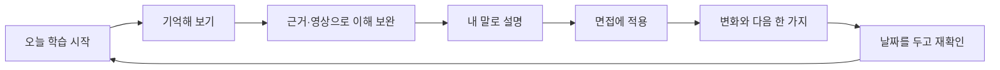

# 각자ON 학습 흐름 QA와 개선안

> 이 문서는 반영 전 QA 기록이다. 2026-10-12 구현 및 재검수 결과는 [화면별 개선 반영](learning-flow-implemented.md)에 있다.

점검일: 2026-10-12. 실행 중인 `http://localhost:3100`에서 하린 합성 테스터로 로그인하고 Q&A 답변을 실제 저장·종료한 뒤 리포트와 같은 질문의 답변 비교를 확인했다. 이 문서의 화면은 이번 점검에서 새로 촬영했다. 과거 캡처는 사용하지 않았다. 별도의 코드 분석 근거는 [학습 흐름 코드 확인](learning-loop-code-findings.md), 대학별 적용 판단은 [면접바이블 반영안](interview-bible-integration-plan.md)에 있다.

## 판단

**개별 기능과 저장은 연결돼 있지만, 기록이 다음 학습을 바꾸는 순환은 아직 완성되지 않았다.** 지금의 우선 과제는 메뉴를 더 만드는 일이 아니라 같은 질문·개념을 기준으로 퀴즈, 영상, 면접, 피드백, 재확인을 연결하는 일이다.

이번에 저장한 Q&A는 학습 리포트에 나타났다. 그러나 같은 질문의 답변 비교에는 포함되지 않았다. 기존 면접 답변 4개도 새 누적 이벤트에 연결되지 않아 대시보드의 누적 면접 답변은 0이었다. 저장량을 실력으로 표시하기 전에 이 집계와 비교를 일관되게 만들어야 한다.

목표 경험은 **“지난번 어려웠던 것을 기억해 주고, 오늘 할 일을 줄여 주며, 실제로 달라진 내 답을 보여주는 앱”**이다. 사용자가 짧게 공부해도 성취를 확인하고 다음에 돌아올 수 있어야 한다. 체류시간·글자 수·저장 횟수는 연습량의 참고이며 실력의 증거로 쓰지 않는다.

## 검수한 10개 단계

| 단계 | 실제 확인 | 상태 | 개선 |
| --- | --- | --- | --- |
| 1. 로그인·가입 | 이메일 로그인 성공. 이후 Google·카카오 가입 UI, 미설정 안내 확인 | 기존 로그인 정상 / 소셜 실계정은 설정 필요 | 가입 후 학교 선택과 첫 공통 질문까지 이어지는 온보딩 추가 |
| 2. MY | 오늘 과제·진척·캘린더·최근 리포트 확인 | 다음 행동 선택 부담 | 최상단에 **오늘 학습 시작 / 이어서** 한 개의 우선 행동, 분량·추천 이유 표시 |
| 3. 퀴즈 진입 | 모드 3개, 같은 이름의 0/6 세션 여러 개 | 시작 가능 / 이어가기 구분 약함 | 오늘 복습·자유 연습·과제를 먼저 구분. 미시작 세션을 재사용하고 주제·시점을 표시 |
| 4. Q&A·힌트 | 첫 문장과 흐린 나머지, 실제 답변 저장 | 저장 정상 / 힌트 내용·높이 개선 필요 | 질문은 역할·어려움인데 힌트가 동기부터 시작. 첫 문장을 질문에 맞춰 검수. 흐린 영역은 2–3줄로 제한하고 입력·저장 접근 유지 |
| 5. 퀴즈 완료 | 1개 Q&A를 저장하고 종료 | 기록 정상 / 다음 단계 단절 | 주 행동을 **이 질문 면접에서 말하기**, 보조 행동을 근거·영상·오답 재확인으로 연결 |
| 6. 학습 리포트 | 이번 Q&A 1개 반영, 학습 종료 후 확정 | 현재 저장 정상 / 전체 집계 불완전 | 암기·과제·영상 메모의 원본 연결, 과거 면접 소급 연결, 미채점과 실력 확인 구분 |
| 7. 답변 비교 | 동일 질문을 선택해 이전 수정본·면접 답 확인 | Q&A 누락 | 퀴즈·작성본·면접·녹음을 질문별 이력으로 통합. 도움 사용·버전·평가 근거 보존 |
| 8. 다시 면접 | 같은 질문 재연습 링크로 설정 진입 | 첫 질문 전달 정상 / 설정 부담 | 선택 질문을 보여주고 1문항 재연습으로 즉시 시작. Chat/Live 전환 시 질문·활동 맥락 유지 |
| 9. 지식한입 | 활동별 영상·썸네일·출처·시청 체크·메모 | 자료 연결 정상 / 학습으로 돌아오는 길 부족 | 영상 뒤 짧은 확인 질문, 30초 설명, 내 활동 답변에 연결하기 |
| 10. 학교 정보 | 계정에서 배정된 지원처·전형·연도 확인 | 학생 직접 등록·개요 진입 없음 | 학교 직접 선택과 면접 안내 제공. 개인 자료 발행 전에도 공통 질문 연습 허용 |

모바일의 고정 하단 메뉴는 일관되고 주요 버튼은 스크롤 후 접근 가능했다. 버튼이 영구적으로 가려진다고 판단하지 않았다. 다만 질문·힌트·설정의 긴 세로 흐름은 입력과 시작 버튼을 여러 화면 아래로 밀어낸다. 다음 행동을 같은 화면에서 찾게 하는 개선이 필요하다.

## 제안하는 IA와 학습 경로

다섯 주 메뉴는 유지한다. MY는 오늘 할 한 묶음, 퀴즈는 기억 확인, 모의면접은 적용, 내 리포트는 변화와 다음 행동, 지식한입은 이해 보완으로 역할을 명확히 한다. 내 자료와 AI 비서는 각 학습 화면에서 도움 패널로 바로 열고 같은 질문으로 돌아온다.

예를 들어 미세플라스틱 질문에서 틀렸다면, 검수된 설명과 영상 한 개를 보고 자기 말로 설명한 뒤 면접에서 적용한다. 이후 같은 문장을 외웠는지만 보지 않고 다른 표현의 질문에서도 설명하는지 확인한다. 회상과 간격을 둔 재연습을 넣는 방향은 [회상 연습 연구](https://www.psychologicalscience.org/journals/psychological-science/j.1467-9280.2006.01693.x/)와 [분산 연습 종합 연구](https://pubmed.ncbi.nlm.nih.gov/16719566/)에 근거한다. 이 앱 자체의 학습 효과가 입증됐다는 뜻은 아니며 실제 사용자 검증이 필요하다.

| 쌓이는 기록 | 다음 접속에서 달라질 것 | 성장 화면에 보여줄 것 |
| --- | --- | --- |
| 오답·시간 초과·복습일 | 오늘 재확인할 개념과 근거 | 현재 남은 약점과 해결한 부분을 구분 |
| 힌트·AI 도움 사용 | 다음에는 도움 없이 다시 설명 | 독립적으로 설명한 실제 시도 |
| Q&A·면접의 같은 질문 답변 | 구체성·질문 대응을 보완할 한 가지 | 첫 답과 최근 답의 실제 변화, 확인한 근거 |
| 영상 메모·독서 연결 | 해당 활동의 적용 질문 | 봤다는 체크와 설명 가능한 상태를 구분 |
| 지원 학교·전형 | 적격 공통·개인 문항과 해당 기준 | 학교별 기준과 공통 역량의 성장 |

추천 세트는 복습 시점, 미연습 항목, 현재 약점, 최근 출제 회피를 함께 사용한다. 한 번 틀린 기록은 남기되 이후 도움 없이 재확인하면 현재 약점에서는 해결 상태로 옮긴다. 자유 연습과 사용자의 계획 변경도 유지한다. 짧은 학습 종료, 기록 내보내기, 알림 조절처럼 사용자가 자신의 공부를 통제할 수 있는 편의도 애착에 도움이 된다.

## 우선 구현 순서

1. **기록 신뢰성:** 질문별 통합 이력, 과거 면접의 중복 없는 소급 연결, 집계 범위 정리. 기존 확정 리포트는 당시 기록을 보존한다.
2. **오늘 학습과 다음 행동:** 오늘 세트, 종료 뒤 바로 같은 질문 면접, 영상 뒤 재설명, 현재 약점의 해결 상태, 복습일 활용.
3. **가입 직후 가치:** 학교·캠퍼스·전형·모집단위 선택 → 출처와 연도가 보이는 면접 안내 → 생기부 없이 공통 질문 첫 연습.
4. **성장 체감:** 같은 질문의 전후 답변과 근거, 도움 없이 재확인한 항목, 새로운 질문에 적용한 기록. 저장 완료·글자 수만으로 점수를 올리지 않는다.
5. **화면 편의:** 힌트 높이 제한, 면접 추천 설정과 펼치는 상세 설정, 탭 전환 맥락 보존, 계획에서 해당 과제·영상 직접 시작.

## 이번에 구현한 부분과 남은 범위

- `DANEOBANG-main.zip`의 Google·카카오 버튼·가입 동작을 현재 PostgreSQL 직접 OAuth 및 Supabase PKCE 인증에 맞춰 이식했다. 신규 역할은 서버가 학생으로 정하고 기존 권한·중지 상태를 보존한다. 설정은 [소셜 인증 문서](social-auth.md)에 있다. 실제 공급사 키와 콘솔 설정이 없어 실계정 왕복 인증은 미검증이다.
- 기존 면접관 캐릭터에 0–100의 5 단위, 총 21단계 반응을 적용했다. 기본 끔이며 켜면 기존 질문별 코칭 요청에서 실제 제출 답변의 의미·원문 인용·확신을 확인한다. 이는 표정 강도이며 합격 가능성·실력 점수가 아니다. 근거 부족·전사 오류는 중립이다. 현재 반응 시점은 **답변 제출 후**이고, 발화 중 실시간 의미 반응은 스트리밍 전사가 필요하다. [면접관 반응 문서](interviewer-reactions.md)
- 바이블 88개 대학을 읽고 적용안을 작성했다. 평가 배점과 질문 출제 비중을 분리해야 한다. 학교 개요·공통 문항·개인 질문·제시문 세트를 나누고 공식 확인 상태를 보존한다. 본문에는 예시 답의 수치 모순도 있어 일괄 정답 기준으로 쓰지 않는다. [전체 반영안](interview-bible-integration-plan.md)
- 위 학습 루프·IA 변경과 바이블 DB 적재는 **개선 제안**이다. 이번 QA 요청을 근거로 이 기능들이 이미 구현됐다고 표시하지 않는다.

## 검증 범위와 한계

실제 Q&A 저장 → 퀴즈 종료 → 학습 리포트 반영·확정 → 같은 질문 비교를 브라우저로 재현했다. 직접 만든 합성 Q&A·학습 리포트만 정리했고 기존 학생 답변·면접·사용자 리포트는 보존했다. 코드·DB 분석은 화면에서 보이지 않는 집계·선정 정책의 확인에 사용했다.

소셜 인증 47개, 면접관 반응·코칭 12개 검증이 통과했고 전체 프로덕션 빌드도 통과했다. 새 가입 화면은 기본 좁은 화면과 1440px에서 확인했다. 면접 반응 설정은 1440px와 390px에서 확인했으며, 반응을 켜면 피드백이 `질문마다`로 전환되고 `종료 후`를 선택하면 반응이 꺼지는 것을 실제 UI에서 확인했다. 이 설정 검수에서는 새 면접이나 유료 AI 호출을 만들지 않았다. 임시 화면 크기는 검수 후 해제했다.

외부 Google·카카오 계정 가입, 유료 AI의 실제 답변 판별, 카메라·마이크·스트리밍 전사, 스크린리더 전체 동선은 수행하지 않았다. 스크린샷만으로 접근성 준수나 장기 실력 향상을 보장하지 않는다. 10초 퀴즈의 일시정지는 제공되지만 충분한 시간 없이 읽기 어려운 사용자를 위한 시간 제한 없는 같은 개념 연습과 타이머 안내도 검증해야 한다.

## 이번 점검의 화면 근거

### 1. 로그인·가입

기존 이메일 진입 이후 새 소셜 가입 화면을 검수했다. 새 화면의 Google·카카오 선택은 표시되며 설정이 없을 때 명확히 안내한다.

### 2. MY 대시보드

개별 정보는 있지만 오늘 무엇부터 할지 한 가지로 정해 주는 동선은 없다.

### 3. 퀴즈 진입

모드 선택 전에 오늘 필요한 복습과 자유 연습을 구분하면 시작 결정을 줄일 수 있다.

### 4. Q&A 힌트

긴 질문과 흐린 전체 답안 때문에 입력칸이 아래로 밀린다. 첫 문장이 질문 의도와 맞는지도 검수가 필요하다.

### 5. 퀴즈 완료

종료 뒤 선택은 목록·리포트이며 같은 질문을 면접에 적용하는 직접 행동은 없다. 하단 버튼은 스크롤하면 접근 가능했다.

### 6. 학습 리포트

이번 Q&A는 저장된다. 전체 집계는 과거 면접·다른 활동의 연결을 보완해야 한다.

### 7. 답변 비교

같은 질문의 과거 작성본과 면접 답은 있지만 방금 저장한 Q&A는 비교 대상에 없다. 글자 수 변화는 내용 개선의 증거가 아니다.

### 8. 모의면접 준비

한 질문을 다시 말하려는데 전체 면접 설정으로 이동한다. 선택 질문 미리보기와 간단한 시작이 필요하다.

이번에 추가한 반응 옵션을 켜면 기존 질문별 피드백과 연결된다. 모바일에서도 설정과 시작 버튼에 접근할 수 있다.

### 9. 지식한입

영상·근거·메모까지는 연결된다. 본 뒤 확인 질문이나 내 답변으로 돌아오는 행동은 없다.

### 10. 지원 학교 정보

배정된 지원처를 읽을 수 있다. 학생 직접 학교 선택과 면접 개요 바로 보기는 후속 구현이 필요하다.

