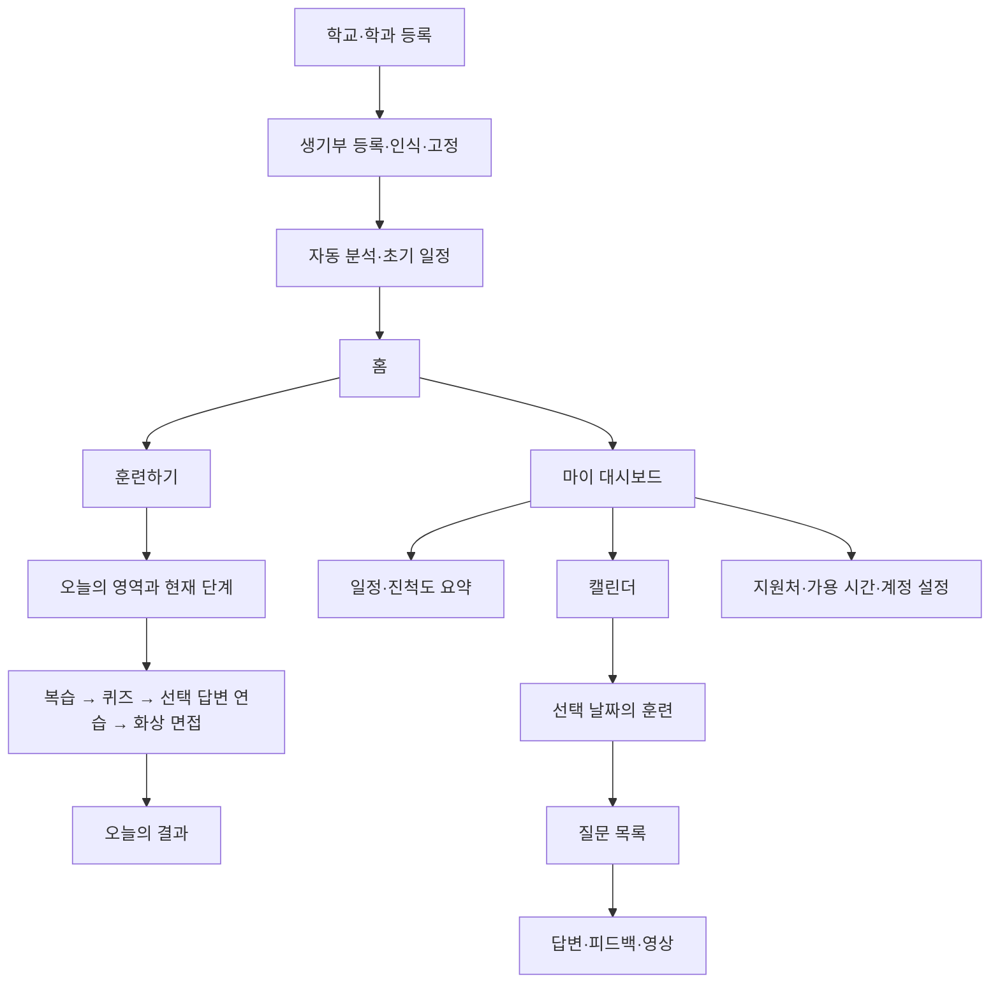
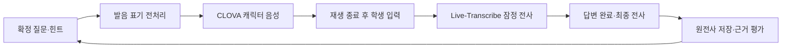

# 각자의 답 전체 개편안

작성 기준: 2026년 10월 23일. 1·2차 통합 회의록, 3차 회의록, 현재 구현 검수, 추가 개선 요청 10개를 통합했다. **이번 작업은 기획과 도입 검토이며 제품 코드는 수정하지 않는다.**

핵심 방향은 **생기부 하나를 훈련의 기준으로 삼고, 하루 한 영역을 학습하며, 화면마다 지금 할 일 하나에 집중하는 것**이다. 시각 기준은 사용자가 만족한 학교 선택 화면으로 통일한다. 음성 구성은 **CLOVA Voice + 전사 전용 모델 + 앱이 통제하는 면접 진행**을 우선 검증하고, GPT-Live 1은 자연스러운 음성 도움의 비교 후보로 둔다.

최신 요청을 우선하므로 이전 회의의 ‘진한 초록 주요 버튼·검은 면접 배경’은 밝은 브랜드 초록과 연한 민트 중심으로 변경한다. 이전의 ‘객관식 중심’은 **정답 하나가 확정된 타이머형 4지선다만 제공**하는 규칙으로 강화한다. 이름·세부 시간·색상 수치는 아래에 제안으로 명시하며, 확정된 요구사항으로 간주하지 않는다.

기존 구현의 세부 근거는 [미반영 항목 검수](./meeting-gap-audit-2026-10-23.md), 시각 확인 범위는 [기존 시각 QA](./visual-qa-2026-10-23.md)를 참조한다.

## 1. 이번 개편의 범위와 현재 상태

현재도 홈의 두 진입, 지원처별 일정, 날짜별 기록, 질문별 영상 저장, 원전사 보존, 일부 반복학습 기능은 있다. 이를 재사용하되 서로 끊겨 있는 데이터와 정책을 연결한다.

| 영역 | 현재의 핵심 간극 | 개편 결과 |
| --- | --- | --- |
| 생기부 | 운영자 가이드북 HTML 등록 중심 | 학과 등록 후 학생 원본 업로드, 인식 즉시 계정에 고정, 자동 분석 |
| 훈련 기준 | 외부 분석 자료·코드에 고정된 지침 | 운영자 지침 버전과 원문 근거를 연결한 구조화 분석 및 MD |
| 커리큘럼 | 기능별 퀘스트 배분 | 하루 한 생기부 영역, 중요도·분량·면접일을 고려한 편성 |
| 면접 | 연습·실전 구분 부재, 5초 침묵 종료 잔존 | 저장된 모드에 따른 서버 정책, 수동 답변 완료, 정상 재시도 |
| 캐릭터 | 이미지 5종은 있으나 A~E 표기, 기본 면접관 수 2명 | 전원 이름·역할·음성·도움 호출을 가진 5명 구성 |
| 전사·평가 | 원전사는 보존하지만 평가 입력에 표시용 답변 사용 | 원음·원전사 기준 평가, 오타 교정본과 작성 연습본 구분 |
| 퀴즈 | 객관식 코드와 Q&A·녹음 모드 공존, 실제 객관식 공급 부족 | 검수된 4지선다 문항 공급부터 결과 화면까지 통일 |
| 리포트 | 전체 피드백 위주, 비언어 영상 분석 부재 | 질문별 근거·평가·영상 연결, 검증된 비언어 항목 추가 |
| UI | 중복 버튼·밀도·어두운 녹색 무대 | 학교 선택과 같은 밝은 표면·여백·위계, 화면별 주 행동 하나 |

## 2. 화면 구조

홈은 진입을 선택하는 곳, 훈련은 수행하는 곳, 대시보드는 상태를 판단하는 곳으로 역할을 나눈다. 대시보드의 여러 요약 지표는 ‘준비 상태 파악’이라는 하나의 목적에 속한다. 각 위젯 안에 입력 폼과 상세 기록까지 넣지 않는다.



| 화면 | 사용자가 끝낼 일 | 기본 노출 | 주 행동 |
| --- | --- | --- | --- |
| 홈 | 이동할 곳 선택 | 훈련하기 / 마이 대시보드 두 진입 | 선택한 메뉴 진입 |
| 학교·학과 등록 | 지원처 지정 | 현재 단계의 선택 목록 | 다음 |
| 생기부 등록 | 훈련 기준 파일 등록 | 파일, 등록 규칙, 검사 상태 | 생기부 등록 |
| 분석 상태 | 처리 상황 확인 | 현재 처리 단계, 실패 시 해결 방법 | 완료 후 훈련 준비 |
| 훈련하기 | 오늘 학습 시작·재개 | 오늘의 영역, 활동 범위, 진행률, 현재 단계 | 이어서 훈련 |
| 복습 | 오늘의 생기부 범위 확인 | 해당 활동과 원문 근거 | 퀴즈 시작 |
| 퀴즈 | 제한시간 내 정답 선택 | 한 문제, 선택지 4개, 타이머 | 선택지 자체 |
| 답변 연습 | 말할 내용을 작성 | 질문, 답변 편집기 | 답변 저장 |
| 면접 준비 | 진행 모드·장치 확인 | 모드에 필요한 설정, 카메라·마이크 확인 | 면접 시작 |
| 면접 진행 | 현재 질문에 답변 | 고정 캐릭터 무대, 답변 패널 | 답변 완료 |
| 면접 종료 | 이번 면접 결과 확인 | 결과 요약, 질문 목록 | 선택 질문 확인 |
| 마이 대시보드 | 준비 상태 판단 | 일정, 완료량, 영역별 진행, 캘린더 | 오늘 훈련 |
| 날짜별 기록 | 해당 날짜 훈련 선택 | 그날의 훈련 목록 | 목록 행 선택 |
| 질문 상세 | 특정 답변을 복기 | 원답변, 평가 요약, 필요 시 영상 | 다시 연습하기 |
| 설정 | 지정한 설정 수정 | 선택한 설정 항목 하나 | 저장 |

시사·지식 자료는 초기 개편에서 최상위 메뉴로 늘리지 않는다. 당일 복습과 관련된 자료로 연결하고, 독립 자료실의 필요성이 확인되면 훈련의 보조 메뉴로 둔다. AI 도움도 전역 버튼을 반복 배치하지 않고 현재 답변·현재 활동에 붙인다.

## 3. 사용자 흐름

### 첫 이용

1. 학교 → 학과·전형을 선택한다.
2. 생기부 등록 규칙을 확인하고 파일을 올린다.
3. 생기부로 정상 인식되면 계정의 원본으로 고정한다.
4. 분석은 백그라운드에서 진행한다. 기다리는 동안 면접일과 가용 학습 시간을 입력할 수 있게 한다.
5. 분석 완료 후 오늘의 영역과 최초 일정을 제시한다. 세부 분석표 전체를 온보딩에 펼치지 않는다.
6. ‘훈련 시작’으로 오늘 학습에 진입한다.

### 매일 학습

**홈 → 훈련하기 → 오늘 영역 복습 → 4지선다 퀴즈 → 필요 시 답변 연습 → 필수 화상 면접 → 오늘 결과**로 진행한다. 화면에는 현재 단계만 펼치고 나머지는 작은 진행 표시로 남긴다.

‘매일 화상’은 훈련이 편성된 모든 학습일에 최소 한 회를 보장하는 규칙으로 적용한다. 휴식일·일정이 없는 날과 구분하며, 날짜를 옮긴 뒤에도 학습일의 필수 화상을 조용히 누락시키지 않는다. 가용 시간이 부족하면 선택 답변 연습을 줄이고, 필수 분량조차 부족하면 일정 충돌을 알려 재편성한다.

### 복기와 보완

**대시보드 → 캘린더 날짜 → 훈련 → 질문 → 답변·피드백·영상 → 다시 연습하기**로 이어진다. 뒤로 이동하면 선택 날짜·훈련과 스크롤 위치를 복원한다. 재연습은 새 시도로 기록하며 이전 제출 답변을 덮어쓰지 않는다.

## 4. 생기부 등록과 자동 분석

### 계정당 하나의 원본

최초 지원 학과 등록 후 업로드를 열고, **정상 생기부로 인식한 시점에 계정당 원본 하나를 고정**한다. 여러 대학에 지원해도 같은 원본을 쓰며 대학별 분석·질문만 달라진다. 학교 변경으로 원본 교체 권한이 생기지 않는다.

권장 상태는 `미등록 → 임시 검사 → 인식 완료·고정 → 분석 중 → 분석 완료`다. 파일 형식·가독성·문서 종류 판정이 실패하거나 불확실하면 고정하지 않고 원인을 표시한다. 생기부로 인식한 뒤의 분석 실패는 같은 원본으로 재처리한다.

등록 화면에는 “생기부로 확인되면 이 계정의 원본으로 고정되며 교체할 수 없습니다”를 파일 전송 전에 명확히 보여준다. 파일명·페이지 미리보기도 등록 전에 확인할 수 있게 한다. 인식 완료 뒤 일반적인 삭제·재등록 버튼은 제공하지 않는다.

서버에서는 계정별 고유 제약, 파일 해시, 원본 식별자, 고정 시각을 함께 저장한다. 두 탭에서 동시에 업로드해도 하나만 확정되도록 처리한다. UI 버튼을 숨기는 것만으로 교체 금지를 구현하지 않는다.

초기 파일 형식은 PDF를 우선 제안한다. 스캔 PDF는 OCR을 거치며 누락 페이지·읽기 실패를 검사한다. 문서 종류 인식은 소유자 확인이나 진위 확인과 같지 않으므로 이를 인증 완료로 표현하지 않는다. 오인식 이의 처리와 계정 삭제 시 자료 처리는 별도 운영 정책으로 정하되, 임의 원본 교체 경로를 만들지 않는다.

### 분석 결과와 지침

분석은 원문 추출 → 영역·활동 분리 → 근거 위치 연결 → 지원 학과별 중요도 판단 → 구조화 결과 및 분석 MD 생성 순서로 진행한다. 속도보다 정확성과 근거 연결을 우선한다.

| 저장 항목 | 사용하는 곳 |
| --- | --- |
| 영역·학년·과목·활동과 원문 페이지 | 오늘 복습 범위, 질문의 사실 근거 |
| 지원처별 S/A 등 중요도와 판정 이유 | 일정 편성, 질문 우선순위 |
| 활동에서 확인된 역할·과정·결과 | 질문 생성과 답변 평가 |
| 원문에 없는 정보·추가 확인이 필요한 부분 | 과장 방지, 학생 확인 질문 |
| 분석·운영 지침 버전 | 재분석과 과거 결과 재현 |

구조화 데이터는 서비스가 사용하고 MD는 같은 결과에서 자동 생성한다. MD를 따로 수작업으로 유지하지 않는다. 원본은 고정하되 파생 분석은 지침 개정이나 지원 학과 변경에 따라 새 버전으로 만들 수 있다.

운영자는 **분석 / 질문 / 평가 / 피드백 / 커리큘럼** 지침을 각각 관리한다. 초안·검토·게시 상태를 두고 게시 버전을 훈련에 연결한다. 새로운 지침 때문에 과거 질문과 평가가 소급 변경되지 않게 한다.

## 5. 커리큘럼과 퀘스트

기존 기능별 퀘스트 명칭을 학생에게 다시 설명하는 대신, **‘오늘은 동아리 활동’처럼 생기부 영역을 하루의 묶음**으로 삼는다. 그 안의 단계가 복습·퀴즈·선택 답변 연습·화상 면접이다.

편성 입력은 지원 대학 수, 학교별 면접일, 가용 시간, 활동 분량, S/A 중요도, 운영 지침, 수행 기록, 질문별 평가다. 같은 활동이 여러 대학에 관련되면 공통 복습은 묶고 학교별 질문 차이만 분리한다.

전체 과정은 **기초 연습 → 실전 면접 → 종합 리포트 → 최종 보완 연습**으로 배치한다. ‘실전’은 단순 퀘스트 제목이 아니라 도움·재시도·피드백 정책이 달라지는 실제 세션 모드다.

일정 편집에서는 날짜 변경과 같은 날 순서 변경을 지원한다. 다만 ‘답변 후 피드백’ 같은 단계 의존성은 유지한다. 자동 재편성은 바뀔 날짜·분량을 미리 보여주고 적용·되돌리기를 제공한다. 완료 기록은 재편성 대상에서 제외한다.

반복학습은 AI 평가, 오답, 시간 초과, 도움 사용을 각각 근거로 남긴다. 학생은 질문별 반복 유지·간격 변경·중지를 할 수 있다. 시간 초과를 지식 부족과 동일하게 점수화하지 않는다.

반복 예정일에 다른 영역이 편성되어 있으면 하루 한 영역 규칙을 우선하고 다음 동일 영역 학습일로 옮긴다. 면접 전 해당 학습일이 없으면 하루의 영역 배치를 재조정하는 안을 제시한다. 반복 시점이 달라진 이유를 표시하며, 완료 기록이나 학생이 중지한 반복을 다시 활성화하지 않는다.

## 6. 타이머형 4지선다 퀴즈

퀴즈는 **문제 하나, 보기 네 개, 정답 하나, 타이머 하나**로 제한한다. 채팅·주관식·답변 녹음은 퀴즈에서 제거하고 답변 연습이나 화상 면접으로 역할을 분리한다.

초기 제안은 문항당 10초다. 기본 퀴즈에는 무제한 모드를 병렬 노출하지 않는다. 긴 문항은 먼저 문장을 줄여 제한시간 안에 읽을 수 있게 한다. 접근성 등의 별도 시간 조정 정책은 본 퀴즈 규칙과 구분한다.

| 단계 | 화면·동작 |
| --- | --- |
| 시작 | 범위·문항 수·시간 규칙만 안내하고 시작 |
| 풀이 | 짧은 질문, 보기 4개, 남은 시간 표시. 선택 즉시 확정 |
| 시간 초과 | 미응답으로 기록. 정답과 짧은 근거 확인 후 다음 문제 |
| 결과 | 풀이 수, 정답률을 점수로 표시, 취약 영역, 개선점 1개 |
| 복기 | ‘답변 돌아보기’를 선택했을 때 문항별 상세 노출 |
| 후속 행동 | ‘취약문항 다시 풀기’ 하나를 주 행동으로 제공 |

타이머 만료와 선택이 겹쳐도 한 번만 채점한다. 재접속이나 백그라운드 전환으로 시간을 리셋하지 않는다. 일시적인 연결 오류는 오답과 구분해 복구한다.

문항은 생기부 사실 회상, 활동의 목적·과정·결과 구분, 근거가 명확한 대학 평가 기준과 활동의 연결을 다룬다. ‘나에게 가장 좋은 활동’처럼 정답이 여럿 가능한 판단을 억지 객관식으로 만들지 않는다.

발행 전 검사는 보기 4개, 정답 1개, 중복·동의어 보기 없음, 출처 근거, 단일 정답성, 짧은 해설을 확인한다. 유효 문항이 부족하면 준비 상태를 보여주며 Q&A로 자동 전환하지 않는다. 생명·최고 기록은 핵심 퀴즈가 완성된 뒤 검토한다.

## 7. 다섯 면접관 캐릭터

기존 5개 인물 자산을 출발점으로 전원 이름·질문 성향·도움 방식·목소리를 부여한다. 화면에는 A/B 대신 이름을 쓴다. 다섯 명이 매번 같은 수의 질문을 해야 하는 것은 아니지만, 다섯 명 모두 무대에 참여하고 이름으로 도움을 받을 수 있게 한다.

아래는 네이밍과 역할의 **초안**이다. 최종 이름은 서로 잘 구별되어 들리는지 호출 실험 후 확정한다. 역할은 질문의 초점이며 점수 기준을 캐릭터별로 다르게 만드는 장치가 아니다.

| 내부 자산 | 이름 제안 | 질문의 초점 | 막혔을 때 제공할 힌트 | CLOVA 청취 후보 |
| --- | --- | --- | --- | --- |
| A | 유나 | 경험의 핵심, 기본 질문 | 말하려던 핵심을 한 문장으로 좁히기 | `vara` |
| B | 도윤 | 전공 관심과 탐구 과정 | 관심의 계기와 탐구 행동 연결하기 | `vdaeseong` |
| C | 하람 | 활동에서 맡은 역할·협업 | 실제 맡았던 일과 구체적 장면 떠올리기 | `vgoeun` |
| D | 태오 | 근거·반론·압박 질문 | 주장과 근거를 나눠 빠진 근거 찾기 | `vdonghyun` |
| E | 서진 | 답변의 순서와 전달 | 시작·경험·배운 점 순서 잡기 | `vmikyung` |

표의 음성 ID는 공식 목록에 존재하는 후보이며 캐릭터와의 최종 조합은 청취 검증 대상이다. [CLOVA TTS 음성 목록](https://api.ncloud-docs.com/docs/ai-naver-clovavoice-ttspremium)

호출은 연습 중 답변 구간에서 “서진아, 도와줘”처럼 **이름과 도움 의도**를 함께 인식한다. 답변 속에서 같은 이름을 언급했다는 이유만으로 도움을 열지 않는다. 음성 인식이 불확실하면 짧게 확인하고, 조용한 환경을 위한 작은 도움 버튼도 둔다.

호출되면 같은 무대 안에서 해당 캐릭터가 도움 역할로 전환한다. 현재 답변을 보관하고 “어느 부분이 막혔나요?” → 학생의 요청 → 짧은 힌트 → 원래 질문으로 복귀한다. 복귀 시 이어서 말하거나 처음부터 다시 답할 수 있다. 도움 대화는 채점 답변과 별도 기록하고, 원음·원전사는 보존한다.

도움 중 완성 답변을 대신 읽어주지 않는다. 생기부에 근거한 예시 답변은 면접 후 피드백에서 제공한다. 실전에서는 이름 호출과 버튼 모두 서버에서 차단한다.

## 8. 면접 화면과 진행 규칙

### 고정 무대와 답변 패널

```text
┌──────────────────────────────────────────────┐
│ 연습 면접 · 동아리 활동             2 / 5  ⋯ │
├──────────────────────────────────────────────┤
│                                              │
│     유나     도윤     하람     태오     서진    │
│     인물     인물     인물     인물     인물    │
│                  현재 발화자 표시             │
│                                              │
│          질문 다시 듣기 · 질문 글로 보기      │
├──────────────────────────────────────────────┤
│ 내 답변                           녹음 중 00:32│
│ ┌──────────────────────────────────────────┐ │
│ │ 지금 말하는 내용이 이 답변 영역에 쌓임    │ │
│ │ 음성 전사와 내 답변을 두 곳에 반복하지 않음│ │
│ └──────────────────────────────────────────┘ │
│ 도움                             [답변 완료] │
└──────────────────────────────────────────────┘
```

실제 시안이 아닌 구조 설명이다. 다섯 인물의 자리와 무대 높이는 질문·답변 전환 중 유지한다. 발화자는 연한 링과 밝기 변화로 구분한다. 별도의 ‘함께하는 면접관’ 목록을 중복 배치하지 않는다. 모바일에서도 같은 순서로 5명 이름과 얼굴을 압축 배치하고 역할 설명은 접는다.

무대 아래 **답변 패널 하나**에 실시간 전사, 경과시간, 녹음 상태, 제출을 모은다. 전사 텍스트를 상단에 띄우고 입력창에 다시 복사하는 구조는 없앤다. 음성 답변 중에는 이 영역을 전사 표시로 사용하고, 입력 방식에서는 같은 자리가 편집기가 된다.

질문은 음성 모드에서 기본 숨김이며 재청취·글로 보기를 제공한다. 카메라 미리보기는 준비 화면에서 확인한 뒤 숨긴다. 녹화 중임을 알리는 상태 표시는 남기고, 필요할 때만 작은 미리보기를 연다. 녹화 영상을 답변 도중 재생하지 않는다.

모바일 키보드가 열려도 답변 영역과 완료 버튼이 가려지지 않도록 동적 화면 높이와 안전 여백을 적용한다. 면접 중 전역 하단 탐색은 접고, 종료는 상단 메뉴로 모은다. 단계마다 별도 고정 버튼을 덧붙이지 않는다.

### 진행 상태

**질문 준비 → TTS 재생 → 답변 수집 → 수동 완료 → 최종 전사·저장 → 평가 → 다음 질문**을 앱이 통제한다. TTS 중 학생 음성을 답변 STT와 채점 입력으로 보내지 않고, 재생 종료 후 별도 시작 버튼 없이 수집을 연다. 질문을 다시 듣는 동안에도 동일하게 입력을 일시 차단한다.

기본 종료는 ‘답변 완료’다. **5초 침묵 자동 제출과 ‘잠깐 생각할게요’ 버튼은 제거**한다. 생각하는 공백은 허용하고, 제한시간이 필요한 실전은 시작 전에 고지한 전체 규칙으로 별도 관리한다. 맥락 기반 자동 종료는 오판 평가 후 추가할 수 있으나 최초 개편의 필수 의존성으로 두지 않는다.

| 정책 | 연습 | 실전 |
| --- | --- | --- |
| 진행 방식 | 화상 중심, 답변 작성 연습은 별도 단계 | 화상 면접 |
| 일반·압박 | 퀘스트가 지정 | 시작 전 학생 선택 |
| 캐릭터 도움 | 허용 | 서버·UI 모두 차단 |
| 다시 답변 | 정상 답변과 도움 복귀 후 허용 | 진행 중 미제공, 완료 후 별도 연습 |
| 피드백 | 답변마다 짧은 평가와 보완점 제시 | 종료 후 일괄 공개 제안 |
| 질문별 영상 | 전체 면접 종료 후 공개 | 전체 면접 종료 후 공개 |

실전의 종료 후 피드백은 진행 중 코칭을 줄이기 위한 제안이다. 즉각적인 답변 평가 요구는 연습에서 충족한다. 점수와 상세 피드백은 저장 시점과 공개 시점을 분리한다.

꼬리질문은 일반 **0~1회**, 압박 **최대 2회**를 초기 정책으로 제안한다. 답변이 충분하면 생략한다. 압박은 근거를 더 확인하는 방식으로 구현하고, 목소리를 공격적으로 바꾸는 방식에 의존하지 않는다. 질문은 한 번에 한 가지를 묻고 인재상 명칭을 그대로 요구하는 장문 템플릿을 정리한다.

## 9. 원전사와 답변 평가

‘원전사 보존’과 ‘STT가 실제 발화를 완벽하게 옮긴다’는 서로 다르다. 원음과 STT 최초 결과를 모두 보존하고, 표시는 최소한으로 교정한다.

| 자료 | 규칙 |
| --- | --- |
| 원음·학생 영상 | 실제 수행 근거로 보존, 질문·시도와 연결 |
| 원전사 | 모델 최초 결과를 불변 기록으로 보존 |
| 표시용 교정본 | 오타·띄어쓰기 등 최소 수정, 변경 이력 보존 |
| 학생 수정본 | 연습용 작성 결과로 별도 저장, 원래 발화와 혼합하지 않음 |
| AI 제안문 | 제안 출처를 표시하고 학생이 적용할 때만 작성 초안에 반영 |

자동 교정이 반복·말더듬·“어”, “음”·문장 중단·부정 표현·수치를 삭제하거나 바꾸면 적용하지 않는다. 애매한 부분은 원전사를 유지한다. 생성형 모델로 문장을 매끈하게 만드는 처리를 기본값으로 두지 않는다.

화면의 실시간 자막은 잠정 전사로, 답변 완료 후 결과는 확정 전사로 구분한다. 기술 용어·대학·학과명은 인식 힌트로 줄 수 있지만, 실제 말하지 않은 내용을 전사에 채워 넣지 않는다.

평가에는 원전사, 원음에서 계산한 발화 지표, 생기부 근거, 도움 사용 여부를 전달한다. 내용 평가와 전달 평가를 분리하고 학생이 고쳐 쓴 문장을 원래 말하기 실력으로 채점하지 않는다. 재시도는 이전 시도와 비교할 수 있도록 남긴다.

‘첫 진단’은 반복 사용 가능한 **‘답변 연습’**으로 변경한다. 작성형 도움은 편집기 옆에서 열고 AI 제안 → 변경 미리보기 → 적용·되돌리기를 제공한다. 이 작성 도움과 원전사 오타 교정은 다른 기능이다.

## 10. 음성 기술 도입 검토

확인 기준일은 2026년 10월 23일이다. 공개 제품·API 문서상 도입 가능성은 확인했으며, **현재 계정의 권한·결제·실제 한국어 품질은 아직 시험하지 않았다.** 아래 비용은 공급사 공개 안내와 가정에 따른 계산이다.

### CLOVA Voice

**도입 가능하다.** 검토 제품은 음성 합성인 CLOVA Voice의 TTS Premium이다. 음성 인식 제품인 CLOVA Speech와 구분한다. 서버에서 API 키로 호출하는 REST 방식이며 MP3/WAV 응답을 사용한다. [API 개요](https://api.ncloud-docs.com/docs/ai-naver-clovavoice)

한국어는 요청당 2,000자 제한이 있고 문장당 200자를 초과하는 오류도 안내된다. 현재 앱의 2,500자 입력 상한을 그대로 적용하면 안 된다. 속도·높낮이 등을 조절할 수 있으나 감정 제어는 음성별 지원이 다르다. [TTS 규격](https://api.ncloud-docs.com/docs/ai-naver-clovavoice-ttspremium), [오류 코드](https://api.ncloud-docs.com/docs/ai-naver-clovavoice)

공개 요청 규격에서 SSML·phoneme·사용자 발음사전 필드는 확인되지 않았다. **화면에 보여줄 질문과 TTS 읽기용 문장을 분리하고, 검수한 대학명·학과명·약어 읽기 표기를 앱에서 적용**하는 방식을 제안한다. 고유명사 발음이 자동 해결된다고 가정하지 않는다. REST 응답을 제공한다는 사실만으로 합성 완료 전 오디오 스트리밍과 낮은 지연을 보장할 수도 없다. [TTS 입력·응답 규격](https://api.ncloud-docs.com/docs/ai-naver-clovavoice-ttspremium)

중요한 도입 조건은 생성 음성의 취급이다. 제품·서비스 탑재는 허용되지만 실시간 API 호출 방식이 요구되며 생성 파일 저장·편집 후 재사용은 제한된다. **현재 질문 음성 DB·스토리지 캐시를 CLOVA에 그대로 적용할 수 없다.** [이용 정책](https://guide.ncloud-docs.com/docs/clovavoice-policy), [재사용 제한 안내](https://guide.ncloud-docs.com/docs/clovavoice-troubleshoot)

이에 따른 설계안은 CLOVA 응답을 현재 재생에만 사용하고 영속 캐시를 만들지 않는 것이다. 질문 재청취도 다시 합성하는 경로로 설계한다. 일시적 재생 버퍼의 허용 범위와 처리 방식은 공급사에 확인한다. 녹화는 학생 카메라·마이크 트랙을 저장하고 TTS 트랙을 합치지 않으며, 질문은 텍스트 메타데이터로 연결한다. 이는 정책에 맞추기 위한 설계 판단이며 녹화물에 합성음을 포함하려면 별도 이용 조건 확인이 필요하다.

공식 FAQ는 월 기본료 **90,000원에 100만 자**, 초과 **1,000자당 100원**, 월 누적 1,000자 단위 올림을 안내한다. Application별 기본료가 발생하므로 캐릭터마다 Application을 만들 이유는 없다. 이번 확인에서는 공식 FAQ의 검색 색인에서 금액을 확인했으며, 신청 시 콘솔의 최종 요금·VAT를 재확인한다. [공식 요금 FAQ](https://www.ncloud.com/support/faq/prod/3309?categoryCode2=AI&categoryCode3=SV_0158)

신청 후 호출이 없어도 기본료가 발생한다. 공개 문서에 확정적인 Voice 동시 요청/TPS 상한을 찾지 못했으므로 예상 동시 면접 수를 제시해 확인해야 한다. [신청 안내](https://guide.ncloud-docs.com/docs/clovavoice-start), [이용량 관리](https://guide.ncloud-docs.com/docs/clovavoice-application)

### GPT-Live 1과 전사 전용 모델

**GPT-Live 1은 실제 공개 모델이며 도입할 수 있다.** API 이름은 `gpt-live-1`이고, 음성을 듣고 말하는 연속 대화 모델이다. Free API tier는 지원하지 않으며 세션 분당 **$0.05**, 후단 추론·도구 비용은 별도다. [공식 모델 문서](https://developers.openai.com/api/docs/models/gpt-live-1)

Live의 연결은 `/v1/live/sessions`다. 현재 앱의 Realtime 연결·이벤트와 다르므로 모델 문자열만 바꿀 수 없다. [Live 연결 문서](https://developers.openai.com/api/docs/guides/voice-websockets)

한국어 음성 `noeul`을 제공하지만 **세션 시작 후 목소리를 바꾸려면 새 세션이 필요**하다. 입력 음소거 제어는 가능하나 지속 대화의 전사와 발화 구간을 앱의 확정 답변·정확한 낭독 완료로 곧바로 취급하면 안 된다. 따라서 한 면접 안에서 다섯 고정 목소리와 수동 종료를 엄격히 운영하는 본 진행에는 추가 제어가 필요하다. [Live 세션 관리](https://developers.openai.com/api/docs/guides/live-conversations)

음성 인식만 필요하다면 **`gpt-live-transcribe`가 더 직접적인 후보**다. 실시간 전사를 제공하고 앱이 `input_audio_buffer.commit`을 보내 최종 전사를 확정한다. server/semantic VAD를 지원하지 않으므로 앱의 답변 완료 버튼과 연결한다. 단어별 타임스탬프·화자 라벨·신뢰도 점수는 제공하지 않는다. [실시간 전사 가이드](https://developers.openai.com/api/docs/guides/realtime-transcription)

녹음 파일 또는 확정된 답변의 전사는 `gpt-transcribe`로 검토할 수 있다. 실시간과 파일 전사는 별도 용도이며 항상 두 번 전사할 필요는 없다. [전사 모델 선택 가이드](https://developers.openai.com/api/docs/guides/transcription)

### 권장 구성과 비교안

| 구성 | 적합성 | 판단 |
| --- | --- | --- |
| CLOVA TTS + Live-Transcribe + 별도 질문·평가 모델 | 고정 질문 낭독, 5개 음성, 원전사·수동 완료 제어 | **우선 검증할 기본안** |
| GPT-Live 1로 질문·답변 대화 전체 처리 | 자연스러운 대화에 적합, 목소리 전환과 엄격한 턴 제어 추가 작업 | 전체 교체보다 제한된 비교 실험 |
| 기본안 + GPT-Live 1 도움 대화 | 막힌 부분을 자유롭게 묻는 경험 | 기본 도움 기능 완성 후 선택 실험 |

기본안에서는 도움도 ‘학생 전사 → 짧은 힌트 생성 → 캐릭터 CLOVA 음성’으로 먼저 제공한다. GPT-Live 1 도움을 추가할 경우 같은 캐릭터의 목소리가 바뀌는 문제까지 비교해야 한다. 다섯 Live 세션을 항상 켜 두거나 Live의 생성 음성과 CLOVA를 동시에 재생하는 구성은 기본안에 넣지 않는다.



이는 두 공급사의 공식 통합 상품이 아니라 공개 API를 조합한 설계안이다. 답변 완료·도움 차단·캐릭터 선택·다음 질문 결정은 모델에 맡기지 않고 앱의 상태로 통제한다.

현재 코드에서 재사용하거나 바꿔야 하는 지점도 구분된다.

| 현재 구현 | 다음 개발 범위 |
| --- | --- |
| [면접 Realtime 경로](../apps/web/src/lib/realtime-interview.ts)는 `gpt-realtime-2.1` 사용 | GPT-Live 1 실험 시 연결·이벤트를 별도 구현. 기존 경로의 입력 차단 정책도 함께 정리 |
| [실시간 전사 경로](../apps/web/src/lib/realtime-transcription.ts)에 이미 `gpt-live-transcribe`와 한국어 설정 존재 | 현재 퀴즈 세션에 묶인 권한·사용량·완료 처리에서 면접 세션으로 확장. 면접에 이미 적용됐다는 뜻은 아님 |
| [미디어 처리](../apps/web/src/app/api/media/route.ts)에 질문 음성 저장·재사용 존재 | CLOVA 경로는 영속 캐시와 분리하고 재청취·취소·실패 복구 처리 |

### 비용 예시

가정: 월 100회, 면접 연결 시간은 회당 20분, 실제 전사 대상 학생 음성은 회당 12분. 세금·환율·후단 AI·저장·네트워크 비용은 제외한다.

| 항목 | 계산 | 예시 비용 |
| --- | --- | --- |
| GPT-Live 1 전체 연결 | 100 × 20분 × $0.05 | $100 |
| Live-Transcribe 학생 입력 | 100 × 12분 × $0.017 | $20.40 |
| 파일 전사만 사용하는 대안 | 100 × 12분 × $0.0045 | $5.40 |
| CLOVA TTS | 월 사용량이 100만 자 이내인 Application 1개 가정 | 기본료 90,000원 안내 |

Live는 연결 세션 시간, 전사 모델은 전사 대상 음성 시간이 기준이므로 단가만 비교하면 안 된다. 실제 전송에 포함되는 침묵·도움 대화·재시도도 계측한다. 파일 전사는 실시간 자막을 대체하지 못한다. [Live 가격](https://developers.openai.com/api/docs/models/gpt-live-1), [Live-Transcribe 가격](https://developers.openai.com/api/docs/models/gpt-live-transcribe), [Transcribe 가격](https://developers.openai.com/api/docs/models/gpt-transcribe), [CLOVA 요금](https://www.ncloud.com/support/faq/prod/3309?categoryCode2=AI&categoryCode3=SV_0158)

## 11. 평가·영상·리포트

질문별 결과는 **직관적 평가 → 근거 → 잘한 점·보완점 → 다음 행동** 순서로 제공한다. 점수·별점은 운영자 평가 지침을 먼저 정의한 뒤 산출한다. 객관적 채점 기준 없이 임의의 ‘면접 합격률’이나 역량 점수를 만들지 않는다.

연습에서는 답변 직후 평가 요약과 보완점 하나를 보여주고 상세를 접는다. 생기부 근거가 부족하면 부족하다고 말하며 억지 장점을 채우지 않는다. 답변 예시는 실제 기록에서 확인된 내용만 사용하고 학생이 말하지 않은 성과를 추가하지 않는다.

면접 전체 종료 화면에는 질문 목록을 제공한다. 선택한 질문에 원답변·AI 피드백·영상이 함께 연결된다. 종료 전 영상 접근 제한은 화면과 미디어 조회 API 모두에서 적용한다. 질문별 영상·시도·전사·평가 식별자가 일치해야 한다.

리포트 상단은 4개 내외의 핵심 지표만 제시한다. 초기 후보는 답변 시간, 공백 비율, 습관어, 검증된 비언어 관찰이다. 아직 분석되지 않은 지표는 숫자 0으로 표시하지 않는다. 항목 선택 시 해당 상세만 펼친다.

비언어 분석은 시선 이탈 구간, 반복 손동작, 자세 변화처럼 **영상에서 확인 가능한 행동**을 대상으로 한다. 해당 구간을 재생하며 학생이 확인할 수 있어야 한다. 성격·진실성·감정 상태를 영상만으로 단정하지 않는다. 카메라 프레임 밖 행동이나 조도 부족은 판단 불가로 처리한다.

습관어의 정확한 시점은 단어별 시간 정보를 제공하지 않는 전사 결과만으로 만들지 않는다. 음성 정렬 등 별도 방법을 검증하기 전에는 답변 전체 단위 빈도를 보여준다. 비언어 분석의 구간 표시는 영상 시간축을 사용한다.

리포트는 **화면 열람을 기본**, 선택 날짜·선택 훈련 다운로드를 보조로 제안한다. 전체 계정 백업과 훈련 리포트 다운로드는 구분한다. 상세 화면의 주 행동은 ‘다시 연습하기’로 통일하고 자료 연결·내보내기는 보조 메뉴에 모은다.

## 12. 시각 디자인과 대시보드

### 학교 선택 화면에서 가져올 원칙

실제 기준 화면: [데스크톱 학교 선택](../.local/school-onboarding-ui-2026-10-16/screenshots/after-01-school-start-pc.png), [모바일 학교 선택](../output/qa/student-e2e-20261022/01-new-student-school-mobile.png).

큰 질문형 제목 하나, 밝은 입력 표면, 선택 행의 로고·이름·상태, 넓은 여백, 다음 행동 하나를 계승한다. 데스크톱은 약 1,090px 작업 폭과 필요한 경우 약 296px의 읽기 전용 요약을 기준으로 삼는다. 모바일은 보조 요약을 접고 현재 작업을 우선한다.

현재 학교 선택 CSS 전체를 복사하지 않고 최종 시각 규칙을 공통 구성요소로 추출한다. 기존 규칙 중 키보드 포커스 표시를 없애는 방식은 계승하지 않는다.

### 색상 제안

현재 브랜드 토큰 `#00ED77`을 기준으로 로고와 연결한다. 실제 로고 원본을 재색칠하지 않고 UI의 배경·선택·버튼을 맞춘다.

| 용도 | 제안 색상 | 사용 원칙 |
| --- | --- | --- |
| 브랜드 강조 | `#00ED77` | 주요 행동·작은 진행 강조 |
| 주요 글자 | `#18372B` | 밝은 초록 버튼 위에도 짙은 글자 사용 |
| 본문 | `#253A30` | 긴 텍스트 가독성 |
| 보조 글자 | `#607168` | 짧은 상태·설명, 대비 확인 |
| 바탕 | `#F7FAF8` | 전체 페이지 |
| 콘텐츠 | `#FFFFFF` | 주 작업 표면 |
| 선택 상태 | `#E8FBF0` | 선택 행·약한 강조 |
| 경계 | `#DFE8E3` | 필요한 구획에만 사용 |

진한 녹색은 글자·아이콘·포커스에 제한하고 넓은 면접 무대나 큰 카드 전체에 반복하지 않는다. 그라데이션은 흰색에서 아주 옅은 민트로 이어지는 정도로, 화면당 한 큰 표면에만 적용한다. Tailwind의 미세한 그라데이션 느낌을 목표로 하되, 이를 위해 현재 CSS 구조 전체를 바꿀 필요는 없다.

### 글자·간격 제안

| 역할 | 크기 | 굵기 | 줄간격 |
| --- | --- | --- | --- |
| 화면 제목 | 24px | 600 | 1.35 |
| 섹션·핵심 값 | 18px | 600 | 1.45 |
| 본문·버튼 | 15px | 400 / 버튼 600 | 본문 1.7 |
| 보조 설명 | 13px | 400~500 | 1.55 |

기본 간격은 8·12·16·24·32·48px로 제한하고, 필드와 큰 묶음은 32px 안팎의 여백으로 구분한다. 큰 표면의 반경은 20px, 입력·버튼은 12px, 주요 조작 영역은 최소 44px를 기준으로 삼는다. 색상만으로 선택·오류·완료를 전달하지 않는다.

한 화면의 강조 버튼은 원칙적으로 하나다. 목록 행 자체를 진입점으로 사용하고 매 행에 ‘보기·이동·확인’ 버튼을 중복 배치하지 않는다. 닫기·재생처럼 명확한 아이콘은 사용할 수 있지만 ‘답변 완료’ 같은 중요한 행동은 글자 라벨을 유지한다.

### 대시보드 구성

| 위치 | 내용 | 표현 |
| --- | --- | --- |
| 상단 | 가장 가까운 면접 D-day, 이번 주 완료량, 전체 계획 진행률 | 핵심 요약 3개 |
| 중심 | 학습 캘린더 | 완료한 날만 캐릭터 도장, 날짜 선택으로 기록 탐색 |
| 보조 | 영역별 수행 현황 | 실제 계획·완료 수 기반 작은 막대 |
| 하단 | 지원 대학별 면접일, 최근 훈련 기록 | 짧은 목록 |
| 공통 주 행동 | 오늘 훈련 시작·재개 | 강조 버튼 하나 |

진행률은 완료한 계획량이라는 분모가 명확한 값으로 표시하고 면접 실력 점수와 혼동하지 않는다. 기록 없는 날은 가짜 데이터나 장식 그래프로 채우지 않는다. 일정 수정·기록 상세·지원처 변경은 각 목적에 맞는 하위 화면으로 이동한다.

## 13. 개발 순서와 의존성

아래는 일정 약속이 아닌 구현 순서다. 생기부·커리큘럼과 면접 원전사·종료 정책은 모두 최상 우선순위이며, 두 흐름을 병행할 수 있다. 화면 개편은 공통 규칙을 먼저 정한 뒤 각 기능과 함께 적용한다.

| 단계 | 우선순위·작업 | 앞서 필요한 것 | 완료 조건 |
| --- | --- | --- | --- |
| 0 | 설계·검증 준비: 화면 흐름, 지침 초안, 음성 비교 실험 | 현재 개편안 | 고정 무대·등록·대시보드 시안, 공급사 조건과 품질 판단 근거 |
| 1A | 최상: 생기부 업로드·고정·자동 분석·지침 버전 | 문서 판정 규칙, 분석 지침 | 학생 파일 1개에서 근거 있는 구조화 분석과 MD 생성 |
| 1B | 최상: 원전사 기준, 수동 완료, 면접 상태 통합 | 음성 공급자 기본 선택 | 긴 침묵에도 자동 제출 없음, TTS 중 입력 차단, 원전사 평가 |
| 2A | 최상: 영역별 일정과 하루 훈련 | 1A의 활동·중요도 | 하루 한 영역, 매 학습일 화상, 순서 변경·재편성 |
| 2B | 상: 연습·실전, 5명 캐릭터, 도움·재시도 | 1B의 상태와 전사 | 실전 서버 도움 차단, 연습 이름 호출과 원래 질문 복귀 |
| 2C | 상: 질문별 평가·영상·기록 연결 | 1A·1B의 근거와 식별자 | 종료 후 질문 선택으로 답변·평가·영상 확인 |
| 3 | 중상: 4지선다 데이터·화면, 답변 연습 도움 적용 | 분석 근거, 문항 발행 검사 | 실제 유효 객관식 공급, 타이머·요약 결과·초안 적용 |
| 4 | 상: AI 평가 기반 반복, 비언어 분석, 최종 리포트 | 충분한 수행·영상과 평가 기준 | 근거 구간 검증, 반복 설정 저장, 리포트 다운로드 |
| 5 | 통합: 대시보드 실데이터 연결·기기 QA·점진 적용 | 위 기능의 실제 데이터 | 모바일 전체 흐름과 회귀 검수 통과 |

홈·대시보드의 공통 레이아웃과 색상·글자 규칙은 단계 0부터 병행한다. 데이터가 아직 없는 역량 차트나 비언어 점수를 먼저 꾸미지 않는다. 전환 중 기존 기록과 원음·전사·질문별 영상 연결을 유지하고, 새 지침·새 세션 모드는 버전으로 구분한다.

최초 배포 가능한 묶음은 **생기부 등록·분석 → 오늘 영역 복습 → 유효한 4지선다 퀴즈 → 원전사 기반 연습 면접 → 질문별 복기**다. 단계 2A·2B·2C·3을 완료하고 해당 범위의 통합 QA를 통과해야 한다. 이후 비언어 분석·반복 고도화를 연결하고, 자연스러운 Live 도움 대화, 고급 애니메이션, 생명·최고 기록 등으로 확장한다.

## 14. 도입 전 검증과 출시 기준

음성의 실제 우열은 문서로 확정하지 않는다. 다음 검증은 이후 구현 단계에서 수행할 계획이며 이번에는 유료 API 호출을 하지 않았다.

| 검증 | 방법 | 통과 판단 |
| --- | --- | --- |
| 한국어 TTS | 대학·학과·생기부 용어·수치·영어 약어를 포함한 동일 문장 50개를 5개 음성으로 비교 | 현 음성 대비 오독과 부자연스러운 억양이 줄고 캐릭터별 구별 가능 |
| 전사 보존 | 동의받은 한국어 답변 표본에서 반복·머뭇거림·부정·수치·전문용어 비교 | 정확도와 별도로 습관어·반복 보존, 의미 변경 여부 기록 |
| 지연·비용 | 첫 재생·자막·완료 후 전사의 P50/P95, 20분 세션 전체 비용 계측 | 실제 기기에서 수용 가능한 지연, 예산·동시성 충족 |
| 질문과 입력 전환 | 질문 재생·재청취·취소·이어폰 해제·통신 실패 시험 | 면접관 음성이 학생 답변으로 들어가지 않음 |
| 종료 | 5초 이상 생각, 짧은 대답, 긴 대답, 완료 중복 클릭 | 의도하지 않은 제출과 중복 턴 없음 |
| 이름 호출 | 다섯 이름의 정상 호출과 단순 언급을 비교 | 실전 차단, 연습 오호출·누락 측정, 버튼으로 복구 |
| 생기부 고정 | 두 탭 동시 등록, 판정 실패, 분석 재시도, 지원처 변경 | 계정당 확정 원본 하나, 실패 시 상태 일관성 |
| 퀴즈 | 보기 수·단일 정답·근거·타이머 경합·연결 복구 | 유효 문항만 발행, 한 문제 한 번 채점 |
| 영상·평가 | 종료 전 API 접근, 질문·시도·영상 대응, 도움 분리 | 종료 전 재생 차단, 잘못된 질문에 평가 연결 없음 |
| 시각 QA | 360·390·768·1440px, 실제 iOS Safari·Android Chrome, 키보드·확대 | 가로 넘침 없음, 무대 안정, 답변·완료 버튼 접근 가능 |

품질 수치 기준은 표본과 현 공급자 기준값을 먼저 측정한 뒤 확정한다. 출시 기준에는 버튼·레이아웃뿐 아니라 **생기부 → 질문 → 원발화 → 평가 → 반복 → 기록**이 같은 학생·같은 근거로 연결되는지 포함한다.

## 15. 운영 준비와 확정할 제안

개발 착수에 필요한 운영 자료는 분석·질문·평가·피드백·커리큘럼 지침, 객관식 문항 검수 기준, 생기부 인식·오인식 처리 기준이다. 특히 평가 점수의 의미와 ‘기록에서 확인된 사실’의 범위를 먼저 맞춰야 한다.

이 문서의 기본 제안은 캐릭터 이름 5개, 퀴즈 10초, 일반 꼬리질문 최대 1회, 실전 피드백 종료 후 공개, 화면 열람 우선 리포트, 밝은 브랜드 초록이다. 실제 시안과 음성 표본으로 검토할 항목이며 지금 확정된 디자인·납품 일정으로 취급하지 않는다.

공급사 쪽 확인은 CLOVA의 동시 호출량·일시 버퍼·녹화물 음성 취급, OpenAI 계정의 모델 접근·한도, 실제 한국어 정확도와 비용이다. 결과에 따라 TTS 공급자는 바꿀 수 있게 하되 학생의 세션·원전사·리포트 데이터 형식은 공급자에 종속시키지 않는다.

## 16. 기존 미반영 항목 대응표

상세 코드 근거는 [기존 검수 문서](./meeting-gap-audit-2026-10-23.md)에 있다. 이 표는 누락을 방지하기 위한 개발 추적 기준이며 구현 완료 판정이 아니다.

| 기존 ID | 개편에 포함한 내용 | 관련 절 |
| --- | --- | --- |
| A01 | 학생 원본 업로드와 자동 분석 | 4 |
| A02 | 지원처별 중요도·분석 MD·질문과 평가의 근거 연결 | 4, 9 |
| A03 | 다섯 운영 지침의 게시·버전 관리 | 4, 15 |
| A04 | 하루 한 생기부 영역·복습 범위 | 3, 5 |
| A05 | 중요도·분량 기반 일정과 연습→실전→보완 | 5 |
| A06 | 날짜 및 같은 날 순서 변경·재편성 | 5 |
| A07 | AI 평가 기반 반복과 학생 조절 | 5, 11 |
| B01 | 연습·실전 저장 및 서버 정책 | 8 |
| B02 | 일반·압박 배치와 답변 충분성에 따른 꼬리질문 | 8 |
| B03 | 이름 호출·힌트 대화·원래 면접 복귀 | 7 |
| B04 | 5초 자동 종료 제거·수동 완료 | 8 |
| B05 | 원전사·수정본 구분과 원발화 평가 | 9 |
| B06 | TTS 중 마이크의 답변 입력 차단 | 8, 10 |
| B07 | 질문 종료 후 즉시 입력·재청취 | 8 |
| B08 | 정상 연습 중 재시도 및 도움 후 재답변 | 7, 8 |
| B09 | 짧은 질문·인재상 직접 언급 정리·지침 적용 | 4, 8 |
| C01 | 전체 종료 후 질문별 영상 열람과 API 제약 | 11 |
| C02 | 검증 가능한 비언어 관찰·영상 구간 | 11, 14 |
| C03 | 질문별 평가·점수 기준·생기부 근거 예시 | 8, 11 |
| C04 | 질문별 피드백과 기록 상세 연결 | 11 |
| C05 | 화면 열람 우선·날짜/훈련 단위 다운로드 | 11 |
| D01 | 첫 진단 → 답변 연습 | 9 |
| D02 | 작성형 AI 도움의 적용·되돌리기 | 9 |
| D03 | 4지선다 전용 퀴즈와 실제 문항 공급 | 6 |
| D04 | 퀴즈 결과 요약 우선·상세 접기 | 6 |
| D05 | 중복 행동 통합·단계별 주 행동 하나 | 2, 11, 12 |
| D06 | 완료 날짜의 캐릭터 도장 | 12 |

| 추가 요청 | 반영 위치 |
| --- | --- |
| 1. 정답형 4지선다·타이머 | 6 |
| 2. CLOVA와 GPT-Live 1 도입 가능성 | 10, 14 |
| 3. 다섯 명 전원 캐릭터·이름 호출 | 7, 8 |
| 4. 학과 등록 후 생기부 하나 고정 | 3, 4 |
| 5. 고정 무대·답변 근처 전사·녹화 미리보기 숨김 | 8, 11 |
| 6. 오타 수준 원전사 유지 | 9 |
| 7. 로고와 어울리는 밝은 컬러 | 12 |
| 8. 글자 크기·굵기·줄간격 위계 | 12 |
| 9. 한 화면 한 목적·버튼 축소·미세한 초록 그라데이션 | 2, 8, 12 |
| 10. 학교 선택의 통일감·대시보드 개편 | 2, 12 |
