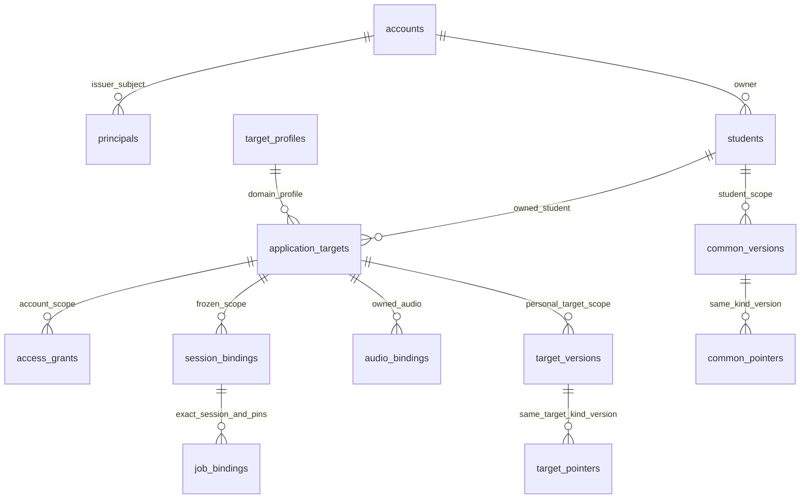

# PR07-B DB 관계·RLS 격리 검증

청사진 v2와 PR07-A의 요청 경계를 잇는 **격리 메타데이터 DB 실험**이다. 운영 Auth/DB 연결, 기존 학생 자료 적재, Storage reader/writer, 실제 면접 저장 전환은 수행하지 않는다. 실행 commit·PostgreSQL 배포/역할·정책·checksum·정상/거부 사례·CI는 Git 제외 `artifacts/pr07b/`에서 실제 결과로 판정한다. 이 문서의 명령과 설계는 실행 성공이나 운영 승인 증거가 아니다.

## 신뢰와 등록·변경 책임

| 입력·관계 | 권위·등록 주체 | 변경/철회·허용 역할 | 검증·revision·감사 | 실제 운영 공급 |
|---|---|---|---|---|
| issuer/audience/algorithm/key·배포 origin | 실제 인증 제공자와 승인된 서버 구성 | 운영 보안 구성 주체. 사용자 입력으로 교체 불가 | 기존 jose 검증, 임의 JWKS URL 금지 | 미공급 |
| issuer+subject→account/owner | 신뢰 등록 도구의 검증된 귀속 근거 | `gakja_mapping`; 일반 요청/worker는 수정 불가 | 복합 principal PK, 계정 FK·활성 상태, 계정 identity 불변, revision/DB actor/action 감사 | 운영 등록자·절차·mapping 미공급. 합성 seed만 존재 |
| 학생 | 입증된 owner의 안정된 학생 키 | 신뢰 등록 도구만 등록 | `(owner,student)` PK. 이름/PDF hash 동일해도 다른 owner 병합 금지 | 기존 자료 미이관 |
| 개인 지원처 | owner/student와 검증된 profile 참조 | 신뢰 등록 도구 | 복합 FK, applicationTargetId와 legacy supportTargetId 분리 | 실제 귀속 근거 미공급 |
| 접근 grant/source pin | 계정 권한 관리자가 승인한 학생/개인 지원처 범위 | mapping 역할이 등록/변경/철회 | grant와 계정 bigint revision 증가·감사를 한 transaction으로 확정 | 운영 권한 관리 주체 미확정 |
| session/audio/job binding | 신뢰 metadata 등록 도구의 frozen pin | mapping 역할 등록. runtime은 제한 조회 | 같은 owner/student/개인 지원처의 session→job FK, context/source pin, 명시 worker job grant | 합성 binding만 존재 |
| version/pointer/object/legacy | 도메인 codec 검증과 명시 귀속 근거 | seed/신뢰 등록; 제한 runtime의 허용 DML만 | 불변 version UPDATE/DELETE 불허, pointer의 exact-scope FK, 원본 bytes/hash·legacy FK | 운영 원본·bucket·writer 미연결 |

계정 신규 생성과 기존 자료 귀속은 별개다. 공개 가입 API·계정 합치기·보호자 공유·조직 정책은 추가하지 않는다. `auth.uid()` 또는 이메일/표시명이 내부 owner/student와 같다고 가정하지 않는다. DB의 actor는 접속 DB 역할이며 검증된 실제 운영자 개인 신원/승인 절차가 공급됐다는 뜻이 아니다. 검수자 서명 권한과 로그인/DB mapping 권한도 별개다.

## 관계와 기존 ID

`accounts.account_id`와 `owner_id`는 명시적으로 연결된 서로 다른 키다. `students`/`application_targets`는 owner를 포함한 복합 키/FK를 사용한다. 같은 source hash·표시명·legacy ID는 계정 연결 근거가 아니다. 공유 `target_profiles`는 명시적인 공통 catalog이며 nullable owner의 개인 자료로 표현하지 않는다.

학생 공통 version/object/legacy는 `common_versions`, `common_private_objects`, `common_legacy_mappings`에, 개인 지원처 자료는 `target_versions`, `private_objects`, `legacy_mappings`에 둔다. 공통 분석에 임의 개인 지원처를 요구하지 않는다. common/target pointer는 해당 scope·kind의 실재 version만 참조한다. 현재 legacy mapping은 **version 참조**만 지원하며, 객체 mapping은 C에서 실제 관계를 별도로 검증한다. 저장 식별자로 기존 payload ID를 덮어쓰지 않는다.

`source_present=false, source_revision=NULL`은 필드 부재이고, `true,NULL`은 literal null, `true,text`는 지정된 pin이다. adapter가 이 세 값을 각각 누락/null/문자열로 출력한다. 빈 문자열이나 주변 공백은 정규화하지 않고 거부한다. 학생/owner/개인 지원처에는 이 wildcard를 적용하지 않는다. SQL helper는 현재 A의 source pin 의미를 보존한다.

session/job은 실행 저장소가 아니라 frozen metadata binding이다. job은 동일 owner/student/applicationTarget/supportTarget/session/context와 source presence/value를 복합 FK로 입증한다. generated non-null source key는 SQL 참조용이며 domain payload의 필드가 아니다. 평가 input fingerprint와 원문 source hash는 다른 대상이므로 같다고 강제하지 않는다. 모호한 legacy resource ID는 binding resolver에서 거부한다.

version은 기존 TS 계산 규칙의 `domain_sha256`, 원문 `original_bytes`의 물리 해시인 `content_sha256`, JSONB 검색 projection을 구분한다. 도메인 해시는 기존 계산 결과를 그대로 전달하며 DB가 JSONB나 원문 bytes로 다시 계산하지 않는다. 별도로 원문 bytes의 SHA256을 DB에서 검사한다. 합성 fixture도 도메인 해시와 물리 해시가 다른 사례를 왕복 검증한다. projection 재직렬화를 기존 서명/hash 대신 쓰지 않으며 실제 Full/Target 분석 codec이나 생성 identity를 새 generic JSON 정본으로 교체하지 않는다. C의 객체 메타데이터는 owner/student/source와 size/hash/opaque reference 계약뿐이며 bucket·업로드·signed URL은 없다.

## 역할·RLS·최소 권한

| 역할 | 범위 | 금지/신뢰 한계 |
|---|---|---|
| 격리 bootstrap 관리자 | 고유 DB/역할 생성, migration/seed·검사·정리 | disposable marker를 확인한 이번 자원만 대상. 운영 URL 자동 재사용 없음 |
| `gakja_owner` | NOLOGIN schema owner, migration/definer | runtime의 membership 없음. FORCE RLS 안에서도 명시된 신뢰 관리 policy는 허용됨 |
| `gakja_mapping` | 승인된 registry/metadata 등록·권한 변경 | superuser/BYPASS/DDL 아님. account owner/revision 임의 변경 금지, trigger가 revision 증가 |
| `gakja_request` | 검증된 backend context의 제한 조회, 불변 version INSERT와 pointer 등 허용 DML | registry/권한/revision 변경, 불변 version UPDATE/DELETE, DDL/TRUNCATE/승격 불허 |
| `gakja_worker` | 명시 worker subject/job grant에 해당하는 job/session metadata 조회 | 전역 pending 탐색·모든 owner 권한 없음 |
| `gakja_bypass` | RLS 우회 대조군 SELECT | 실제 Supabase service token 시험이 아닌 순수 PostgreSQL BYPASSRLS 역할 |

개인 테이블은 ENABLE/FORCE RLS와 GRANT를 함께 설정한다. USING은 대상 행, WITH CHECK는 새 행을 검사한다. 런타임은 실제 별도 LOGIN 연결로 실행해 current_user/session_user·속성·membership을 확인하며, 관리자 SET ROLE만으로 대신하지 않는다. PUBLIC 테이블/함수/sequence 권한과 schema CREATE 권한을 점검한다. superuser/BYPASSRLS는 FORCE RLS로 제한되지 않는다. 이와 달리 owner는 명시적 trusted management policy로 허용되는 것임을 구분한다.

초기 principal mapping과 unselected session/audio discovery에는 제한 SECURITY DEFINER 함수를 사용한다. 함수는 고정 `search_path=pg_catalog`, 명시 schema, 제한 EXECUTE와 PUBLIC 회수를 사용한다. runtime의 registry 전체 읽기 권한은 없다. 임의 owner 인자/임시 객체로 범위를 바꾸는 RPC나 browser Data API는 추가하지 않는다.

## A의 인증에서 SQL까지

`createPostgresAccountResolver`는 기존 verifier가 검증한 principal을 DB의 issuer+subject mapping으로 조회한다. `createPostgresRequestAuthority`는 boundary가 발급한 context를 재검증한 다음 pool connection을 받는다. 선택 전 context는 필요한 narrow binding discovery만 허용하며 일반 scoped query는 거부한다. 위조 객체·만료·미매핑·의존성 장애는 local owner로 fallback하지 않는다.

DB account 조회가 같은 작은 pool을 사용하므로 connection을 쥔 채 boundary.revalidate를 호출해 deadlock을 만들지 않는다. pool 대기 뒤에는 minted/만료 상태를 다시 확인하고, 같은 connection의 READ COMMITTED transaction에서 현재 account/revision/grant를 다시 읽는다. `set_config(...,true)`로 principal/account/student/개인 지원처를 transaction-local 전달하며 값은 parameterized query를 사용한다. query와 결과 확정 앞의 현재 revision 검사, COMMIT/ROLLBACK/예외/서버 statement cancellation 뒤 RESET/청결 검사 또는 connection 폐기로 이전 계정 문맥이 재사용되지 않게 한다.

**SET LOCAL은 인증이 아니다.** SQL credential을 가진 주체는 직접 임의 문맥을 설정할 수 있다. 이 제한 역할의 연결은 검증된 Node backend만 보유하고 임의 SQL/RPC/claims setter를 사용자에게 노출하지 않는다. RLS 단독 claims 사례와 실제 signed JWT→A boundary→DB resolver→HTTP/WSS 사례는 별도로 집계한다. SQL injection 방지는 parameterized query와 고정 query 구성의 책임이다.

`createPostgresTestResources`는 DB의 실제 binding과 합성 session/audio body provider를 연결하는 test composition이다. 실제 Storage reader나 학생 자료 shadow reader가 아니다. 내부 worker resolver는 DB job→개인 지원처→session 관계와 제한 job grant를 A의 finite-job capability에 연결한다. 기존 A/B 서명·모델 전/확정 전 검수 gate는 유지한다.

철회는 새 READ COMMITTED statement에서 commit된 현재 mapping을 확인하는 경계다. 짧은 transaction으로 현재 권한을 다시 읽고 A의 metadata-await 이후 검사와 WSS 재검사를 유지한다. 검사 직후 일어나는 모든 철회를 원자적으로 막는 writer fence를 확보했다고 주장하지 않는다. 장기 snapshot을 현재 grant로 재사용하지 않으며, writer 확정·fencing은 E/F의 별도 과제다.

## 실행·검증·운영 미연결

`npm run test:db-local`은 명시한 PostgreSQL17.11 바이너리로 loopback/SCRAM의 고유 cluster를 만들고 실제 DB 검사를 실행한다. `npm run test:db-isolation`은 dedicated 테스트 변수·run ID·disposable marker를 확인한다. 운영 DB URL을 읽지 않는다. 빈 DB migration의 version/checksum과 catalog fingerprint를 기록하고 replay는 중복 적용하지 않으며 drift를 실패시킨다. SQL의 제한적 `-text` 속성은 Windows/Linux checksum 차이를 막고 기존 원문 보존 규칙은 그대로 둔다.

DB 시험은 `tests/db/`에서 별도 실행하며 offline portable에 몰래 skip하지 않는다. CI의 기존 verify를 유지하고 고정 PostgreSQL17.11의 별도 DB job을 항상 실행한다. mock/SQL 문자열 검사를 실제 RLS 통과로 표시하지 않는다. 실제 PostgreSQL 버전/배포 checksum·image ID, migration/seed checksum, 제한 역할·권한·정책, 정상/거부/우회 대조·pool/cancel·실제 A HTTP/WSS·worker·bytes 결과는 실행 artifacts로 연결한다. 작은 합성 DB의 계획은 운영 부하 보장이 아니다.

실제 운영 issuer/audience/key/JWKS·배포 origin·등록/철회 운영자·subject/계정/자원 mapping은 미공급이다. DB adapter의 `kind:operational`은 실제 SQL 구현 계약일 뿐 운영 Auth 연결 승인이 아니다. service entry에 DB adapter를 자동 주입하지 않았고 새 세션/변경/STT 저장의503과 retained fail-closed entry를 유지한다. 실제 평가 승인0/검수대기35는 별도 coverage로 확인한다. W0 실제 브라우저 QA, G1 검수/장치·상용 미디어, PR04 의미 품질은 미완료다.

## 롤백·C 인계

B 구현만 feature branch에서 revert하고 이번 run의 marker가 확인된 격리 DB/cluster/container만 정리한다. A의 retained service entry·인증 실패 차단을 유지한다. 운영 데이터 포맷/DB 신규 기록을 바꾸지 않았으므로 DB 역이관을 수행했다고 쓰지 않는다. 실제 DB 신규 쓰기 이후의 rollback은 기존 계획의 별도 역보존 조건이 필요하다.

C는 owner/student/common·개인 지원처/source binding과 정확한 object size/hash/ref, 제한된 권한 조회 경로를 받아 실제 비공개 Storage adapter를 작은 단위로 연결한다. 운영 Auth/mapping·권한/삭제 책임이 정해지지 않으면 C의 운영 연계도 미완료로 유지한다. legacy 원본 bytes/hash·기존 ID를 보존하고 업로드 접수와 실제 객체 완료 확인, signed URL 권한·만료를 별도로 검증한다. 이번에는 bucket/URL/API를 발급하지 않는다.

공식 동작 근거: [PostgreSQL17 RLS](https://www.postgresql.org/docs/17/ddl-rowsecurity.html), [정책 command](https://www.postgresql.org/docs/17/sql-createpolicy.html), [SET LOCAL](https://www.postgresql.org/docs/17/sql-set.html), [함수 권한](https://www.postgresql.org/docs/17/sql-createfunction.html), [JSON 원문과 JSONB](https://www.postgresql.org/docs/17/datatype-json.html), [Supabase RLS](https://supabase.com/docs/guides/database/postgres/row-level-security). 제품 정책이나 현재 정본 codec을 이 참고로 교체하지 않는다.
