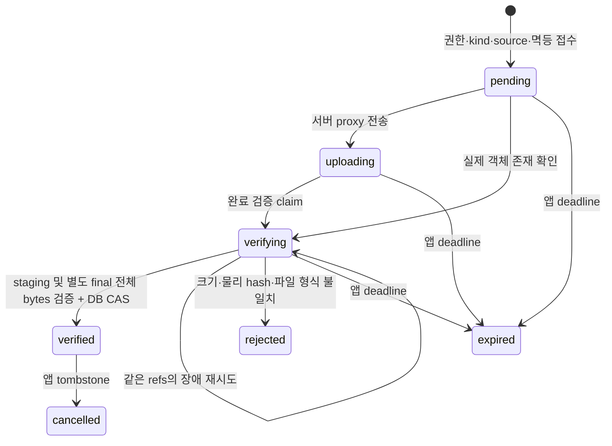

# PR07-C 비공개 Storage 읽기·완료 검증

청사진 v2를 따라 A의 요청 인증과 B의 소유권 DB를 실제 객체 API에 연결한다. **C1 reader와 C2 객체 등록은 별개 관문**이다. 이 문서는 계약·구현 범위이며 실행 성공/운영 승인 선언이 아니다. 정확한 SHA의 새 설치·DB/API 시험·CI·원본 비교는 Git 제외 `artifacts/pr07c/final-report.json`과 연결된 실제 로그로 판정한다.

## 현재 경계와 새 연결

| 기존 경계 | C의 연결 | 보존 범위 |
|---|---|---|
| B private/common objects | 기존 행은 완료 증거가 아님. 새 `storage_uploads` 접수·검증 원장을 별도 조회 | 기존 행을 migration 기본값으로 verified 처리하지 않음 |
| B common/target versions | 별도 typed version-object 관계에서 owner/student/개인 지원처/source/raw hash/domain hash 일치 | 기존 version·정본 bytes·TS codec·ID와 원래 도메인 해시 불변 |
| B legacy mappings | legacy→기존 version FK→새 version-object FK | 같은 파일명/ID 문자열로 추정하지 않음. 기존 mapping을 object FK로 오인하지 않음 |
| B audio binding | audio-object FK와 현재 verified 객체 pin으로 연결 | 기존 resource/domain target ID 불변, TTS/publish 전환 없음 |
| `AudioRepository` | service의 좁은 audio read composition만 추가 | local read/publish 그대로. read-only를 전체 repository로 cast하지 않음 |
| source/analysis read ports | C reader는 bytes/ref를 반환 | `StoredFile.path`에 URL 삽입 없음. D의 current/staged/historical shadow는 후속 |

## C2 상태와 물리 객체 귀속

미완료 상태도 취소할 수 있다. terminal 상태는 다시 verified로 승격하지 않는다. `cleanupState`는 pending/clean/failed로 별도 기록한다. clean은 해당 API 삭제 시도의 결과이며, provider 권한의 잔여 유효 기간에 늦게 생긴 staging까지 영구히 없다는 뜻이 아니다. 같은 tombstone을 다시 cleanup할 수 있다. 운영에서 철회된 사용자 대신 정리할 주체와 credential lifecycle은 공급 조건이다.

학생 공통 객체는 owner/student와 `scope=common`으로 저장하며 개인 지원처는 넣지 않는다. 다만 읽는 요청은 기존 A grant에서 학생·지원처를 선택해야 하며 B의 `can_student_version`이 현재 학생/source 권한을 검사한다. target 객체는 같은 owner/student의 정확한 개인 지원처/supportTarget FK를 요구한다. source 필드 부재/literal null/문자열과 domain hash 필드 부재/null을 보존한다.

접수는 서버가 주입한 bucket/opaque run prefix와 DB 생성 UUID로 staging/final key를 할당한다. client owner/ref/key/URL은 권위가 아니다. key는 `${prefix}/staging/${objectId}`와 `${prefix}/final/${objectId}`로 고정한다. 서로 다른 owner의 동일 bytes/hash도 별도 UUID·객체다. receipt/object UUID는 전역 유일하고 key·scope·예상 size/hash·source는 불변이다. 자기 행에 상대 ref를 넣어도 새 원장의 불변 제약/권한 및 reader의 원장 조회를 통과하지 못한다.

일반 request 역할은 B 객체 INSERT 권한을 C migration에서 회수하며 원장 직접 DML·검증 완료 함수 실행도 허용하지 않는다. 좁은 등록/전이 함수는 명시적으로 주입한 trusted mapping pool에서만 실행한다. 함수와 TS adapter는 현재 A principal/account/revision/grant와 scope를 다시 검사한다. mapping credential 자체는 신뢰한 서버 권한이며 일반 SQL 사용자에게 제공하지 않는다. SET LOCAL은 여전히 인증이 아닌 backend 문맥 전달이다.

사용자 제출은 PDF만 허용한다. MD/JSON/분석/음성/bundle은 서버 발급의 finite kind/idempotency/object capability와 현재 검사 callback이 필요하다. 내부 읽기는 명시 object 목록과 만료·현재 job 권한을 확인한다. 이는 평가 검수 승인과 별개이며 객체 저장으로 질문/A/B 승인이나 OCR·분석 진실성을 발급하지 않는다.

실제 업로드 API 성공·클라이언트 완료 알림만으로 확정하지 않는다. staging 전체 bytes를 size/raw SHA 및 파일 container 형식과 대조하고, 별도 final key에 no-upsert copy한 뒤 **최종 읽기 대상의 전체 bytes도 재검증**한다. 그 뒤 DB의 조건부 전이로 확정한다. copy 성공 뒤 DB 실패는 verifying+고정 refs로 추적하며 재시도에서 실제 final bytes를 확인한다. DB 확정 후 응답 유실은 같은 receipt를 재조회한다. 동시 완료·취소는 revision/CAS와 tombstone으로 조정한다. DB와 Storage API를 하나의 원자 transaction으로 표현하지 않는다.

## C1 reader와 기존 HTTP

1. A가 발급한 context와 B의 현재 mapping/grant를 검사한다.
2. 제한 DB 조회로 verified 원장과 정확한 scope/source/ref/size/raw SHA/revision을 고정한다. 객체 선택 ID는 권한이 아니다.
3. DB transaction/connection을 반환하고 공식 Storage API로 읽는다.
4. 실제 bytes 길이와 SHA256을 검사한다. ETag/Content-Length나 JSONB projection은 원본 해시를 대신하지 않는다.
5. 비동기 IO 뒤 현재 권한과 같은 원장 상태/ref/pin을 다시 확인하고 bytes를 반환한다.

기본은 앱 proxy이며 provider 직접 download URL을 제품 reader로 반환하지 않는다. 기본 한도는 객체16MiB, 동시 transfer4개, timeout15초다. 메모리 Buffer 한도 안에서 전체 검증 후 전달하고 임시 파일·부분 스트리밍·Range·reader cache는 사용하지 않는다. provider도 별도 bytes/concurrency/timeout/redirect 제한을 둔다. 승인되지 않은 host/bucket/key, traversal, 로컬 경로를 따라가지 않는다.

기존 service audio의 singleflight는 C에서 exact object identity digest를 optional metadata로 추가한다. digest는 owner/student/common 또는 target/source/ref/hash/revision/object ID를 포함한다. 기존 audio ID나 서명 payload를 바꾸지 않으며, 응답 전 최신 audio binding 조회에서도 현재 객체 pin/상태를 대조한다. Range는416으로 거부한다. 응답의 private/no-store와 인증 후 거부를 유지한다. 이미 전달된 bytes의 회수나 마지막 검사 이후 모든 철회의 원자 차단은 보장하지 않는다.

## Provider와 URL 계약

공식 Supabase Storage REST API를 fetch로 호출하며 새 SDK 의존성은 추가하지 않는다. CI는 Supabase `storage-api:v1.89.12` manifest digest `8526956cb462e9f7d392e9848ec77133b2769982ed614e9753cc687e8e4339a6`를 고정한다. 내부 file backend를 쓰는 **실제 Storage API 서비스**이며 직접 파일을 읽는 mock과 구분한다. provider용 PostgreSQL17.11은 앱 DB와 다른 container라 provider migration/역할이 앱 역할을 오염시키지 않는다.

앱 JWT는 기존 jose의 명시 issuer/audience/key 신뢰를 사용한다. 격리 Storage의 service/anon JWT는 run 전용 secret으로 별도 생성한다. service credential은 서버 내부 전용이고 이 연결의 성공을 Storage 사용자 RLS 성공으로 표시하지 않는다. Supabase의 `owner_id`와 내부 owner는 같다고 가정하지 않는다. anonymous/public/list를 실제 API에서 거부하고 앱 owner 격리는 A/B/원장과 별도로 시험한다. `storage.objects`/`storage.buckets`의 upload/delete 흉내 SQL DML은 사용하지 않는다.

signed download는 발급 권한과 링크 소유 접근을 구분한다. 짧은 TTL의 실제 만료 전/후를 로컬 origin API에서 시험하며 grant 철회가 이미 발급된 직접 URL을 즉시 취소한다고 주장하지 않는다. hosted Supabase 문서는 Storage URL signing key를 Auth key와 구분하고, 만료/철회 뒤 CDN cache가 남을 수 있다고 설명한다. 이 격리 origin 시험은 hosted signing-key/CDN 검증이 아니다.

signed upload는 제품 기본 전송 경로가 아닌 provider 계약 시험이다. 공식 hosted 문서는2시간을 설명한다. 선택한 self-host 버전의 환경 설정과 실제 token lifetime/reuse/upsert를 따로 기록하며 격리 설정은7200초다. 짧은 앱 접수 deadline이 provider 권한도 같이 만료시킨다는 뜻이 아니다. 2시간 실제 경과 시험을 하지 않았다면 미실행으로 남긴다. staging token으로 final key를 덮어쓸 수 없고 취소/만료 뒤 늦은 업로드는 확정하지 않는다. 프로젝트 key 회전/전체 CDN purge는 수행하지 않는다.

## 재현·관문·후속

- `npm run test:storage-unit`: 명시 mock/fault 시험. 실제 provider 수용 증거를 대신하지 않는다.
- `PR07C_POSTGRES_BIN`에 명시 PostgreSQL17.11 bin 절대 경로를 준 뒤 `npm run test:storage-db-local`: 새 owned cluster의 실제 C DB/repository 시험. Storage 서비스 시험은 아니다.
- `npm run test:storage`: Docker의 고유 network/앱PG/providerPG/Storage API, 실제 readiness/private bucket/합성 fixture/검사/API 삭제/owned 자원 정리. 전용 run ID와 생성 직후 marker를 확인하며 기존 자원을 자동 채택하지 않는다.

B `0001_ownership.sql`·bootstrap·합성 seed checksum과 기존 verify/db-isolation job은 유지한다. C는 새 `0002_private_storage.sql`과 별도 storage-isolation job을 사용한다. migration은 B checkpoint를 보존하고 C 최신 fingerprint를 별도 기록해 upgrade/replay/drift를 구분한다. 테스트가 nested `tests/storage`에 있으므로 기존 full/portable manifest를 늘리거나 DB 미준비를 몰래 skip하지 않는다. 해당 명령/CI가 명시 실행한다.

C1·C2 코드와 격리 서비스의 실행 통과, 최종 SHA 새 설치/회귀/CI/원본 비교를 각각 판정한다. Windows에 Docker engine이 없으면 로컬 mock/실제 PG와 CI 실제 Storage의 범위를 나눠 적는다. 운영 provider/Auth/mapping·bucket/credential 등록·삭제 책임은 미공급이며 운영 연계는 미완료다. W0 실계정/브라우저 QA, G1 실제 장치·상용 STT/TTS·검수, PR04 의미 품질과 평가 승인0/대기35는 별도 관문이다.

D에는 검증한 object mapping·정확한 raw bytes/hash와 기존 domain hash·legacy ID/pin→version→object 조회·현재 codec 적용 경계를 넘긴다. D의 current/staged/historical shadow는 기존 local을 유일 writer로 두고 독립 비교하며 실제 학생 자료의 귀속·이관은 아직 수행하지 않는다. session/답변/평가 writer와 실제 학생 active pointer를 C에서 전환하지 않는다.

롤백은 C adapter 주입/새 migration·metadata 변경을 분리해 되돌리며 A retained service entry·인증 실패 차단·B 권한을 보존한다. 이번 marker가 입증된 격리 자원만 정리한다. 실제 신규 객체/DB 기록이 생긴 환경에서는 먼저 참조·확정 상태를 역보존해야 하며 ref 삭제나 toggle로 데이터를 버리지 않는다.

공식 참고: [접근 제어](https://supabase.com/docs/guides/storage/security/access-control), [ownership](https://supabase.com/docs/guides/storage/security/ownership), [URL signing keys](https://supabase.com/docs/guides/storage/security/signing-keys), [CDN cache](https://supabase.com/docs/guides/storage/cdn/smart-cdn), [signed upload](https://supabase.com/docs/reference/javascript/storage-from-createsigneduploadurl), [API와 Storage schema](https://supabase.com/docs/guides/storage/schema/design). 지원 범위 설명과 실제 실행·운영 승인은 구분한다.
