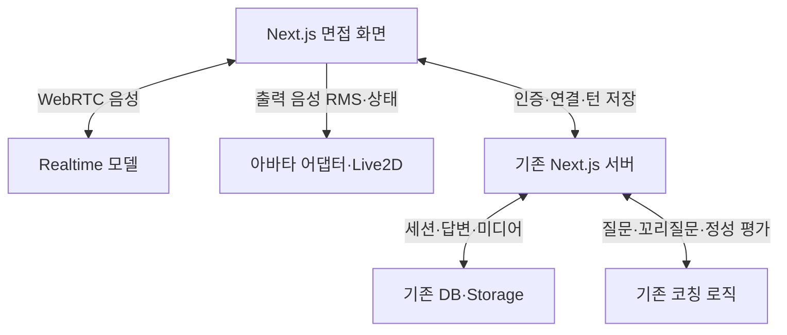

# 각자ON 음성 면접·Live2D 립싱크 적용 계획

- 작성일: 2026-10-20, 한국 시간
- 대상 저장소: https://github.com/mys203120-netizen/gakja
- 확인 커밋: `32da04623d106279e891e136e153c5f723ed63f8`
- 문서 상태: 구현 전 기술 검토·개발 적용안
- 검증 범위: 해당 커밋의 소스와 OpenAI·Live2D·MDN 공식 문서 대조. 실제 유료 음성 연결, 모바일 실기기 성능, 사용성 실험은 수행하지 않았다.

## 1. 판단과 권장 방향

**면접관 출력 음성의 RMS를 분석해 Live2D의 입 개폐를 제어하는 방식은 구현 가능하다.** 미리 제작한 모델이 있다면 발음별 입 모양을 맞추는 방식보다 구현 범위가 작다. [S1][S2]

각자ON에서는 Realtime 완성을 기다릴 필요가 없다. 기존 질문 TTS 재생 경로에 RMS 분석을 먼저 붙여 아바타 품질을 검증하고, 양방향 Realtime 면접은 저장·복구까지 포함한 별도 단계로 진행한다.

권장 순서:

1. 기존 TTS와 준비된 모델로 RMS 립싱크 검증
2. Listening·Thinking·Speaking 표정 및 동작 연결
3. 면접 전용 Realtime 연결과 턴 저장을 함께 구현
4. 끼어들기·재연결·기존 음성/텍스트 전환 검증
5. 필요성이 확인되면 발음별 입 모양 정합 확장

꼬리질문은 이미 있으므로 신규 기능으로 다시 개발하지 않는다. 기존 생성 주체와 Realtime의 응답 주체가 충돌하지 않게 연결한다.

## 2. 제공된 설명의 사실확인

| 설명 | 판단 | 문서에 반영할 정확한 표현 |
| --- | --- | --- |
| Realtime 음성 → Web Audio → Live2D 입 개폐 | 타당 | 출력 음성의 파형을 분석해 모델 파라미터를 갱신하는 방식으로 구현 가능하다. [S1][S4] |
| 음량이 커지면 입이 더 크게 열린다 | 타당 | RMS를 보정·평활화해 입 개폐 범위에 매핑한다. 단순 원시 값 대입보다 조정이 필요하다. |
| 입 개폐 구현 난이도는 무조건 낮다 | 조건부 | 준비된 모델에서 파라미터만 제어하면 상대적으로 작다. 모델 제작·SDK 초기화·모바일 오디오·수명 관리까지 포함하면 범위가 커진다. |
| Realtime에서 음성 입력·출력과 STT가 가능하다 | 타당하나 구분 필요 | Realtime 모델은 음성을 직접 입력받아 음성으로 응답한다. 별도 TTS 호출이 필수는 아니며, 자막·기록용 입력 전사는 별도 설정과 처리가 필요하다. [S5][S6] |
| OpenAI Realtime는 Live2D용 viseme 데이터를 직접 주지 않는다 | 확인한 표준 규격 기준 타당 | 확인한 Realtime/TTS 규격에는 Live2D용 viseme 트랙 전달을 전제로 할 필드가 없다. 기본안은 출력 음성 기반 RMS이며 향후 API 변경은 재확인한다. [S6][S8] |
| 발음별 입 모양에는 phoneme 추출·변환을 직접 만들어야 한다 | 수정 필요 | 직접 구현 외에 공식 Cubism SDK MotionSync Plugin for Web을 검토할 수 있다. 해당 모델·플러그인·입 모양 설정과 실시간 입력 지원 범위는 별도 검증한다. [S3] |
| 상당수 유튜브 AI 아바타 서비스가 이 방식을 쓴다 | 근거 미확인 | 서비스별 구현을 확인하지 않았으므로 일반적인 보급률 주장으로 사용하지 않는다. |
| 정교한 립싱크보다 면접관 존재감이 더 중요하다 | 제품 가설 | 각자ON에서는 상태 반응을 먼저 구현하되, 학생 사용성 테스트로 확인한다. |
| 입모양보다 연결·저장·복구가 더 큰 위험이다 | 합리적인 개발 판단 | 네트워크·저장 실패는 답변 손실로 이어질 수 있어 먼저 완료 기준을 정한다. 실제 발생률·난이도를 측정한 결과는 아니다. |
| Realtime 면접 완료 → 저장 → 꼬리질문 → Live2D 순서가 필수다 | 수정 필요 | 저장·중복 방지는 Realtime과 함께 설계한다. 립싱크는 기존 TTS에서 먼저 구현 가능하며 꼬리질문은 재사용한다. |

## 3. 현재 구현과 재사용 범위

아래 경로는 모두 `apps/web/` 기준이다. 고정 커밋의 구현 상태와 이후 신규 제안을 구분한다.

| 영역 | 현재 상태 | 연결할 기존 경로 |
| --- | --- | --- |
| 웹·서버 | Next.js 16·React·TypeScript | `package.json`, `src/app/api/` |
| Live 면접 | 질문 MP3 재생 → 답변 녹음 → 업로드 → 전사·정리 → 제출 | `src/components/live-interview-session.tsx`, `src/lib/client/live-interview-controller.ts` |
| 녹음 분석 | 학생 마이크의 RMS·발화·침묵 측정 | `src/lib/client/live-interview-recorder.ts` |
| 실시간 자막 | 퀴즈 전용 WebRTC transcription 세션 | `src/lib/realtime-transcription.ts`, `src/lib/client/realtime-transcription.ts`, `src/app/api/quiz/realtime/route.ts` |
| TTS | Google 기본, OpenAI 선택 가능 | `src/app/api/media/route.ts`, `src/lib/ai.ts` |
| 코칭 모델 | `gpt-5.6-terra`로 제한 | `src/lib/ai.ts` |
| 캐릭터 | SVG·GSAP·CSS, 입 움직임은 speaking 상태 애니메이션 | `src/components/interviewer-character.tsx`, `src/components/live-interviewer-stage.tsx`, `src/app/interview-v2.css` |
| 질문·꼬리질문 | 서버가 세션·문항·생성 상태 관리 | `src/app/api/interviews/route.ts` |
| 녹음 복구 | 기기 임시 저장과 서버 업로드 영수증에 따른 복구 | `src/lib/client/recording-recovery.ts`, `src/components/live-interview-session.tsx` |
| 저장 | 면접 세션·턴·미디어 자산 구조 존재 | `interview_sessions`, `interview_turns`, `media_assets` |
| 평가 | 정성 코칭·자기점검·음성 관찰값 | `src/lib/speech-analysis.ts`, `src/components/speech-growth.tsx`, 면접 API |

현재 실시간 자막 세션은 `type: 'transcription'`, 모델은 `gpt-live-transcribe`이다. 음성으로 질문하는 양방향 Realtime 세션이 아니며, 퀴즈 소유권 검사도 있어 면접에 그대로 재사용할 수 없다.

기존 음성 제출 경로는 소유 녹음·완료된 전사·표시 정리본 등을 확인한다. 실시간 전사 delta를 곧바로 기존 `answer_recording` 제출에 넣으면 이 계약을 깨뜨린다. 관련 확인 경로는 `src/lib/interview-transcript-selection.ts`이다.

## 4. 적용 범위 결정

### 유지할 것

- Next.js·React·TypeScript와 기존 API Routes·인증·저장 구조
- 생기부·검수된 학교 자료·질문 구성 비율·면접관 배정
- 기존 꼬리질문 토글·깊이·피드백 시점 설정
- 기존 음성 녹음 제출 및 텍스트 답변 전환
- 원전사와 학생 정정본의 구분, 답변·파생질문 이력

### 추가할 것

- 면접관 출력 음성 분석기와 아바타 공통 인터페이스
- 준비된 Live2D 모델의 로딩·렌더링·상태·립싱크 제어
- 면접 전용 Realtime 연결·사용량 관리·종료 처리
- Realtime 이벤트와 앱 턴을 연결하는 저장·중복 방지 계약

### 이번 범위에 넣지 않을 것

- Vite 이전, Zustand의 의무 도입
- 기존 꼬리질문 로직의 별도 복제
- 근거 없는 합격확률·자신감 점수 생성
- 검증 없이 STAR를 모든 질문에 강제 적용
- 얼굴·입 모양을 통한 학생 실력 또는 합격 가능성 표시

기존 코드의 코칭 모델을 환경변수만 GPT-4o로 바꾸면 모델 제한 검사에 걸린다. 음성 전용 모델 설정을 기존 코칭 모델 설정과 분리한다. Realtime 가이드는 현재 `gpt-realtime-2.1`을 예시로 사용한다. 일반 GPT-4o와 Realtime 모델을 같은 모델로 취급하지 않는다. [S5][S9]

## 5. 오디오와 아바타의 연결 구조

### A. 먼저 구현할 기존 TTS 기반 립싱크

기존 질문 음성 재생에 출력 분석기를 추가한다. 녹음·전사·제출·꼬리질문 흐름은 기존 경로를 활용한다.

| 경로 | 담당 |
| --- | --- |
| 기존 질문 TTS → 하나의 재생 경로 | 질문 음성 출력 |
| 같은 출력 음성 → Web Audio 분석기 | 면접관 RMS 산출 |
| RMS → 아바타 어댑터 | 입 개폐 |
| 면접 컨트롤러 상태 → 아바타 어댑터 | 눈·고개·표정 |
| 학생 마이크 → 기존 녹음기 | 학생 답변 녹음·분석 |

학생 마이크 RMS를 면접관 입에 연결하지 않는다. 캐릭터·WebGL이 실패해도 질문 음성·자막·답변 저장은 계속 작동해야 한다.

### B. 이후 추가할 Realtime 면접



Realtime는 음성 입출력을 처리하고, 앱의 문항 진행과 영구 기록은 서버가 관리한다. 서버 SDP 중계 또는 임시 접속 키 방식을 선택하며 영구 API 키는 브라우저로 보내지 않는다. [S5][S6]

기존 질문 생성과 Realtime의 자유 질문 생성을 동시에 켜지 않는다. 초기안은 **서버가 승인한 다음 질문을 Realtime가 전달하는 방식**이다. 학생 발화 종료만으로 다음 질문을 자동 생성·재생하지 않도록 응답 설정을 제어하고, 서버 승인 뒤에 출력을 요청한다. 승인 질문과 실제 출력 전사의 일치도도 QA한다. 질문 생성까지 Realtime에 위임하려면 별도 평가·저장 계약으로 범위를 확장한다.

이 방식에는 서버 질문 생성·확정에 필요한 지연이 남는다. Realtime를 붙였다는 이유만으로 전체 응답 지연이 자동 해소된다고 설명하지 않는다.

## 6. RMS 립싱크 구현 지침

### 6.1 분석 대상과 재생 경로

- 기존 TTS: 재생 `HTMLAudioElement`를 Web Audio 그래프에 연결해 분석한다.
- Realtime: 수신한 면접관 출력 `MediaStream` 또는 SDK가 제공하는 출력 오디오 경로를 분석한다.
- SDK의 자동 음성 재생과 앱의 Web Audio 재생이 겹치지 않게 한 경로만 출력한다.
- 동일한 오디오 요소에 `createMediaElementSource()`를 반복 생성하지 않도록 수명과 참조를 관리한다.
- 학생 마이크 스트림은 녹음·RTC의 소유권을 정해 공유하거나 필요한 트랙을 명시적으로 복제한다. 한 경로의 정리가 다른 경로의 마이크를 예기치 않게 종료하지 않게 한다.
- 사용자 시작 동작에서 오디오 재생·`AudioContext`를 활성화하고 실패하면 ‘소리 켜기’ 버튼을 제공한다.
- 분석기·모델 초기화 실패가 음성을 끊지 않도록 오디오 소유권은 아바타 컴포넌트와 분리한다.

### 6.2 값 처리

`RMS = sqrt(sum(sample²) / sampleCount)`

권장 처리 순서:

1. `getFloatTimeDomainData()`로 현재 출력 파형을 읽는다. [S4]
2. RMS를 계산하고 유효하지 않은 값은 0으로 처리한다.
3. 작은 잔향·무음으로 입이 떨리지 않도록 noise gate를 적용한다.
4. gain과 곡선을 조정해 모델이 표현할 수 있는 개폐 범위로 변환한다.
5. attack/release 평활화로 급격한 떨림을 줄인다.
6. 실제 출력 중인 활성 발화에만 입 개폐를 반영한다.
7. 중단·일시정지·연결 실패·모델 해제 시 입을 0으로 되돌린다.

임계값·gain·평활화 시간은 모델과 음성별 튜닝 값이다. 고정 수치를 보편적인 정답이나 검증된 품질 기준으로 문서화하지 않는다.

### 6.3 Cubism 파라미터 제어

공식 Web Framework의 직접 사용 예시는 다음 형태이다. 실제 import·초기화·렌더 루프는 선택한 SDK 버전에 맞게 구성한다. [S2]

```ts
// Cubism 초기화 및 모델 로딩 이후, ID 핸들을 한 번 구해 보관한다.
const mouthId = CubismFramework.getIdManager().getId('ParamMouthOpenY');

// 프레임 갱신 시. cubismModel은 내부 CubismModel 인스턴스이다.
// mouthOpen은 RMS를 보정하고 모델 범위에 맞게 제한한 값이다.
cubismModel.setParameterValueById(mouthId, mouthOpen);
```

일부 래퍼는 문자열 기반 API를 제공할 수 있다. 공식 CubismModel API와 래퍼 API를 혼용하지 않는다. 캐시한 ID·모델별 파라미터 범위를 사용하고 기본 모션이 같은 프레임에서 입 값을 다시 덮어쓰지 않게 업데이트 순서를 정한다.

RMS는 매 프레임 React 전체 상태로 올리지 않는다. 오디오·렌더 루프와 `ref` 또는 전용 컨트롤러에서 처리하고, 화면에 필요한 의미 있는 상태 변경만 React에 반영한다.

### 6.4 모델 준비와 종료

- 필수 자산: 입 개폐가 제작된 모델 데이터·텍스처·연결 설정. 보통 `.moc3`, `.model3.json`, 텍스처를 사용한다. [S10]
- 표정·고개 동작은 해당 모델에 실제로 제작된 파라미터·모션만 매핑한다.
- 초기화는 브라우저에서 수행하고 기존 SVG 캐릭터를 대체 표시로 유지한다.
- 페이지 이탈·모델 교체 시 렌더 루프, 이벤트, 노드 연결, 모델·WebGL 리소스를 정리한다.
- 공유 AudioContext는 소유자가 해제한다. 캐릭터 교체 때문에 진행 중인 면접 음성을 종료하지 않는다.
- 배포 전 SDK 배포 조건과 모델 에셋 이용 범위를 확인한다. 이 문서는 비용 면제 여부를 확정하지 않는다. [S11]

## 7. 면접관 상태 설계

연결 상태와 표정 상태를 분리한다. 연결 실패·저장 중·Thinking을 하나의 값으로 섞지 않는다.

| 상태 축 | 제안 값 | 목적 |
| --- | --- | --- |
| 연결 | disconnected / connecting / connected / reconnecting / failed | 통신·권한 안내 |
| 면접관 | idle / listening / thinking / speaking | 표정·고개·입 제어 |
| 답변 저장 | draft / saving / saved / failed | 답변 보존 여부 표시 |

위 값은 앱 내부 정규화 상태의 제안이며 OpenAI의 실제 이벤트 이름이 아니다. SDK·API 이벤트를 변환하는 어댑터를 둔다.

| 면접관 상태 | 진입 조건 | 동작 | 입 |
| --- | --- | --- | --- |
| Idle | 시작 대기·일시정지 | 약한 호흡·눈 깜빡임 | 닫힘 |
| Listening | 학생 답변 수신이 실제 활성 상태 | 시선 유지·드문 고개 끄덕임 | 닫힘 |
| Thinking | 답변 종료 후 다음 진행 처리 | 절제된 대기 동작·‘다음 질문 준비 중’ | 닫힘 |
| Speaking | 면접관 출력 음성이 실제 재생 중 | 기본 표정 유지 | 출력 RMS |

- 모델이 음성을 생성했다는 이벤트만으로 Speaking 완료를 판단하지 않는다. 생성·수신·재생은 별도 상태이다.
- 학생이 길게 생각할 때 자동으로 발언을 확정하지 않도록 ‘생각할 시간 더 갖기’ 또는 수동 완료 경로를 둔다.
- 면접관이 긍정 표정을 보였다는 이유로 답변 점수가 높다는 뜻을 전달하지 않는다.
- 실전 모드에서는 설정에 맞춰 평가를 종료 후 제공하고, 훈련 모드에서는 답변 후 피드백을 제공한다.
- 면접관이 여러 명이면 실제 발화 중인 한 명의 입만 움직인다. 나머지는 청취·대기 상태를 유지한다.
- ‘움직임 줄이기’에서는 눈·고개 동작을 줄이고 음성·자막·조작은 유지한다.

## 8. Realtime 저장·턴 확정 계약

Realtime 대화 상태나 프런트엔드 상태 관리 도구가 영구 저장을 대신하지 않는다. 음성이 전송됐다는 사실도 녹음 파일이 서버에 저장됐다는 뜻이 아니다.

### 8.1 식별자와 권한

- 앱의 `sessionId`, `turnId`, `generation`과 공급자의 연결·발화·응답 ID를 구분한다.
- 새 연결·다시 답변 시 `attemptId`를 발급한다.
- 현재 재녹음이 서버 generation을 항상 올리는 것은 아니다. `turnId + generation + attemptId + responseId`와 로컬 실행 버전을 함께 사용해 이전 시도의 이벤트를 차단한다.
- 서버가 로그인 학생, 세션 소유권, 현재 문항, 유효한 generation을 다시 검사한다.
- 클라이언트가 보낸 학생 ID·문항·진행 순서만 믿고 답변을 확정하지 않는다.
- 토큰 유효기간, 최대 사용시간, 세션별 사용량 제한과 원격 연결 종료를 서버에서 관리한다.

### 8.2 미리보기·원문·수정본

| 데이터 | 취급 |
| --- | --- |
| 전사 delta | 자막 미리보기. 제출 완료로 취급하지 않음 |
| 공급자의 완료 전사 | 해당 발화의 전사 결과. 앱 서버 저장 완료와는 별개 |
| 녹음 원본 | 보관 정책·동의 범위에 따라 별도 수집·업로드 |
| 학생 정정본 | 원문을 덮어쓰지 않고 수정 이력과 출처 보존 |
| AI 평가·꼬리질문 | 어떤 답변·전사 버전에서 파생됐는지 기록 |

Realtime 입력 전사는 비동기 ASR 결과이며 모델이 음성에서 해석한 내용과 완전히 일치한다고 보장되지 않는다. 평가 근거로 사용할 때 이 차이를 고려한다. [S6]

초기 적용에서는 기존 녹음·전사 확정 계약을 유지하고 실시간 전사를 미리보기로 사용한다. 기존 서버가 답변 확정과 다음 문항을 승인하도록 한다. 이후 Realtime 완료 전사를 직접 제출하는 방식으로 바꾸려면 별도 제출 스키마·출처 검증·저장 영수증·정정 정책을 먼저 구현한다.

### 8.3 한 번만 저장·진행

1. 활성 발화와 앱 턴을 매핑한다.
2. 완료된 발화의 녹음·전사 상태를 확인한다.
3. 서버가 `requestId`와 턴·시도·generation으로 중복 제출을 막는다.
4. 짧은 DB 트랜잭션에서 답변 확정과 다음 진행의 pending 상태를 원자적으로 기록한다.
5. 모델 호출은 트랜잭션 밖에서 수행한다. 결과 반영 시 현재 턴·시도·generation·processing 상태를 다시 검사한다.
6. 서버 영수증을 받은 뒤에만 UI에 ‘저장됨’을 표시한다.
7. 같은 이벤트가 다시 와도 같은 결과를 돌려주고 다음 질문을 중복 생성하지 않는다.

발화 종료 감지, 전사 완료, 답변 저장 완료, 다음 질문 승인은 각각 다른 사건이다. 단일 `isSpeaking` 값이나 전사 `done` 이벤트 하나로 모두 처리하지 않는다.

## 9. 끼어들기·중단·복구

### 9.1 학생이 면접관 말을 끊을 때

- 실제 음성 재생을 중단한다.
- 진행 중인 생성·출력 처리를 선택한 API·SDK 규격에 맞게 취소한다.
- 실제 들려준 구간과 모델의 대화 이력을 일치시킨다. WebRTC·SDK가 자동 처리하는 범위와 앱 담당 범위를 확인한다. [S7]
- 이전 응답의 늦은 이벤트는 턴·generation·attemptId·응답 ID와 로컬 실행 버전으로 걸러낸다.
- 입을 닫고 학생 수신 상태로 전환한다.
- 중간에 끊긴 질문을 완료 질문으로 확정하지 않고 이어 듣기·다시 듣기 정책을 적용한다.

### 9.2 네트워크 단절·새로고침

- 수신 중인 자막과 확정 저장된 답변을 구분한다.
- 기기에 보존 가능한 녹음·초안은 기존 복구 구조와 연결한다.
- 새 Realtime 연결은 기존 연결의 연속이라고 가정하지 않는다. 서버의 마지막 확정 문항·답변을 기준으로 복원한다.
- 학생에게 현재 질문과 ‘작성/녹음 중’, ‘저장 중’, ‘저장됨’ 상태를 보여준다.
- 미완성 답변은 재생·복구·재시도할 수 있게 하고 자동 확정하거나 조용히 폐기하지 않는다.
- 기기 저장은 best effort이다. 녹음 컨테이너와 브라우저별 복구·재생 가능 범위 및 불가 상황을 검증한다.

### 9.3 화면 전환·종료

- 일시정지·백그라운드 전환 시 마이크·출력·입모양·타이머 상태를 함께 정리한다.
- 세션 정책에 따라 peer connection·data channel·원격 call을 종료하고 사용량 상태를 정리한다.
- 탭 종료 요청이 반드시 전달된다고 가정하지 않는다. 서버의 만료·정리 정책을 둔다.
- 마지막 답변 저장이 끝나지 않았으면 세션·리포트를 완료 처리하지 않는다.
- Realtime 실패 시 같은 질문에서 기존 녹음 제출 또는 텍스트 답변으로 전환한다. 두 음성 경로가 동시에 재생되지 않게 한다.

## 10. 제안 파일 구성과 기능 분리

다음 경로는 신규 제안이며 현재 존재하는 구현으로 표시하지 않는다.

| 신규 제안 경로 (`apps/web/` 기준) | 책임 |
| --- | --- |
| `src/lib/client/interviewer-audio-analyser.ts` | 면접관 출력 RMS·평활화·정리 |
| `src/lib/client/interviewer-audio-output.ts` | TTS·Realtime 출력 어댑터, 단일 재생 소유권 |
| `src/components/live2d-interviewer.tsx` | 모델 로딩·렌더링·기존 SVG 대체 표시 |
| `src/lib/client/live2d-controller.ts` | 모델별 파라미터·표정·모션 제어 |
| `src/lib/client/realtime-interview.ts` | 면접용 RTC 연결·이벤트 정규화·종료 |
| `src/lib/realtime-interview.ts` | 서버 연결·소유권·사용량·원격 종료 |
| `src/app/api/interviews/realtime/route.ts` | 면접 전용 연결·종료 라우트 |

DB 변경은 기존 `interview_sessions`·`interview_turns`·`media_assets`를 우선 활용한다. 새 식별자·영수증·연결 수명 정보에 필요한 마이그레이션은 기존 제약과 중복 방지 방식을 읽고 정한다. 이 문서의 필드명을 그대로 운영 SQL로 간주하지 않는다.

배포 제어는 `live2dEnabled`, `realtimeInterviewEnabled`처럼 별도 플래그를 제안한다. 아바타와 Realtime를 각각 끌 수 있어야 하며 기존 면접 경로가 계속 동작해야 한다.

상태 공유가 복잡해질 때 Zustand를 선택할 수 있지만, 프레임마다 변하는 RMS를 전역 저장하거나 DB 대신 사용할 이유는 없다.

## 11. 개발 단계와 완료 기준

| 단계 | 구현 범위 | 완료 기준 |
| --- | --- | --- |
| A0. 자산·출력 검증 | 사용 가능한 모델 1개, 기존 TTS 음성, 오디오 출력 소유권 | 모델 로딩 실패 시에도 질문 재생·답변 진행 가능 |
| A1. 기본 립싱크 | 출력 RMS → 입 개폐, 무음·중단·정리 | 음성 중 입 개폐, 무음·중단 시 닫힘, 중복 음성 없음 |
| A2. 상태 반응 | Listening·Thinking·Speaking, 면접관 전환 | 실제 재생·수신 상태와 캐릭터 일치, 비발화 면접관 입 닫힘 |
| B1. RTC 최소 흐름 | 서버 인증·연결·질문 음성·학생 입력·턴 매핑·저장 | 한 문항이 인증부터 저장 영수증까지 완료 |
| B2. 기존 학습 흐름 연결 | 승인 질문·기존 꼬리질문·피드백 시점·리포트 | 중복 질문 없음, 자료·전형 설정 유지, 저장된 답변과 리포트 일치 |
| B3. 복구·모바일 | 끼어들기·단절·새로고침·백그라운드·기존 입력 전환 | 답변 상태 복원, 중복 확정 없음, 오류 후 면접 계속 가능 |
| C. 선택 확장 | MotionSync·발음별 입 모양 | MVP 대비 이점과 모바일 성능을 확인한 경우에만 도입 |

연결 안정성을 나중에 추가하는 방식으로 B1을 배포하지 않는다. B1부터 세션 소유권·턴 식별·중복 방지·저장 상태를 포함한다.

## 12. 실제 QA 테스트 케이스

아래 항목은 실행할 테스트 계획이다. 현재 통과한 것으로 표시하지 않는다.

| ID | 우선순위 | 실행 방법 | 기대 결과 |
| --- | --- | --- | --- |
| QA-01 | Major | 기존 TTS 질문을 재생하고 짧은 쉼·긴 쉼 확인 | 소리에 따라 입이 움직이고 무음에서는 닫힘 |
| QA-02 | Major | 면접관 음성이 없는 동안 학생이 말함 | 면접관 입은 닫혀 있음 |
| QA-03 | Major | 면접관 음성 재생 중 일시정지·다시 듣기·화면 전환 | 입·재생·상태가 함께 바뀌며 음성 중복 없음 |
| QA-04 | Major | 두 면접관이 번갈아 질문 | 실제 발화자 한 명만 입이 움직임 |
| QA-05 | Major | 모델 파일 요청 실패·WebGL 초기화 실패 | 기존 캐릭터/대체 표시로 전환, 면접 기능 유지 |
| QA-06 | Major | 마이크 거부·자동재생 차단·오디오 컨텍스트 중단 | 실행 가능한 안내·소리 켜기·텍스트 전환 제공 |
| QA-07 | Critical | 답변 도중 네트워크를 끊고 복귀 | 보관 가능한 초안·녹음 유지, 저장 여부 명확, 같은 턴에서 복구 |
| QA-08 | Critical | 완료 이벤트·저장 요청을 두 번 전달 | 답변·다음 질문·사용량 확정이 중복되지 않음 |
| QA-09 | Critical | 재녹음·설정 변경 후 이전 응답을 늦게 전달. 동일 generation의 이전 attempt도 포함 | 이전 시도·응답·generation 결과가 현재 턴을 바꾸지 않음 |
| QA-10 | Critical | 다른 학생/다른 세션/만료된 연결 식별자로 저장·종료 요청 | 서버 거절, 타 학생 정보·음성 접근 불가 |
| QA-11 | Major | AI 질문 중 학생이 끼어들고 다시 말함 | 출력 중단·입 닫힘·이력 일치·학생 입력 수신 |
| QA-12 | Critical | 마지막 답변 저장 지연 중 종료 버튼·새로고침 | 답변 누락 상태에서 완료 리포트 생성 안 함 |
| QA-13 | Major | RTC 실패 후 기존 녹음/텍스트 방식으로 전환 | 질문·설정·답변 상태 유지, 하나의 입력·출력 경로만 활성 |
| QA-14 | Major | 꼬리질문 토글·깊이·실전/훈련 피드백 시점 변경 | 기존 설정 준수, RTC·서버의 중복 꼬리질문 없음 |
| QA-15 | Major | iOS Safari·Android Chrome에서 화면 잠금·앱 전환 후 복귀 | 중단 상태 안내·명시적 재개, 불필요한 마이크·원격 연결 정리 |
| QA-16 | Minor | 동작 줄이기·작은 화면·자막 확대 | 조작과 질문 가독성 유지, 장식 동작 과다 없음 |
| QA-17 | Major | 반복 입장·나가기·모델 교체 | 렌더 루프·오디오 노드·미디어 트랙·연결이 누적되지 않음 |
| QA-18 | Critical | 학생이 전사를 정정한 후 기존 파생질문·리포트 조회 | 원문·정정 이력 보존, 기존 무효화·파생 이력 정책 유지 |

통신·저장 통합 테스트는 오프라인, 지연, 중복 이벤트, 순서 역전, 권한 거부를 주입해 검증한다. 실제 음성 품질·모바일 오디오·복구 가능한 녹음은 실기기에서 별도로 확인한다.

## 13. 품질·비용·미확정 사항

### 품질 측정

- 학생 발화 종료 → 첫 면접관 음성 재생까지 p50·p95 지연
- 다음 질문 생성·턴 저장·전사 확정 각각의 소요시간
- 음성 재생과 입 개폐의 시간 차, 중단 후 입이 닫힐 때까지 시간
- 재연결 성공률·답변 복구율·중복 저장 발생 수
- 모바일 렌더 프레임·모델 로딩 시간·장시간 사용 시 리소스 변화
- 학생이 ‘듣고 있다’고 느끼는지, 표정을 평가 신호로 오해하는지

수치 목표는 POC 실측 후 정한다. Realtime·Live2D 사용만으로 ‘사람과 같은 대화’, 특정 지연시간, 서비스 수준 달성을 보장하지 않는다.

### 비용

Supabase·Vercel 고정 요금과 음성 API 사용량을 분리한다. 월 5만 원 안팎으로 전체 운영이 가능한지는 이용 학생 수·세션 수·입출력 음성량을 측정해야 판단할 수 있다.

- 학생별·세션별 사용시간과 API 사용량을 기록한다.
- 대기·백그라운드·장애 상태에서 원격 연결이 계속 비용을 발생시키지 않게 종료한다.
- 음성 원본 보관량·기간과 전사/평가 재시도 횟수를 포함한다.
- Live2D 모델 제작·구매·이용 조건은 인프라 월요금과 별도이다.

### 구현 전 확정할 항목

| 항목 | 권장 초기값/방향 |
| --- | --- |
| Live2D 자산 | 면접관 1개로 먼저 검증한 뒤 필요한 인원으로 확장 |
| 립싱크 범위 | RMS 기반 입 개폐 |
| Realtime 모델·SDK | 구현 시 현행 공식 모델·규격·계정 사용 가능 범위 재확인 |
| 다음 질문 생성 | 기존 서버 로직을 단일 주체로 사용 |
| 실시간 전사 | 우선 미리보기, 기존 제출 계약 유지 |
| 자동 발화 종료 | 긴 생각 시간·수동 완료·수정 가능한 종료 정책 검증 |
| 녹음 보관 | 기존 동의·권한·보관 정책과 연결 |
| 점수·합격률 | 이번 음성·아바타 적용에서 제외 |
| 앱 플랫폼 | 이번 설계는 현재 Next.js 웹 기준. Expo의 오디오·아바타 런타임은 별도 검증 |

## 14. 개발자에게 전달할 작업 지시

> 현재 Next.js 기반 각자ON의 면접·꼬리질문·자료 연결·녹음 복구 구조를 유지한다. 먼저 기존 질문 TTS 출력에서 RMS를 구해 준비된 Live2D 모델의 입 개폐와 상태 동작을 구현한다. 학생 마이크 분석과 면접관 출력 분석은 분리한다. 모델 실패 시 기존 캐릭터로 전환하고 음성·답변 진행을 유지한다.
>
> 양방향 Realtime는 별도 기능 플래그로 추가한다. 면접 전용 인증·연결·종료 API, 앱 턴과 공급자 이벤트의 매핑, 서버의 저장 영수증·중복 방지·generation 검사, 끼어들기·재연결·기존 입력 방식 전환을 함께 구현한다. 기존 서버와 Realtime가 각각 꼬리질문을 생성하지 않게 한다. 실시간 자막을 저장 완료 답변으로 간주하지 않는다.
>
> 위 QA를 실행하고 미통과 항목·실기기 미검증 범위·성능 실측을 구분해 보고한다. Vite 이전·Zustand 도입·평가 점수·합격확률 추가는 이 작업의 필수 범위로 확대하지 않는다.

## 15. 확인 자료

공식 API와 SDK는 변경될 수 있다. 아래 내용은 작성일 기준 확인이며, 실제 구현 시 모델·SDK 버전과 폐기 일정을 다시 확인한다.

- [S1] Live2D, [Lip-sync Based on Volume of Wav Files (Web)](https://docs.live2d.com/en/cubism-sdk-tutorials/native-lipsync-from-wav-web/) — RMS와 입 파라미터 적용. 공식 샘플 자체에는 음성 재생 기능이 없다.
- [S2] Live2D, [Parameter Operation](https://docs.live2d.com/en/cubism-sdk-manual/parameters/) — CubismIdHandle과 Web 파라미터 제어.
- [S3] Live2D, [Cubism SDK MotionSync Plugin for Web](https://docs.live2d.com/en/cubism-sdk-manual/cubism-sdk-motionsync-plugin-for-web/) — Web용 MotionSync 플러그인. 실제 도입 시 해당 버전의 지원 범위 확인.
- [S4] MDN, [AnalyserNode.getFloatTimeDomainData()](https://developer.mozilla.org/en-US/docs/Web/API/AnalyserNode/getFloatTimeDomainData) — 출력 파형 샘플 읽기.
- [S5] OpenAI, [Getting started with the Realtime API](https://developers.openai.com/api/docs/guides/realtime) — 음성 대화·WebRTC·서버 연결 역할.
- [S6] OpenAI, [Create client secret](https://developers.openai.com/api/reference/resources/realtime/subresources/client_secrets/methods/create) — 임시 키·오디오 설정·입력 전사의 성격.
- [S7] OpenAI, [Realtime conversations](https://developers.openai.com/api/docs/guides/realtime-conversations) — 대화·음성·중단 처리.
- [S8] OpenAI, [Text to speech](https://developers.openai.com/api/docs/guides/text-to-speech) — 별도 TTS 경로.
- [S9] OpenAI, [GPT-Realtime-2.1](https://developers.openai.com/api/docs/models/gpt-realtime-2.1), [GPT-4o](https://developers.openai.com/api/docs/models/gpt-4o), [Deprecations](https://developers.openai.com/api/docs/deprecations) — 모델 구분·지원 상태·변경 일정.
- [S10] Live2D, [Data for Embedded Use](https://docs.live2d.com/en/cubism-editor-manual/export-moc3-motion3-files/) — 모델 데이터·텍스처·설정 파일.
- [S11] Live2D, [SDK Release License](https://www.live2d.com/en/sdk/license/) — 배포 조건.

저장소 근거:

- [확인 커밋](https://github.com/mys203120-netizen/gakja/commit/32da04623d106279e891e136e153c5f723ed63f8)
- [Live 면접 화면·음성·복구 연결](https://github.com/mys203120-netizen/gakja/blob/32da04623d106279e891e136e153c5f723ed63f8/apps/web/src/components/live-interview-session.tsx)
- [Live 면접 컨트롤러](https://github.com/mys203120-netizen/gakja/blob/32da04623d106279e891e136e153c5f723ed63f8/apps/web/src/lib/client/live-interview-controller.ts)
- [기존 캐릭터](https://github.com/mys203120-netizen/gakja/blob/32da04623d106279e891e136e153c5f723ed63f8/apps/web/src/components/interviewer-character.tsx)
- [퀴즈 실시간 전사](https://github.com/mys203120-netizen/gakja/blob/32da04623d106279e891e136e153c5f723ed63f8/apps/web/src/lib/realtime-transcription.ts)
- [면접 API·질문 진행·꼬리질문·저장](https://github.com/mys203120-netizen/gakja/blob/32da04623d106279e891e136e153c5f723ed63f8/apps/web/src/app/api/interviews/route.ts)
- [음성 전사 선택 계약](https://github.com/mys203120-netizen/gakja/blob/32da04623d106279e891e136e153c5f723ed63f8/apps/web/src/lib/interview-transcript-selection.ts)

## 16. 2026-10-21 적용 현황

사용자 확인에 따라 실제 Live2D 모델 대신 기존 인물 이미지 5종으로 우선 적용했다. 출력 음성 RMS·발화 상태·실시간 질문 재생·입력 마이크 복제·기존 답변 저장 경로를 연결했다. 실제 모델 자산이 들어오면 같은 아바타 어댑터로 연결할 수 있다.

기능 플래그, 연결 종료·만료 정리, 실제 공급자 및 앱 인증·DB 경유 검증 결과와 실기기 미검증 범위는 [구현 현황](docs/realtime-live2d-implementation.md)에 기록했다.
