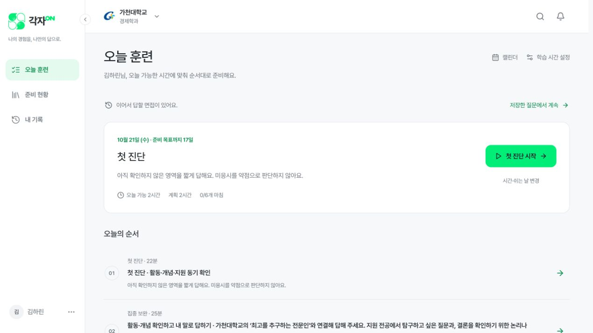
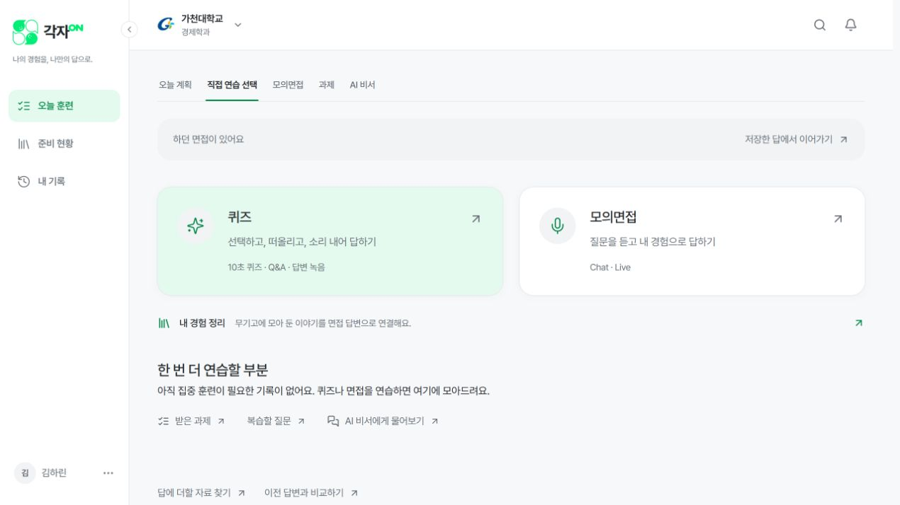
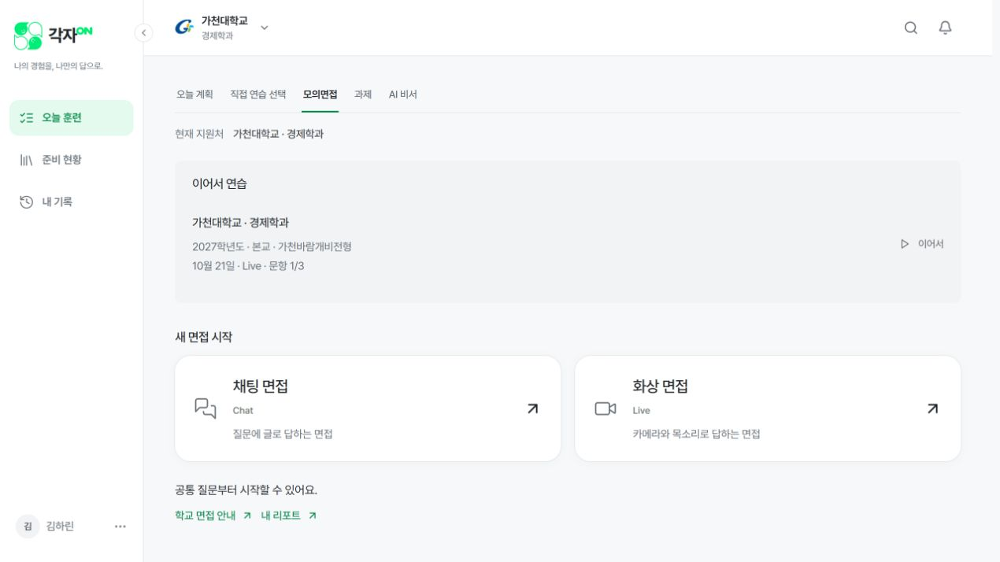
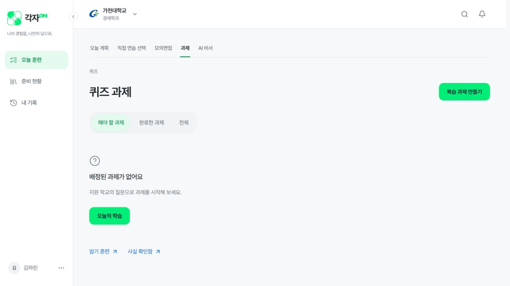
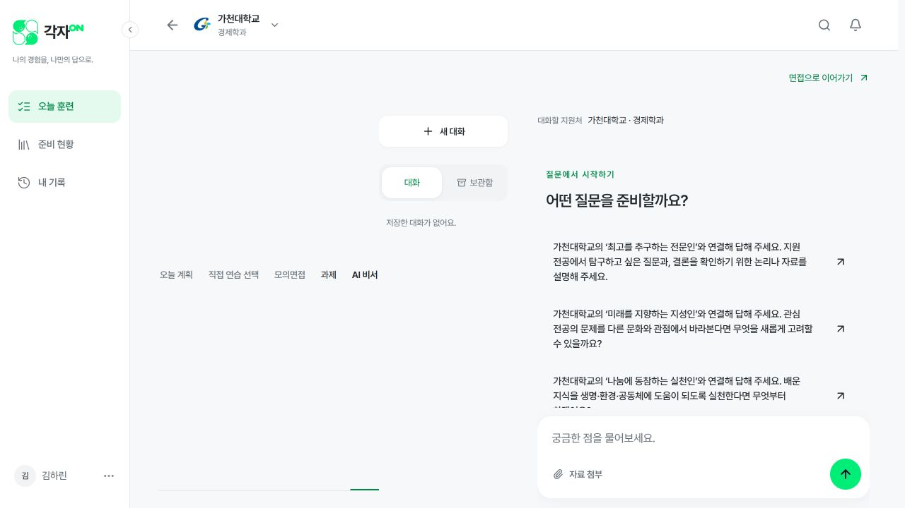
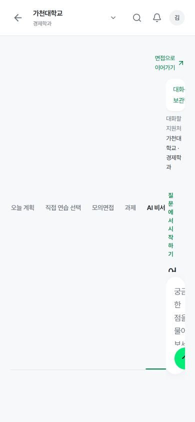
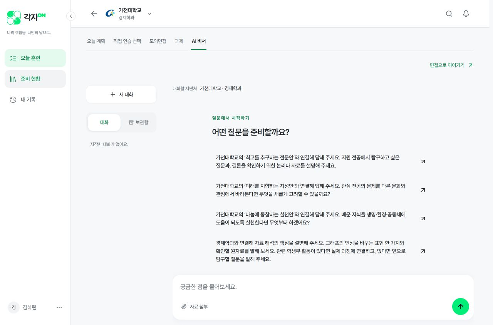
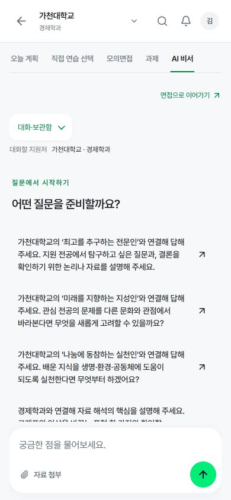

# 오늘 훈련과 기존 연습 기능 QA — 2026-10-21

대상: localhost:3100, 현재 학생 세션. 오늘 훈련 → 직접 연습 → 모의면접 → 과제 → AI 비서를 실제로 열어 확인했다. 답변 제출·학습 완료·설정 변경은 수행하지 않았다. 회원 데이터는 초기화하지 않았다.

## 결론

오늘 계획은 아직 모든 기존 기능을 조합한 계획이 아니다. 첫 진단·집중 보완·연결 면접은 같은 Live 실행 엔진을 사용하고, 퀴즈·과제·AI 비서는 별도 경로다. 도구들이 캘린더와 주간 계획 아래에 묻혀 있고, 직접 연습 안의 모의면접과 상단 모의면접 탭이 중복된다.

AI 비서의 비정상적인 간격은 실제 배치 오류였다. 섹션 메뉴와 채팅을 담은 공통 부모에 flex 방향이 빠져 메뉴가 채팅 왼쪽의 세로 중앙에 늘어났다. 모바일에서는 채팅 폭이 약 38px까지 줄었다. AI 비서 소유 CSS에서 세로 배치와 메뉴 높이·간격을 명시해 수정했다.

## 계획과 기능의 실제 연결

| 표시 | 실제 실행 | 비고 |
|---|---|---|
| 첫 진단 22분 | Live 엔진, 진단 질문 최대 3개. 기본 글 입력, 음성 전환 가능 | Chat 전용 실행과는 다름 |
| 집중 보완 66분 | 25·25·16분 세 차시. 각 차시는 본질문 1개, AI 꼬리질문 최대 2개, 보완점·재답변 | 퀴즈를 배정하는 단계는 없음 |
| 연결 면접 22분 | Live 엔진, 여러 주제 본질문 4개 | 현재 꼬리질문은 꺼져 있음 |
| 정리 10분 | 기록 확인 링크와 스스로 완료 처리 | 보완한 내용·내일 다시 답할 질문을 확인하는 안내형 정리는 부족함 |
| Chat·퀴즈·과제·AI 비서 | 별도 도구 | 오늘 자동계획의 실행 단계에 포함되지 않음 |

22·66·22·10분은 권장 배분 시간이다. 실제 훈련을 그 시간만큼 진행하도록 보장하는 길이가 아니다. 지금은 질문 수에 따라 종료되므로 짧게 답하면 훨씬 빨리 끝날 수 있다. 시간을 채우는 강제 대기보다 단계별 수행 내용과 남은 확인점을 보여주는 방향을 권한다.

근거: `apps/web/src/lib/hybrid-training.ts:7,103–121`, `apps/web/src/components/training-run.tsx:60–61,91`, `apps/web/src/components/interview.tsx:31`, `apps/web/src/components/live-interview-session.tsx:63`.

## 실제 화면 확인 순서

1. **오늘 훈련 — 구조 보완 필요.** 오늘의 순서 자체는 클릭해 진입할 수 있다. 그러나 별도 도구 링크가 면접 일정·캘린더·앞으로의 훈련 뒤 마지막에 있어 찾기 어렵다. 오늘 훈련에서만 하위 탭이 사라지는 점도 진입 구조를 불안정하게 만든다.

2. **직접 연습 — 중복 확인.** 퀴즈와 모의면접 카드가 있고, 상단에는 다시 모의면접·과제·AI 비서가 있다. 사용자는 직접 연습과 모의면접이 같은 위계인지 구별하기 어렵다.

3. **모의면접 — Chat·Live 구분은 명확함.** 같은 선택 화면이 직접 연습의 카드와 상위 탭 양쪽에 연결되어 중복 진입점이 된다.

4. **과제 — 계획 연결 보완 필요.** 현재 세션은 배정된 과제가 없는 상태다. 빈 과제 화면은 열리지만, 과제가 오늘 학습 시간과 어떻게 연결되는지 알기 어렵다. 과제가 존재하는 학생의 제출 흐름은 이번 검사에 포함하지 않았다.

5. **AI 비서 — 배치 오류 수정·확인.** 수정 전 상단 하위 메뉴가 채팅 왼쪽의 별도 열로 늘어나 모바일 본문까지 압축했다. 수정 후 메뉴는 위에, 대화 목록과 채팅은 아래에 배치된다. 긴 추천 질문 16개가 처음부터 나열되는 정보량 문제는 추가 개선 대상으로 남는다.

## 권장 구조

주 메뉴 **오늘 훈련 / 준비 현황 / 내 기록**은 유지한다.

오늘 훈련 아래에는 **오늘 계획 / 자유 연습 / AI 비서**를 같은 위치에 둔다. 답변 중에는 탐색 탭을 숨겨 집중을 유지한다.

- **오늘 계획:** 학생이 지금 수행할 차시, 받은 과제, 다음 차시 제안. 각 차시에 실제 수행 방식을 짧게 표시한다.
- **자유 연습:** 퀴즈 / Chat 면접 / Live 면접을 각각 한 번씩 노출한다. 상위의 별도 모의면접 탭은 합친다.
- **AI 비서:** 언제든 열 수 있고, 훈련 중에는 현재 질문·지원처를 연결해 도움받고 같은 질문으로 돌아온다. 대화만으로 학습 완료로 처리하지 않는다.

예: `집중 보완 · 전공 개념 / 개념 확인 → 본질문·꼬리질문 → 한 가지 보완·재답변 / 권장 25분`.

과제는 받았을 때 오늘 계획의 학습 시간 안에 포함하고, 별도 과제함은 전체 목록으로 연결한다. 필수 과제를 기존 120분 위에 추가해서 실제 부담을 숨기지 않는다.

퀴즈를 실제 계획에 배정하려면 질문·활동·지원처·콘텐츠 버전과 연결하고, 해당 차시 완료 및 남은 시간 갱신까지 연결해야 한다. AI 도움은 도움 사용으로 남기고 독립 수행 기록과 구분한다. 과제의 준비 현황 집계와 보완 해결 판정은 현재 경로가 다르므로 계획에 과제를 편입할 때 함께 검증한다.

추천 질문은 처음에는 3개 정도의 짧은 주제로 보여주고, 전체 질문은 펼쳐보도록 한다. 긴 질문 원문은 선택한 후 보여주는 방향을 권한다.

## 추가 발견: 캘린더와 오늘 훈련의 완료 상태 불일치 — 수정 완료

초기 같은 화면에서 오늘 훈련은 0/6, 캘린더는 1/6을 표시했다. 일부 진단 질문만 답하고 세션을 종료했을 때, 캘린더는 세션 종료만으로 완료로 간주했다. 오늘 훈련은 모든 본질문에 유효 답변이 있어야 완료로 간주했다.

`apps/web/src/app/api/planner/route.ts`에도 공통 `allInterviewRootsAnsweredSql`을 적용했다. 실제 답변 원본을 검사하므로 부분 종료, 답변 무효화, 복구를 같은 기준으로 판정한다. 기존 답변과 계정은 삭제하지 않았다. 수정 후 실제 학생 화면의 오늘 훈련과 캘린더 모두 0/6으로 일치했다.

## 이번 수정과 검증

수정 파일: `apps/web/src/components/assistant-page.module.css`.

- AI 비서의 PageMotion에 `flex-direction:column` 명시.
- 직계 메뉴의 높이가 줄지 않도록 하고, 채팅 위 간격 16px 명시.
- 390·700·701·1280px에서 탭이 본문 위에 위치하고 문서 가로 넘침이 없는지 확인.
- 각 화면 폭에서 입력창 하단이 844px 뷰포트 안에 유지되는지 확인.
- 모바일 대화·보관함 펼침/접힘 후에도 입력창 유지 확인.
- 메시지 영역에 키보드 PageDown을 적용해 내부 스크롤과 고정된 입력창 위치 확인. 키보드 포커스 표시 유지.
- CSS 소유권·CSS Modules 검사 7개 통과.
- 메뉴 경로·컨텍스트·렌더 검사 176개 통과.
- 격리된 합성 계정으로 혼합 훈련 API 검사 154개 통과. 부분 진단 종료·전체 답변 완료·한 답변 무효화·모든 답변 무효화·답변 복구 5가지에서 오늘 훈련과 캘린더 완료 상태가 일치했다.
- 외부 AI 호출 0회. 해당 검사에서 만든 합성 계정만 정리했고, QA 서버도 종료했다.
- 프로덕션 빌드 및 TypeScript 검사 통과.
- `git diff --check` 통과.

수치 기록: [layout-measurements.json](layout-measurements.json).

## 검증 범위와 남은 사항

이번에는 화면 진입, 메뉴 위계, 배치, 내부 스크롤, 코드의 실행 연결과 합성 데이터 기반 완료 상태 API 회귀를 확인했다. 실제 모바일 기기의 소프트 키보드, 스크린리더 전체 동선, 마이크 녹음·AI 전송·피드백 생성, 과제 제출 후 계획 재배분은 재실행하지 않았다. 접근성 전반 통과를 의미하지 않는다.

메뉴 통합, 퀴즈·과제의 자동 배정, AI 비서의 차시 중 도움 연결, 연결 면접의 꼬리질문, 정리 활동 보강은 제안이며 이번에 구현한 변경과 구분한다.
